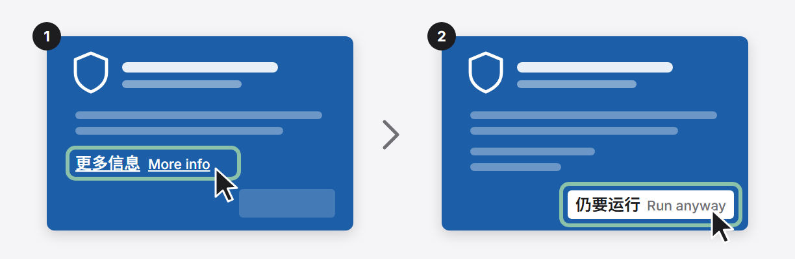
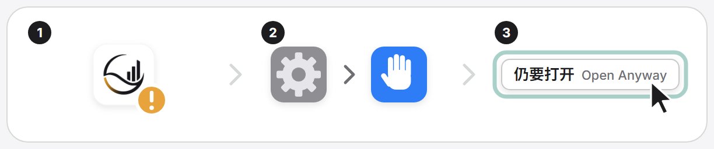
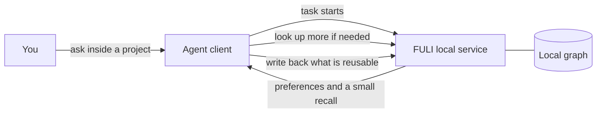

<p align="center">
  <picture>
    <source media="(prefers-color-scheme: dark)" srcset="https://raw.githubusercontent.com/JevonsCode/fuli/main/brand/svg/mark/fuli-mark-dark.svg" />
    
  </picture>
</p>

<h1 align="center">Fuli</h1>

<p align="center">
  English · <a href="README.zh-CN.md">简体中文</a> · <a href="https://有点.意思.com/fuli/">Website</a>
</p>

<p align="center">
  <a href="https://www.npmjs.com/package/fuli-context"></a>
  <a href="https://www.npmjs.com/package/fuli-context"></a>
  <a href="LICENSE"></a>
</p>

**Switch AI tools. Keep yourself.**

FULI is a memory and collaboration layer that runs on your own computer. It remembers your taste,
preferences and project knowledge, and shares them across Agent clients such as Claude Code, Codex
and OpenCode. Each task gets only the small slice it needs, which saves tokens. Each project also gets
its own team of Agents that know the work better the longer you use them.

Fuli (复利) is Chinese for **compound interest**. What you teach an Agent today keeps paying off
tomorrow. We think people should not have to do everything themselves: you get your hands back to
decide, come up with ideas, or take a break.

## What we believe

- **Local first.** Your personal graph and conversation records stay on your computer. The shared team layer holds only confirmed project knowledge, never your taste, personality or judgment preferences.
- **You decide.** AI looks things up, summarises and executes, and it tells you when something needs you. Still, humans retain final authority. A preference an Agent guessed counts only after you confirm it.
- **Recall on demand, spend fewer tokens.** A session does not start with your whole history. It gets the preferences in effect and a small, relevant recall, and the Agent looks up the rest when it needs it.
- **Keep only what is reusable.** Every task ends with one check, and only reusable knowledge is kept; often nothing is. We measure how often you no longer have to explain something twice, not how much is stored.
- **History is kept.** When a newer approach replaces an older one, the source, time and reason stay. An Agent can say what to use now and why it used to be different.

## What it does

- **Same teammate in any client.** Connect several clients to the same FULI data, pick the same Agent, and carry on with its responsibilities, collaboration history and last piece of work.
- **It remembers you.** Taste, personality and judgment preferences are stored apart, each with a source and a scope. Global preferences apply everywhere, project preferences only in their project.
- **Every task has an owner.** Ask for work inside a project directory. FULI recognises the project and staffs a lead Agent, and the reply ends with who led and who helped.
- **Agents grow.** An Agent in FULI is called an FLA. Each one has a name, an occupation and its own working memory, and gains experience from the tasks it has done.
- **Agents talk to each other.** In the [Roundtable](docs/agent-roundtable.md) one Agent can ask an Agent in another conversation, and every exchange is recorded.
- **External knowledge, read-only.** Bind Notion or Lark documents, or content behind an MCP or RAG endpoint, to a project. FULI reads it and never writes back.

### Four built-in roles

Every space starts with these four. Nobody has to hire them.

| | Role | Does |
| --- | --- | --- |
|  | **Astro** | Receives conversations that belong to no project yet. When a topic keeps coming back, it asks whether to make it a project |
|  | **Jefa** | Project manager: triages conversations and runs the task board |
|  | **Bole** | AR (Agent Resources): recruits by occupation and staffs projects |
|  | **Tonborg** | Reviews for you within the autonomy you set and recommends clients and models. Every decision is logged; a thumbs up, thumbs down or short reason changes the next one |

## Quick start

### Desktop client (recommended)

Download from the [latest release](https://github.com/JevonsCode/fuli/releases/latest).

| System | File | How |
| --- | --- | --- |
| Windows | `FULI-Setup-<version>.exe` | Double-click to install; you can pick the folder the first time. No terminal and no administrator rights; Node.js, Java and the graph database are bundled. The installer is not code-signed yet, so if Windows says it protected your PC, choose “More info → Run anyway”. Running it over an existing install updates it and keeps your data |
| Windows offline update | `fuli-windows-tray-<version>.zip` | For an existing install. Check the matching `.sha256`, unzip, and run `Update-Fuli.cmd`. Normally you just click 「Update to vX」 in the console |
| macOS (Apple silicon) | `fuli-macos-arm64-<version>.dmg` | Drag FULI.app onto Applications as the window's arrow shows; FULI ejects the installer when you open it. Needs macOS 13.5 or later. The app is not signed yet, so the first time it is blocked, open System Settings › Privacy & Security and click “Open Anyway”. See [macOS app](docs/macos-app.md) |

Not signed yet, so each system holds FULI back once:

| Windows | macOS |
| --- | --- |
|  |  |

On first launch FULI finds the AI clients on this computer and connects each with one click (Codex,
Claude Code, Cursor, Claude Desktop and others). Restart the client, ask for something inside a
project directory, and you are going. Other MCP clients can run `fuli connect` for a standard
configuration. Sign-in, hook trust and human review are still yours to confirm.

### Servers, VMs and the cloud

Without a desktop, install with npm. Intel Macs and Linux use this path too. You need Node.js 24.12
or later. The default container mode also needs Docker Compose v2, and macOS and Linux can choose a
native mode without a VM instead (Java 21 and `uv`).

```bash
npm install --global fuli-context
fuli setup
fuli open
```

`fuli setup` shows its plan and changes nothing until you confirm. The console runs at
`http://127.0.0.1:2727` by default. Every command, port and fix is in [Install and run](docs/install.md).

## How it works



1. You ask an Agent for something inside a project directory. The client's hook (or the Agent itself, where there is no hook) first asks FULI which project this is and which preferences apply.
2. FULI answers with a small slice: the preferences in effect and a few pieces of project knowledge related to the task. If that is not enough, the Agent looks up more.
3. When the work is done, the Agent writes back only what can be reused, such as a convention or a decision with its reason. Temporary output and guesses are not kept.
4. Private conversation records, Agent working memory and confirmed knowledge are stored apart. Once a conversation grows long, its older part folds into a digest.
5. FULI assembles context and coordinates work; the connected AI tools do the work. Client adapters decide which conversations can be resumed, and connecting another tool never opens another project's private memory.

## Learn more

| You want to know | Read |
| --- | --- |
| Install details, CLI commands and local ports | [Install and run](docs/install.md) |
| The full principles, what is stored where, how a project is recognised | [How FULI works](docs/how-it-works.md) |
| How to connect each client and recover from failures | [Connect a client](docs/client-connections.md) |
| Which Skills, hooks and MCP tools an Agent gets | [Agent integrations and MCP tools](docs/agent-tools.md) |
| Binding Notion, Lark and other knowledge bases | [External knowledge](docs/external-knowledge.md) |
| Built-in roles and employee packages | [Specialist Agents](docs/employee-agents.md) |
| Small apps that Agents build | [Agent apps](docs/agent-apps.md) |
| How Tonborg decides | [Tonborg and autonomy](docs/judgment-and-autonomy.md) |
| The Roundtable and cross-client continuity | [Roundtable](docs/agent-roundtable.md) · [Conversations and collaboration (Chinese)](docs/agent-conversations-and-collaboration.md) |
| What is proven so far, and the privacy boundaries | [Capabilities and limits](docs/capabilities-and-limits.md) |
| Tokens saved and recall accuracy | [Measured report](https://有点.意思.com/fuli/report/en/) |
| Architecture | [External knowledge architecture (Chinese)](docs/external-knowledge-architecture.md) · [Retrieval design (Chinese)](docs/retrieval-design.md) · [Agent interface architecture](docs/agent-interface-architecture.md) |
| Running the source and tests | [Develop and verify](docs/development.md) · [Contributing](CONTRIBUTING.md) |
| What changed in each version | [Release notes](https://github.com/JevonsCode/fuli/releases) |

## Brand

<picture>
  <source media="(prefers-color-scheme: dark)" srcset="https://raw.githubusercontent.com/JevonsCode/fuli/main/brand/svg/lockup/fuli-lockup-bilingual-horizontal-dark.svg" />
  
</picture>

The FULI mark, wordmark and lockups come from the [FULI 复利 brand system on Figma](https://www.figma.com/community/file/1698659778015746085). Brand files and how to change them are in [`brand/README.md`](brand/README.md).

## License

[Apache-2.0](LICENSE)
