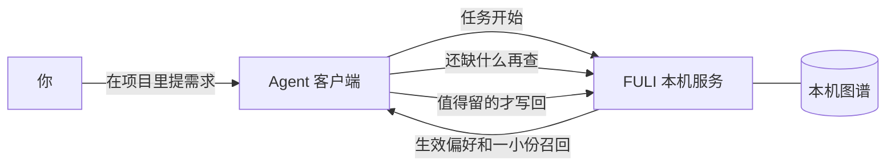

<p align="center">
  <picture>
    <source media="(prefers-color-scheme: dark)" srcset="https://raw.githubusercontent.com/JevonsCode/fuli/main/brand/svg/mark/fuli-mark-dark.svg" />
    
  </picture>
</p>

<h1 align="center">复利（Fuli）</h1>

<p align="center">
  <a href="README.md">English</a> · 简体中文 · <a href="https://有点.意思.com/fuli/">产品网站</a>
</p>

<p align="center">
  <a href="https://www.npmjs.com/package/fuli-context"></a>
  <a href="https://www.npmjs.com/package/fuli-context"></a>
  <a href="LICENSE"></a>
</p>

**换 AI 工具，留住你自己。**

FULI 是装在你电脑上的记忆和协作层。它记住你的品味、偏好和项目知识，让 Claude Code、Codex、
OpenCode 这些 Agent 客户端共用。每次只取回任务用得上的那一小份，省下 token。它还给每个项目配一支
Agent 团队，用得越久越懂行。

名字取自 **compound interest**，复利。今天教会 Agent 的事，明天还在生息。我们相信人不必事事亲力亲为，
腾出手来做决定、想点子，或者歇一歇。

## 我们的理念

- **本地优先。** 个人图谱和对话记录留在你的电脑上。团队共享层只放确认过的项目知识，你的品味、个性和判断偏好不会进去。
- **人说了算。** AI 负责查找、归纳和执行，该提醒时提醒你。人始终保留最终判断权，Agent 猜出来的偏好要等你确认才算数。
- **按需取回，少花 token。** 会话一开始不会把全部历史塞给模型，只带上生效的偏好和一小份相关召回。还缺什么，Agent 自己再查。
- **只留值得复用的。** 每个任务结束前检查一次，有可复用的才记下，没有就什么都不留。我们看重的是 Agent 少让你重复解释了几次，存了多少条并不重要。
- **历史不覆盖。** 旧做法被替代时，来源、时间和理由都还留着。Agent 能说清现在该用哪个，也能说清以前为什么不一样。

## 它能做什么

- **换客户端，还是同一位搭档。** 让几个客户端接入同一份 FULI 数据，选中同一位 Agent，就能接着它的职责、合作记录和上次的工作往下做。
- **记住你这个人。** 品味、个性和判断偏好分开存，每条都带来源和作用域。全局偏好处处生效，项目偏好只管自己的项目。
- **每个任务都有负责人。** 在项目目录里直接提需求，FULI 认出项目并安排一位负责的 Agent。回复最后一行写着谁负责、谁协助。
- **Agent 会成长。** FULI 里的 Agent 叫 FLA，各有名字、职业和自己的工作记忆，从做过的任务里攒经验。
- **Agent 之间直接对话。** 在[圆桌](docs/agent-roundtable.md)里，一个 Agent 可以去问另一段对话里的 Agent，每次往来都留着记录。
- **外部知识只读接入。** Notion 和飞书的文档，或者 MCP、RAG 接口里的内容，都可以绑到项目上，FULI 只读，不往源系统写。

### 四位内置角色

每个空间都自带这四位，不用招募。

| | 角色 | 负责 |
| --- | --- | --- |
|  | **Astro** | 接待还没归属项目的对话。同一话题反复出现，它会问你要不要为它成立项目 |
|  | **Jefa** | 项目经理，给对话分诊，管任务看板 |
|  | **Bole** | AR（Agent Resources），按职业招人，安排人手 |
|  | **Tonborg** | 在你设定的自主程度内替你审核，推荐客户端和模型。每次判断都有记录，点赞、点踩或补一句理由，它下次就改 |

## 快速开始

### 桌面客户端（推荐）

到[最新版本](https://github.com/JevonsCode/fuli/releases/latest)下载安装包。

| 系统 | 文件 | 怎么装 |
| --- | --- | --- |
| Windows | `FULI-Setup-<版本>.exe` | 双击安装，不用终端，也不用管理员权限。Node.js、Java 和图数据库都已内置。安装包还没有代码签名，Windows 提示“已保护你的电脑”时，点“更多信息 → 仍要运行”。装过 FULI 的直接覆盖更新，数据保留 |
| Windows 离线更新 | `fuli-windows-tray-<版本>.zip` | 给已安装的 FULI 用。核对同名 `.sha256`，解压后运行 `Update-Fuli.cmd`。平时在控制台点「更新到 vX」就行 |
| macOS（Apple 芯片） | `fuli-macos-arm64-<版本>.dmg` | 把 FULI.app 拖进「应用程序」，需要 macOS 13.5 以上。安装包还没签名，第一次打开被拦下时，到「系统设置 › 隐私与安全性」点「仍要打开」。详见 [macOS 应用](docs/macos-app.md) |

第一次打开时，FULI 会找出这台电脑上的 AI 客户端，点一下就能接入（Codex、Claude Code、Cursor、
Claude 桌面版等）。接入后重启客户端，在项目目录里提个需求就开始了。其他 MCP 客户端运行
`fuli connect` 拿一份标准配置。登录、Hook 信任和人工审核仍然由你确认。

### 服务器、虚拟机或云端

没有桌面的环境用 npm 安装，Intel 芯片的 Mac 和 Linux 也走这条路。需要 Node.js 24.12 以上。默认的容器模式
还要 Docker Compose v2，macOS 和 Linux 也可以选不用虚拟机的原生模式（要 Java 21 和 `uv`）。

```bash
npm install --global fuli-context
fuli setup
fuli open
```

`fuli setup` 先把计划给你看，确认后才动环境。控制台默认在 `http://127.0.0.1:2727`。
全部命令、端口和排错见[安装与运行](docs/install.zh-CN.md)。

## 怎么工作



1. 你在项目目录里给 Agent 提需求。客户端的 Hook（没有 Hook 时由 Agent 自己）先问 FULI 这是哪个项目、这次该守哪些偏好。
2. FULI 只回一小份内容，包括生效的偏好和几条跟任务有关的项目知识。Agent 觉得不够，再按需去查。
3. 做完以后，Agent 只把能复用的东西写回去，比如一条约定，或者一个决定和它的理由。临时输出和猜测不会留下。
4. 私有对话记录、Agent 的工作记忆和确认过的知识分开存。对话长了，较早的部分会折叠成摘要。
5. FULI 组织上下文、协调任务，真正干活的是接入的 AI 工具。能接续哪些对话取决于客户端适配器。换了工具，也拿不到别的项目的私有记忆。

## 深入了解

| 想知道 | 去读 |
| --- | --- |
| 安装细节、CLI 命令和本机端口 | [安装与运行](docs/install.zh-CN.md) |
| 完整理念，什么存在哪里，怎么认出项目 | [FULI 怎么工作](docs/how-it-works.zh-CN.md) |
| 各客户端怎么接，出了问题怎么恢复 | [客户端接入（英文）](docs/client-connections.md) |
| Agent 拿到哪些 Skills、Hook 和 MCP 工具 | [Agent 接入与 MCP 工具](docs/agent-tools.zh-CN.md) |
| 绑定 Notion、飞书等外部知识库 | [外部知识库只读接入](docs/external-knowledge.zh-CN.md) |
| 内置角色和员工包 | [专职 Agent（英文）](docs/employee-agents.md) |
| Agent 自己做的小应用 | [Agent 应用（英文）](docs/agent-apps.md) |
| Tonborg 怎么判断 | [Tonborg 与自主程度（英文）](docs/judgment-and-autonomy.md) |
| 圆桌和跨客户端接续 | [圆桌](docs/agent-roundtable.md) · [对话与协作](docs/agent-conversations-and-collaboration.md) |
| 已经证明了什么，隐私边界在哪 | [能力与边界](docs/capabilities-and-limits.zh-CN.md) |
| 省了多少 token，召回准不准 | [实测报告](https://有点.意思.com/fuli/report/) |
| 架构细节 | [外部知识架构](docs/external-knowledge-architecture.md) · [检索设计](docs/retrieval-design.md) · [Agent 接口架构（英文）](docs/agent-interface-architecture.md) |
| 跑源码和测试 | [开发与验收](docs/development.zh-CN.md) · [参与贡献](CONTRIBUTING.md) |
| 每个版本改了什么 | [发布说明](https://github.com/JevonsCode/fuli/releases) |

## 品牌

<picture>
  <source media="(prefers-color-scheme: dark)" srcset="https://raw.githubusercontent.com/JevonsCode/fuli/main/brand/svg/lockup/fuli-lockup-bilingual-horizontal-dark.svg" />
  
</picture>

FULI 的图形标、字标和组合标来自 [Figma 上的 FULI 复利品牌系统](https://www.figma.com/community/file/1698659778015746085)。品牌文件和修改方法见 [`brand/README.md`](brand/README.md)。

## License

[Apache-2.0](LICENSE)
