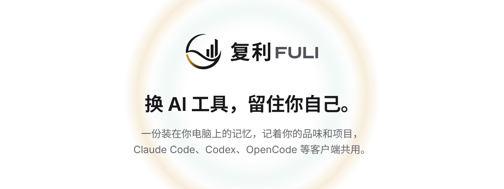
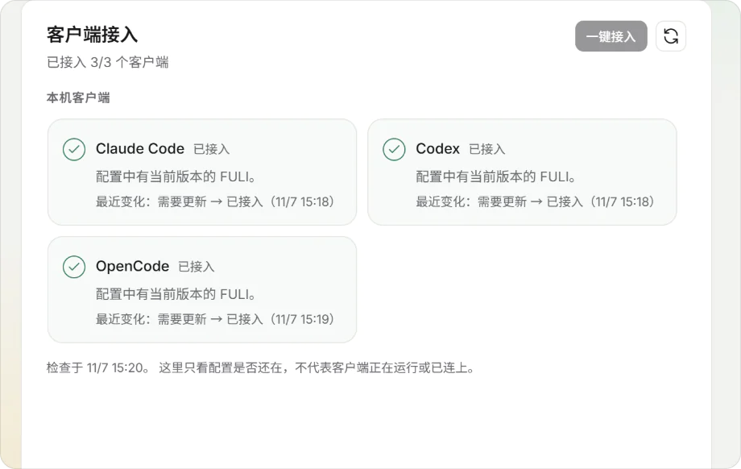
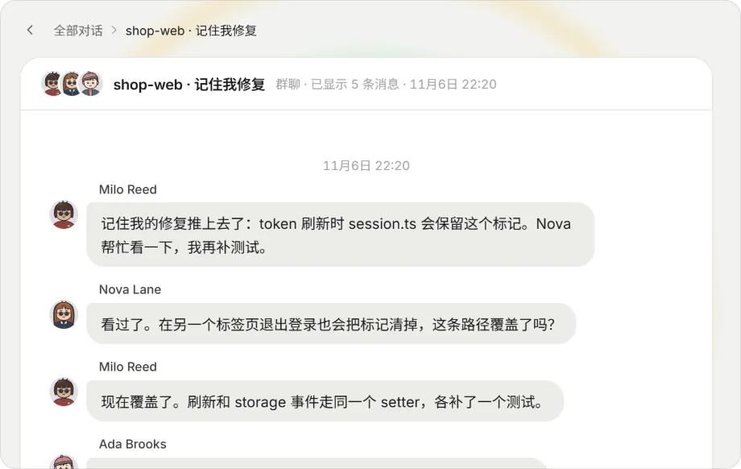
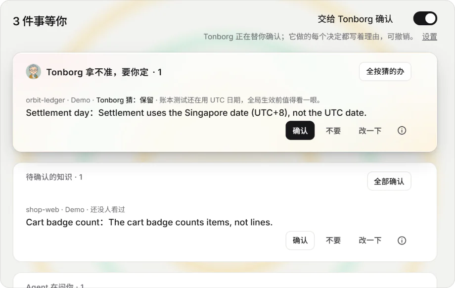
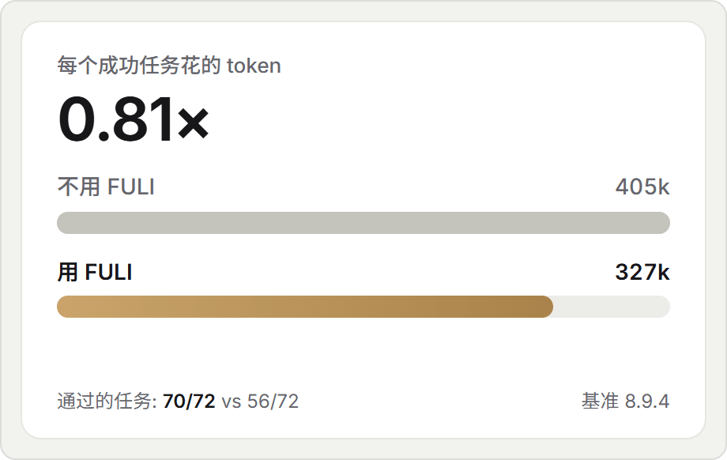
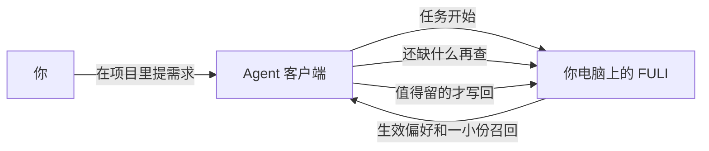
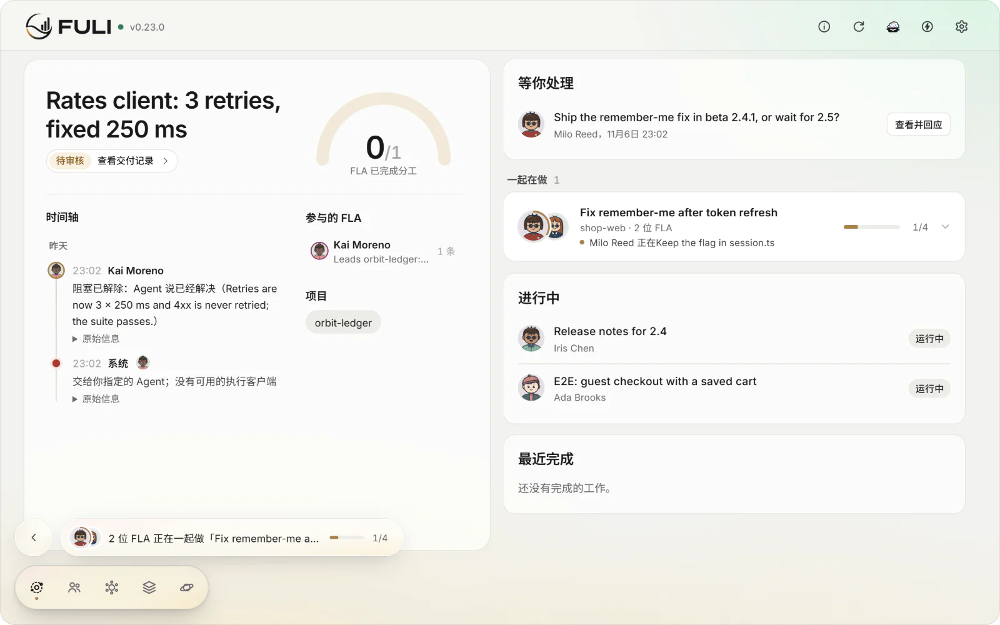

<p align="center">
  <picture>
    <source media="(prefers-color-scheme: dark)" srcset="brand/svg/lockup/fuli-lockup-bilingual-horizontal-dark.svg" />
    
  </picture>
</p>

<p align="center">
  <picture>
    <source media="(prefers-color-scheme: dark)" srcset="docs/readme/hero-zh-dark.webp" />
    
  </picture>
</p>

<p align="center">FULI 是一个插件，让你的任务穿梭在你所有的 Agent 客户端之间：Claude Code、Codex、OpenCode……它们共用一份记忆、一套品味和一支 FLA 团队。哪个合适就用哪个，换着用也不用从头交代。它不替代你的客户端，也不改动你自己的配置：你的模型、订阅、会话和设置都照旧，FULI 只作为插件加上自己的那几项；在控制台移除某个客户端，或者卸载 FULI，它加的配置就会拿掉。</p>

<p align="center">
  <a href="README.md">English</a> · 简体中文 · <a href="https://有点.意思.com/fuli/">产品网站</a> · <a href="https://github.com/JevonsCode/fuli/releases/latest">下载</a>
</p>

<p align="center">
  <a href="https://github.com/JevonsCode/fuli/releases/latest"></a>
  <a href="https://www.npmjs.com/package/fuli-context"></a>
  <a href="https://github.com/JevonsCode/fuli/releases"></a>
  <a href="https://www.npmjs.com/package/fuli-context"></a>
  <a href="LICENSE"></a>
</p>

<h3 align="left">一切都是能自动则自动，一切执行就交给 FLAs 吧。你做好判断，做好领头羊，领着你的 FLAs 大军披荆斩棘，或者去喝杯咖啡休息休息～享受你自己经验带给你自己的复利吧。</h3>

<p align="left">项目的简历、FLAs 的招募，如果你不想关心，它们都是自动的，你唯一要做的就是把握方向。FLAs 可以自动带着上下文和各种工具穿梭在各个 Agent 客户端，无论是高等级模型还是低等级模型，在这里都可以发挥作用。</p>


每次任务只取回用得上的那一小份。你的判断和经验一直在累积，FULI 越用越懂你，这就是复利。
慢慢地，AI 做出来的东西也带上了你的品味。

## 它能做什么

<table>
  <tr>
    <td width="50%" valign="top">
      
      <h3>所有客户端共用一份记忆</h3>
      点一下就接入 Claude Code、Codex、OpenCode 或 Cursor。在一个客户端里说过的规矩，换到另一个也还在。
    </td>
    <td width="50%" valign="top">
      
      <h3>FLA 团队，在圆桌上对话</h3>
      每个项目有一位负责的 Agent（FLA），有名字、职业和自己的工作记忆；活儿需要时，几位 FLA 组成小组。它们在圆桌里互相评审、测试、交接，每一句你都看得到。
    </td>
  </tr>
  <tr>
    <td width="50%" valign="top">
      
      <h3> Tonborg 替你确认</h3>
      新知识要等一句确认。打开「交给 Tonborg 确认」，它按你的偏好确认日常的条目，拿不准的留给你，每次都写下理由，点赞或点踩它下次就改。
    </td>
    <td width="50%" valign="top">
      
      <h3>越用越省 token</h3>
      即将发布的 0.25.0 实测：同样的任务，用 FULI 每个成功任务花的 token 是不用时的 0.81 倍，72 个任务通过 70 个。省下的来自代码里没有、只在你话里的事实。
    </td>
  </tr>
</table>

自带四位 FLA：

<table>
  <tr>
    <td width="25%" align="center" valign="top">
      <br />
      <b>Jefa</b> 是你的项目经理。
    </td>
    <td width="25%" align="center" valign="top">
      <br />
      <b>Bole</b> 招人，给每个项目排人手。
    </td>
    <td width="25%" align="center" valign="top">
      <br />
      <b>Tonborg</b> 替你确认，推荐客户端和模型。
    </td>
    <td width="25%" align="center" valign="top">
      <br />
      <b>Astro</b> 接待还没归属项目的对话。
    </td>
  </tr>
</table>

## 怎么工作



任务开始时只带上生效的偏好和几条相关事实。还缺什么，Agent 自己再查；做完以后，只写回下一个任务用得上的东西。

## 安装

FULI 在你的电脑上跑一个小服务和一个控制台。

**桌面客户端（推荐）。** 到[最新版本](https://github.com/JevonsCode/fuli/releases/latest)下载：

| 系统 | 文件 |
| --- | --- |
| Windows | `FULI-Setup-<版本>.exe`，不用终端，也不用管理员权限。 |
| macOS（Apple 芯片，13.5 以上） | `fuli-macos-arm64-<版本>.dmg`，把 FULI 拖进「应用程序」。 |

第一次打开时，FULI 会找出这台电脑上的 AI 客户端，点一下就能接入。安装包还没签名，两个系统第一次都会拦一下，
放行的两步见[安装与运行](docs/install.zh-CN.md)。

**服务器、虚拟机和云端。** 没有桌面的环境，以及 Intel 芯片的 Mac 和 Linux，用 npm 安装（需要 Node.js 24.12 以上）：

```bash
npm install --global fuli-context
fuli setup
fuli open
```

`fuli setup` 先把计划给你看，确认后才动环境。

## 控制台

<p align="center">
  
</p>

控制台一打开就是眼下要紧的事：等你回答的问题、正在干活的 FLA、刚做完的工作。全部跑在 `127.0.0.1` 上，
没有账号，也不用登录。

## 常见问题

<details>
<summary><b>我的数据放在哪？</b></summary>

在你的电脑上。个人图谱和对话记录都留在本机。外部知识（Notion、飞书、MCP 或 RAG）只读接入，FULI 不往源系统写。
</details>

<details>
<summary><b>支持哪些客户端？</b></summary>

Claude Code、Codex、OpenCode、Cursor 和 Claude 桌面版都能在控制台里一键接入。其他 MCP 客户端运行
`fuli connect` 拿一份标准配置。
</details>

<details>
<summary><b>FULI 怎么省 token？</b></summary>

会话开始时只带生效的偏好和几条相关事实，其余的 Agent 需要时再查。只有你知道的事实，比如你顺口提过一次的沙箱地址，
之后会直接召回，不用在代码里翻找。数字见[基准文档](FULI_ALIGNMENT_BENCHMARK.md)第 8.9.4 节。
</details>

<details>
<summary><b>内置 FLA 会多花钱吗？</b></summary>

不会偷偷多花。内置 FLA 默认借你客户端的会话干活，你给它们接了模型，才用它们自己的模型。
</details>

<details>
<summary><b>怎么把 FULI 从客户端里拿掉？</b></summary>

在控制台的「设置 › 客户端接入」里，对那个客户端点「移除」。`fuli uninstall` 和 Windows 卸载程序会对每个接入过的
客户端做同样的事。FULI 只拿掉自己加的那几项（MCP 服务、Hook、Skills 和它的权限条目），改之前先备份每个文件，
你自己改过的 Skill 会留着。FULI 的数据会一直保留，你自己删才会删。在 macOS 上，先在控制台移除客户端，再把
FULI.app 移到废纸篓：只移到废纸篓的话，这些配置还留在客户端里。
</details>

<details>
<summary><b>留下什么由谁决定？</b></summary>

由你决定：AI 负责查找和执行，人始终保留最终判断权。每个任务结束前检查一次，只留能复用的知识。Agent 猜出来的偏好，
要等你或者在你设定的自主程度内的  Tonborg 确认才算数。旧答案带着来源和理由留在历史里。
</details>

## 深入了解

| 想知道 | 去读 |
| --- | --- |
| 安装细节、CLI 命令和端口 | [安装与运行](docs/install.zh-CN.md) |
| 理念，什么存在哪里 | [FULI 怎么工作](docs/how-it-works.zh-CN.md) |
| 各客户端怎么接 | [客户端接入（英文）](docs/client-connections.md) |
| Skills、Hook 和 MCP 工具 | [Agent 接入与 MCP 工具](docs/agent-tools.zh-CN.md) |
| Notion、飞书等知识库 | [外部知识库只读接入](docs/external-knowledge.zh-CN.md) |
|  Tonborg 与自主程度 | [Tonborg 怎么判断（英文）](docs/judgment-and-autonomy.md) |
| 圆桌 | [圆桌](docs/agent-roundtable.md) |
| 已经证明了什么 | [能力与边界](docs/capabilities-and-limits.zh-CN.md) · [实测报告](https://有点.意思.com/fuli/report/) |
| 跑源码 | [开发与验收](docs/development.zh-CN.md) · [参与贡献](CONTRIBUTING.md) |

FULI 的图形标和字标来自 [FULI 复利品牌系统](https://www.figma.com/community/file/1698659778015746085)，见 [`brand/README.md`](brand/README.md)。
以 [Apache-2.0](LICENSE) 许可发布。
