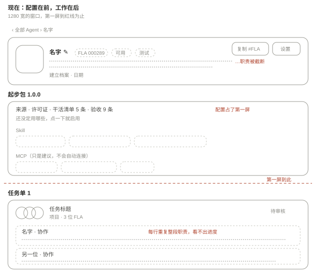
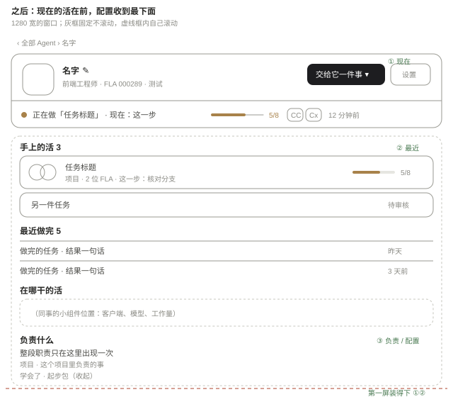
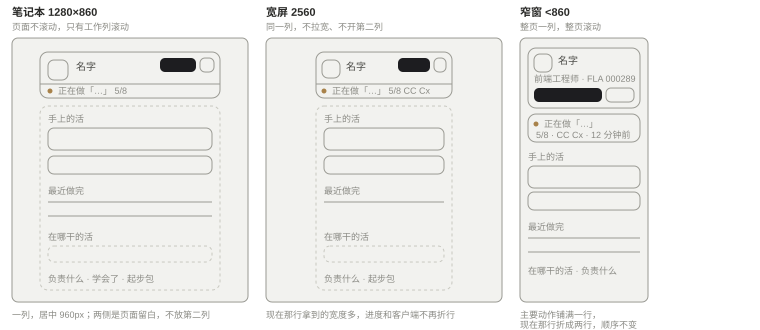

# The FLA page

How one assistant's own page is designed, and why. The console's shared
language — colours, type, controls, motion — stays in
[console-design.md](console-design.md); this page's own layout is summarised
there under Layout and argued here.

Jevons, 2026-11-23, looking at a real FLA page: 「FLA 的界面 UX UI 还是要再设计一下，
我觉得现在不合理」「我们 FULI 给人看的东西，都要清晰明了，文字讲重点，有需要就画图……
有交互的要方便交互，能点击的不输入」.

## Who opens this page, and what they came for

One person opens one assistant. In order of how often they want it:

| | The question | Where it is answered |
| --- | --- | --- |
| 1 | What is it doing right now, how far along? | 现在, the line under the name — first screen |
| 2 | What did it just do, how did it turn out? | 手上的活 and 最近做完 — first screen |
| 3 | Let it carry on, or hand it something new. | 交给它一件事, the one primary button |
| 4 | What is it responsible for, what can it do? | 负责什么 — one scroll down |
| 5 | Where did it work, on which model, at what cost? | 在哪干的活 — one scroll down |
| 6 | Settings. | 设置, a quiet button; its own panel |

The old page answered 6, then part of 4, then 1 — exactly backwards. 起步包
(configuration a person touches once) held the main part of the first screen,
and the work was below the fold.

## What the repository can actually show

Nothing is drawn that FULI cannot report. Checked line by line against the code:

| Shown | Comes from | Missing data reads as |
| --- | --- | --- |
| Current state (正在做 / 等你拍板 / 被卡住了 / 现在没活) | `agentWorkbenchEntry()` over `agent.workStatus` or this FLA's own task page (`GET /api/project-agent-tasks?agentId=`) | 「没有上报状态」 or, when the read failed, 「这次没读到它在做什么」 with 再读一次 — never 「现在没活」 |
| Current task and its step | `GET /api/project-agents/{id}/workbenches` → `progress`, `steps`, `currentStepId` | the step line is left out |
| Progress 5/8 | the same `progress {completed, total}` | the status word instead of a bar — never a guessed percentage |
| Which clients the work runs in | `sessions` on the task list (`taskSessions()`, 3 clients at most) | no marks |
| Opening that conversation | `clientMarks()` + 设置 › 会话打开方式 | a muted mark that says why, with 去设置 beside it |
| How long it has been running | `currentTaskRunningSince` (roster only) | the last change time instead |
| Finished work and its result | the same task read, `resultSummary` / `failureReason` / `completedAt` | the task without a result line |
| Responsibility, occupation, projects | `profile.responsibility`, `occupation`, `assignments[].responsibility` | 「还没定职业」 |
| Handoff phrase | `mentionPhrasings()` | the FLA alone, no pair phrasing |
| Where it worked, on which model, how much | `GET /api/project-agent-work-locations` (widget `fla-work-locations`) | `-` with the reason, never 0 |
| Which workstream it leads or owns | `GET /api/workstreams?agentId=` (widget `workstream-ledger`) | the section is left out |
| What it learned | `GET /api/project-agents/{id}/growth` (widget `fla-growth`) | the section is left out |

The two rows this page first drew as reserved positions are recorded now, so
their real widgets sit there (see [Widgets in the column](#widgets-in-the-column)).

## Before and after





| The old page | What it cost | The new page |
| --- | --- | --- |
| Header with 「FLA 000289」「可用」「测试」 as three equal pills | Three unrelated facts shout equally; the eye has no entry point | One quiet line: `职业 · FLA 000289 · 测试`. Only the work state keeps a coloured mark, and only when it is not plain 可用 |
| Responsibility clamped to two lines with 「…」 | The one thing you cannot read is the one thing the header promised | The header shows no responsibility; 现在 takes that line. The full text appears once, in 负责什么 |
| 起步包 card held the middle of the first screen | Configuration pushed the work below the fold | 起步包 moves to the bottom of the column and opens on demand |
| 任务单 repeated each FLA's whole responsibility per row | The same paragraph three times; no progress anywhere | A share's assignment is two lines at most, with the full text on hover; the recorded bar and step sit on the row |
| 「复制 #FLA」 and 「设置」 as two equal outline buttons | The main action was a string only an insider understands | One ink button, 交给它一件事, with three named ways inside it; 设置 is a quiet outline button beside it |
| Nothing said what the FLA was doing | The most common question had no answer | 现在 is the line under the name |

## Layout

### Fixed region — identity and 现在

One surface, two rows separated by a hairline. No card inside a card.

```
◯  名字 ✎   前端工程师 · FLA 000289 · 测试        [交给它一件事 ▾] [设置]
──────────────────────────────────────────────────────────────────────
●  正在做「任务标题」 · 现在：核对 locale 分支   ▓▓▓▓▓░░░ 5/8   CC Cx   12 分钟前
```

- The portrait is 44px, not 72: it identifies, it is not the subject.
- The name is the page's one H1 (`usePageTitle(..., { inPage: true })`), renamed
  where it stands. The breadcrumb keeps naming the page, Jevons's 11-04 call.
- `FLA 000289` is plain muted text, not a pill, and copies the number on click.
- 现在 has four shapes, and every one of them carries somewhere to go:
  - **正在做** — task title (opens the task), the current step, the recorded bar, the client marks, how long.
  - **等你拍板 / 被阻塞 / 暂停** — the reason in the FLA's own words, then 去处理, which opens that task.
  - **现在没活** — says so, then the last finished task (title, when), which opens it. The primary button is already in the row above.
  - **没有上报状态** — says so, and offers 去看它的会话 (scrolls to 在哪干的活). A read that failed says 「这次没读到它在做什么」 and offers 再读一次. A limitation never ends the sentence.
- A task opens on this same page: a link that names one (`?task=`, from 现在, 手上的活, 最近做完 or the action panel) shows that task's full card at the top of the column.

### Scrolling region

One column, `PageStack` width (960px, centred), in this order:

1. **被阻塞的任务** — only when there are any; each row keeps its 解除阻塞 action.
2. **手上的活 n** — the unfinished task sheets, the FLA's own share first, the first one open. Finished sheets are 最近做完's.
3. Its workflows waiting on the person, only when there are any.
4. **最近做完 n** — finished and failed tasks, newest first: title, one line of the recorded result (a failed one says 没做成 in words), project and when; five, then 查看全部.
5. **在哪干的活** — clients, models, segments (`fla-work-locations`).
6. **工作线账本** — the lines it leads or owns, only when there are any (`workstream-ledger`).
7. **负责什么** — the full responsibility, once; the projects it is on with each project's own responsibility; earlier projects and how it was recruited, folded; why it left, if it did. The occupation is in the header line and not repeated here.
8. **学会了** — the experiences it kept, 保留 / 不要 in one click.
9. **起步包** — the occupation kit: source, licence, counts, Skill and MCP toggles. Folded by default, because it is configuration.

The activity calendar the old page showed under its work record is not on this
page: 最近做完 and 在哪干的活 answer the same question with the work itself.

At 1100px and up the page itself does not scroll: the fixed region stays and
only this column scrolls, so 现在 is always on screen. Below 1100px the whole
page scrolls, as it already did.

## The one action

`交给它一件事` / `Give it something to do` is the only ink button on the page.
It opens one panel with three named groups, because the three are not the same
act and the old page blurred them:

1. **新开一段对话** — the handoff phrases from `mentionPhrasings()`, each shown
   in full (`#FLA 名字 在这里继续`) and copied on click. You see what you are
   about to paste. Below them, when FULI has one, 「把『最近这件工作』带到别的
   客户端」: the opening prompt from the work-locations read (`continuation`),
   which opens a new session and leaves the original where it is.
2. **继续 FULI 里的一项工作** — one row per open task: its title and state.
   Clicking opens that task. No typing, no id.
3. **打开它正在用的会话** — one row per client the task reports. A client with
   a session link opens it. A client without one says which of the two reasons
   applies — 「还没有配会话打开方式」 (with 去设置会话打开方式, which lands on
   that setting), 「这个客户端只能打开自己，打不开某一次会话」, or 「没记下是哪一次会话」.

A group with nothing in it is left out; an FLA with nothing to hand over (an
archived one) has no button.

Everything else folds: 设置 is a quiet outline button, and the old
「复制 #FLA」 is now the first row of group 1, named in words.

## Widgets in the column

The column has three widget places, in reading order, with the page's own
sections between them (`web/src/widgets/layout.ts`):

| Place | Widgets | Then the page's own |
| --- | --- | --- |
| `fla.overview` | `fla-blocked`, `fla-sheets` | workflows, 最近做完 |
| `fla.history` | `fla-work-locations`, `workstream-ledger` | 负责什么 |
| `fla.profile` | `fla-growth`, `fla-kit` | — |

Every widget takes the slot's four context keys (`spaceId`, `agentId`,
`agentName`, `projectName`). The work-locations read and the task-sheet read are
each made once per FLA and shared (`web/src/lib/shared-read.ts`): 现在 and
手上的活 read the same sheets, the count and the action panel the same work
locations.

## Widths



- **1280×860 (the client's default)** — the shape above. One column, centred,
  the page's own gutter on both sides. The fixed region and the scrolling
  column share the same edges.
- **Wide (up to the 1888px canvas, and beyond)** — the same single column; the
  extra room is page margin, as on every other console page (Jevons 11-13: cards
  are never dealt into two columns that scroll together). Width is spent on the
  content that benefits: above 1400px 现在 lays the step, the bar, the client
  marks and the time on one line instead of wrapping, and 手上的活 keeps each
  row's bar on the row.
- **Below 860px** — one column, the page scrolls. The identity row stacks
  (portrait and name, then the meta line, then the actions full width) and 现在
  wraps to two lines. The order never changes, so what you learned on the
  laptop still holds.

## Type, colour, spacing

Inspectable choices, all from the existing tokens — no new visual system.

- **Type** — name `--text-title` 22/600; section labels `--text-control` 13/600
  in `--color-ink-soft` (the same label the task-sheet widget already uses, so
  every section of the column reads as one list); row names
  `--text-card-title` 15/600; body 14; meta and times `--text-meta` 12.
  Numbers use `.ui-num` so 5/8 lines up between rows.
- **Colour** — the page is the plain neutral grey; each block is one white
  surface split by hairlines. Gold (`--color-gold`) only ever means progress:
  the bar, and the dot that breathes while something runs. Ink is the primary
  button and the current destination. Danger is only a blocked or failed task;
  warning only 等你拍板. At most one saturated element per block, and a
  problem is never green.
- **Spacing** — the 4px scale. The identity row is 16/20, 现在 is 12/20,
  sections are 16 apart, rows inside a section 8. Section labels align with the
  rows under them, not with the card's padding, so the column has one left edge.
- **Shape** — `--radius-card` 14 on the surfaces, `--radius-control` 8 on
  controls, `--radius-pill` on the client marks. Hairlines only; a shadow
  appears solely on the open task card and on the action panel.
- **Motion** — only the shared `--motion-enter / --motion-exit / --motion-move`,
  `TransitionGroup name="ui-list"` for the lists, and the existing breathing
  dot on a reported running step. Motion is there to say *this is live*;
  with 减少动态效果 on, the dot holds still and nothing else changes.

## Accessibility

- Every section is a landmark with its own heading; the column is one reading
  order that matches the visual one at all widths.
- The primary panel is the shared dropdown menu: Esc closes it, focus returns to the
  button, arrow keys move between the rows, and a row that cannot open says why.
- The progress bar carries `role="progressbar"` with the real numbers; the
  client marks carry the client's name and what clicking does; the breathing dot
  is decorative and hidden from the reader.
- Nothing is conveyed by colour alone: every tone also has a word.

## The list page and the fixed roles

The same language has to hold for the FLAs list and for Jefa, Bole, Tonborg and
Assistant. This round only keeps them from clashing:

- The list page's row already shows portrait · name · occupation · FLA number ·
  current work · time, which is the same order and the same words as the new
  header. Nothing there changes.
- A fixed role opens on its Workbench, which needs the room; the identity row
  and 现在 sit above it unchanged, and the scrolling column is the Workbench's.
  A fixed role has no occupation kit and no handoff pair phrasing, so those rows
  are absent rather than empty.

What still needs doing on those pages is listed in the pull request, not fixed
here.
