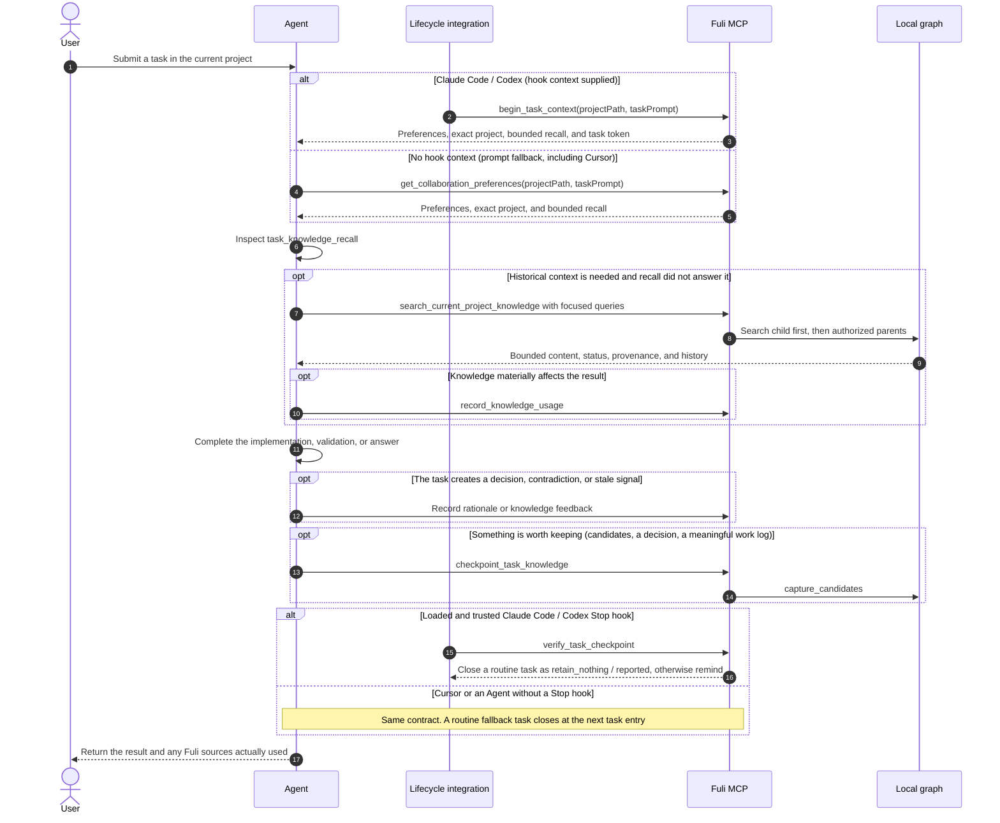

# How FULI works

English · [简体中文](how-it-works.zh-CN.md) · [README](../README.md)

The ideas behind FULI in full, what gets stored where, how a project is recognised, which tool an Agent calls when, built-in roles, and the Roundtable.

## Philosophy

### 1. Measure reuse value, not knowledge volume

Fuli is built around one question:

> Without Fuli, would the agent have to relearn information that is confirmed, still valid, and
> relevant to the current task?

Node count, transcript count, and graph size are not success metrics. The product succeeds when a
past collaboration asset is reused within the correct project, time, provenance, and authority
boundaries—and reduces repeated explanation, correction, or rework.

### 2. Review every task; do not retain every task

A task may produce:

- reusable knowledge such as API conventions, runbooks, release procedures, or constraints;
- experience explaining why an approach worked or failed;
- a decision trace with options, a human choice, rationale, and later validation;
- judgment aids such as preferences, principles, taste, or personality tendencies.

It may also produce only disposable output, a guess, or a one-off choice. In that case,
`retain_nothing` is the correct result. Every task should perform a knowledge-value checkpoint, but
not every task must become stored knowledge.

### 3. Human authority outranks agent repetition

An agent may discover candidates, surface conflicts, recommend promotion, or resolve a deferred
conflict when explicitly authorized. It may not turn semantic similarity, repetition, or its own
judgment into human confirmation. Shared-knowledge promotion and sensitive project mutations use a
preview followed by an explicit, one-time, atomic action.

### 4. Assemble context, then retrieve evidence on demand

Fuli does not inject the complete history at session start. The entry step always loads effective
personal-global preferences, preferences from one exactly matched project, and explicitly
propagating preferences from authorized parent projects. When the current task signals that a
stable prior fact, method, URL, decision, release, deployment, or authentication runbook may matter,
the same step also performs a small bounded recall from that project and its authorized knowledge
sources. The agent uses focused on-demand search when more evidence is needed.
Retrieval alone is not usage; a usage event is recorded only when an item materially affects an
answer, implementation, or decision.

### 5. Preserve evolution instead of overwriting history

An old approach may have been correct under earlier conditions and later replaced. Fuli preserves
provenance, confirmation authority, time, rationale, revisions, supersession, and negative evidence
so an agent can explain both what applies now and why the past was different. Negative feedback may
lower rank or trigger review, but it never silently erases history.

### 6. Put shared knowledge in the parent; keep differences in each child

For example, hotel and flight projects can keep their own PRDs, configuration, and domain rules,
while a parent activity-platform project owns shared local-run, mock, test, and deployment runbooks:

```text
Activity platform (parent: shared runbooks)
├── Hotel project (child: hotel PRD / configuration / overrides)
└── Flight project (child: flight PRD / configuration / overrides)
```

When an agent works in the hotel project, it searches hotel-local knowledge first, then follows
explicit outgoing `PART_OF` or `USES_KNOWLEDGE_FROM` relationships to authorized sources, up to two
hops. A child item with the same stable key overrides an inherited item. Project-scoped personal
preferences remain exact by default; only preferences explicitly marked `descendants` or
`selected_projects` may propagate over the same authorized relationships, with origin project,
path, and distance preserved. Equally near parent conflicts require human judgment and are never
resolved by weight. Generic `RELATED_TO` relationships do not expand scope automatically; search
returns only a one-time read-only expansion suggestion that the Agent must ask the user to approve.

Similar items from multiple children create only a common-knowledge candidate. A shared preference
across projects without one common parent likewise creates only a personal-global candidate while
preserving each source text, qualifier, and provenance. Current clustering is a lexical heuristic,
not proof of semantic equivalence. A human must choose the content, scope, and rationale before it
can apply.

### 7. Local first; no personal model in the shared layer

The personal graph stays local by default. Supported client adapters can journal visible
conversations for private agent continuity, separately from structured confirmed knowledge.
Conversation recall is bounded, with a default seven-day inactivity window. Credentials, temporary
logs, and raw command output must not enter the knowledge graph. The team-shared layer contains only
confirmed project or domain knowledge with context and provenance—not personal taste, personality,
or judgment preferences.

## Practical use: classification, scope, project resolution, and retrieval

### Decide what to store before deciding where to store it

Content type and effective scope are independent dimensions. The first three rows are personal
collaboration preferences and carry a `profileAspect`. Project facts have no `profileAspect` and do
not appear on the Personal preferences page.

| Type | What belongs here | Example |
| --- | --- | --- |
| Taste (`taste`) | Outcomes, styles, and quality directions the user explicitly likes or rejects across UI, writing, product, architecture, or engineering work | “Use fewer large gradients and avoid cards nested inside cards.” |
| Personality (`personality`) | A stable working or collaboration trait explicitly described by the user | “I communicate directly and want the Agent to move work forward proactively.” |
| Judgment preference (`judgment_preference`) | Decision conditions, priorities, risk posture, and operational boundaries used when making trade-offs | “Discuss directional ambiguity first; never `git push` without explicit authorization.” |
| Project knowledge | Reusable objective facts, terminology, requirements, routes, APIs, architecture, rationale, and runbooks | “A GitHub Release triggers Fuli's npm publication.” |

Four questions provide a quick classifier: “What outcome do I want?” is taste; “How do I work over
the long term?” is personality; “How do I decide under a trade-off?” is judgment preference; and
“How does this system objectively work?” is project knowledge. One-off commands, temporary output,
unverified guesses, raw chat, and credentials are not promoted into confirmed knowledge.

Personality is not a catch-all category for everything learned about a person. Only an explicit,
stable self-description can be confirmed with a human basis. A personality inferred by an Agent
from one behavior must remain `pending`; it cannot masquerade as human-confirmed. An empty
Personality filter on `/preferences` therefore usually means there is no qualifying item in the
selected scope, not that capture failed. “Keep copy concise” is more likely taste, while “do not
push without authorization” is more likely a judgment preference. To make the intent explicit,
say: `This is a long-term collaboration trait; save it as a personal-global personality preference: I communicate directly.` An Agent-inferred candidate can be confirmed, corrected, or invalidated
by the user from `/preferences`.

### Personal-global, project-scoped, and shared

| Scope | When to use it | Key write fields | Retrieval rule |
| --- | --- | --- | --- |
| Personal-global preference | The behavior should remain the same in unrelated projects | `targetKind: "personal"`; omit `personalProjectId`; set `profileAspect` | Loaded for every task |
| Project-scoped personal preference | The collaboration behavior belongs to one project or project family | Same fields plus the exact `personalProjectId`; default to `local_only` and never inherited by child projects; explicitly use `descendants` or `selected_projects` when propagation is intended | Exact project wins; propagation follows only the explicit inheritance mode and authorized relationships, and score never resolves a conflict automatically |
| Project knowledge | A fact belongs to one project or to a designated parent/source project | `targetKind: "personal"`; set `personalProjectId`; omit `profileAspect` | Search the current project first, then authorized `PART_OF` / `USES_KNOWLEDGE_FROM` sources up to two hops |
| Team-shared knowledge | Human-confirmed project or domain knowledge genuinely needed by a team | `targetKind: "project"` after preview/review | Visible only from explicitly selected or subscribed public projects; personal preferences never enter this layer |

To choose a preference scope, ask: **Should this change the Agent's behavior in a completely
unrelated project?** If yes, use personal-global. If it applies only to Fuli, use a project-scoped
preference. If it applies to a project family, keep it project-scoped and explicitly choose whether
it may propagate to descendants. Do not turn an objective project fact into a personal-global item
merely because more than one project may reuse it. Put it in an explicit parent or knowledge-source
project and add a directional authorization relation. When global and project-scoped variants have
the same stable `attributes.preferenceKey`, human/source confirmation authority is resolved first;
at equal authority, the exact project variant overrides the global one.

### How Fuli identifies the current project

Fuli matches only stable `project_id` values already registered under Personal projects; it does
not guess from fuzzy directory similarity. Normally the `project_id` matches the repository
directory name, so `/workspace/fuli` maps to `fuli`. Standard calls pass only the current working
directory, and resolution follows this order:

1. Find the nearest Git repository root, read its `origin` remote from its `.git/config` (a
   worktree's common directory) and match it exactly to one registered project's recorded
   repository source URL; ssh and https forms of the same repository are equal. Any clone or
   worktree therefore resolves to its project (`git_remote`), whatever its folder is called.
2. Otherwise match the repository directory name exactly to a registered `project_id`; for a
   Codex worktree, the original repository ID from its `.git` pointer. A project that records a
   different repository source is never matched by name (`repository_remote_conflict`).
3. Match the current directory name exactly to a registered project ID.
4. At a workspace root, match one registered direct child only when exactly one child contains
   `.git`, `package.json`, `pyproject.toml`, `Cargo.toml`, or `go.mod`.
5. Multiple candidates return `ambiguous`; no candidate returns `unmatched` (a remote recorded by
   several projects counts as several). Neither state applies project preferences or guesses a project.

For an unregistered repository with an unambiguous identity, the installed capture skill may call
`upsert_personal_project` before the first project-scoped write to create a minimal local private
project. It never creates or subscribes to a public project automatically. If a workspace has
multiple candidates, run the Agent from the exact project directory or explicitly register and
select the project first.

### Which tool the Agent calls and when

Normal use does not require manual MCP calls: submit a task to the Agent from the project directory.
Fuli includes lifecycle adapters for Claude Code, Codex, and Cursor. When a loaded, trusted entry
hook supplies `begin_task_context` context, use it without repeating the fallback. Cursor's adapter
starts the durable task through a hook but relies on the Agent to retrieve preferences and role
context. When no hook context was supplied, call the following once at task entry:

```json
{
  "tool": "get_collaboration_preferences",
  "arguments": {
    "projectPath": "/workspace/fuli",
    "taskPrompt": "Fix npm publishing and reuse this project's existing release conventions."
  }
}
```

The important part of a matched response resembles:

```json
{
  "context": {
    "personal_project_id": "fuli",
    "project_resolution": {
      "status": "matched",
      "basis": "repository_root",
      "personal_project_id": "fuli"
    }
  },
  "effective_preferences": ["personal-global preferences + exact fuli preferences"]
}
```

If entry-time `task_knowledge_recall` did not answer a stable project fact, search with one to four
short queries centered on an action, artifact, target system, or identifier. Do not use the full
user request verbatim as the only query:

```json
{
  "tool": "search_current_project_knowledge",
  "arguments": {
    "projectPath": "/workspace/fuli",
    "queries": ["npm publication runbook", "GitHub Release trigger"],
    "includePending": false
  }
}
```

At task end, hook mode calls `checkpoint_task_knowledge`: use `capture_candidates` only for a small,
durable, evidence-backed batch; otherwise use `retain_nothing`. A checkpoint sent too early is
corrected with `amend: true` (reason and work log only); the first record stays as history. A prompt-fallback Agent applies the
same rule and writes through `capture_session_knowledge`. Personal preferences set the correct
`profileAspect` and stable `attributes.preferenceKey`; project facts omit `profileAspect`. If
automatic capture is disabled under Settings, automatic writes return `capture_disabled` and no
category is created: transcripts, checkpoints, knowledge and preference candidates, knowledge usage,
view records, and feedback or corrections reported through an Agent all stop. If the capture
settings cannot be read, automatic writes stop the same way (`reason: policy_unavailable`). Edits
you submit yourself in the FULI console and an explicit `新项目：` request still save, and reading
existing knowledge keeps working. Session turns written while automatic recording is off are skipped
with a content-free marker and are never imported after it comes back on.

Capture can also be limited to projects. `projectMode` is `all` (the default), `all_except` with
`excludedProjectIds`, or `selected` with `selectedProjectIds`; `unregisteredDirectories`
(`skip` by default under `selected`, `capture` otherwise) decides work outside every registered
project. A directory resolves to its project the same way task entry does, so a worktree of a
repository is that repository's project. A project that is not recorded returns
`reason: project_off`, an unregistered directory `project_unregistered`, and every task receipt
ends with the reason and that explicit edits still save, for example
`此项目未开启记忆；你明确提交的修改仍会保存`. Switching a project off never hides or
deletes what it already recorded; `projectsOffSince` keeps when it stopped. Agents read the
settings with `get_capture_policy` (pass `projectPath` to learn about the current project) and
change them with `update_capture_policy` only after restating the change and getting the user's
confirmation; the settings page uses `PATCH /api/capture-policy`. Saying "这次别记" in a session pauses
only that session at once, without a confirmation: the Agent calls `update_capture_policy` with just
`sessionPaused: true` and its `taskContextToken`, and every later receipt in the session says
`本会话已暂停记录（自 HH:mm 起）` (`reason: session_paused`). Earlier records stay, workers the session
starts are paused with it, "继续记" (`sessionPaused: false`) resumes from then on, and nothing written
while paused is recorded later. The pause lives in the local runtime directory and ends with the session.

To turn FULI off for one session altogether, the person types `/fuli stop` (Claude Code and Cursor, where
setup installs the `fuli` command Skill) or `fuli stop` (any client; Codex accepts no custom slash command).
The prompt hook answers the line itself, so the model never sees it: from then on that session gets no
injected memory, preferences or recall, its Agent's own FULI reads (searches, Agent memory, conversations)
are refused, it records nothing and starts no collaboration (workers, loans, other Agents, role work), while other sessions, the local service and existing memories stay as they are.
`fuli start` turns it back on within the existing settings (a pause or a stricter global, client or project
setting still applies), `fuli restart` also gives the next turn the full context again, and `fuli status`
shows the session and the default; nothing said while FULI was off is recorded later. Context already sent
to the model cannot be taken back, so isolation needs a new session. Only a task token shows which session a
tool call is for (Claude Code keeps its tool connection across /clear; Codex and Cursor connections name no
session), so while any session of a client is off FULI refuses that client's tool calls without a task token,
rather than serve memory to a session that may be the stopped one. Agents pass the `taskContextToken` they
already have (entry, searches and team reads take it), so other windows keep working. The same switch runs from a shell the
client started (`!fuli session stop`), so an Agent with shell access can run it too (the same trust as
access to your files); the console and `fuli mcp --call` still read for you, and `fuli session default off` makes new sessions start with FULI
off until started; sessions already open keep theirs.

Run these local contract tests to check that these docs and project-path behavior still match the
implementation:

```bash
npm run test:node -- test/acceptance-docs.test.js test/project-path-context.test.js
```

## Agent interaction sequence

This is the simplified lifecycle for a normal task. The Chinese
[detailed sequence diagram](../acceptance/智能体调用时序图.md) also covers inheritance, usage counting,
write previews, and source markers.



## Agent Roundtable

Agents talk to each other directly, the way a lead asks a teammate or a sub-agent. A Codex
Agent can ask the Agent behind a specific Claude Code conversation, or a FULI Agent that has
never run yet. Nobody creates rooms or invites participants: an Agent calls `message_agent`,
Fuli wakes the recipient read-only in its own client and returns its answer: Claude Code
forks the conversation; Codex records the exchange in it (or uses a new session while it is
open in the app). A message that cannot be delivered waits in the recipient's inbox for its
next task.

Agents can also keep direct and group chats with `agent_chat`. Messages are pushed: an Agent
that calls `wait` gets new messages at once, and a direct message or an `@` mention wakes an
Agent that is not waiting. Chats only carry communication; they never change knowledge weights.

Every exchange is kept locally; the console's Roundtable page shows who asked whom, through
which client, and exactly what was said. Tools and limits: [Agent Roundtable](agent-roundtable.md).

## Built-in roles and Agent identity

Jefa (project manager), Bole (AR, Agent Resources), and Tonborg (judgment) are built-in roles in every
space and are never hired. Bole's workbench shows staffing, current work, and recruitment history;
Tonborg's workbench shows decisions and feedback. Jefa's task board is built into FULI and needs no
installation; **Manage assigned projects** on a role's card or workbench sets which projects it manages.
The console has no hiring step: a custom employee package is recruited through the `recruit_employee` Agent
tool, which reuses a durable identity with separate project assignments. An installed employee workbench and
API share the FULI port; existing FULI MCP clients discover and call its tools. Recruitment does not start a
model or rewrite client settings. See the [employee package and extension contract](employee-agents.md).
Agents can also grow small [Agent apps](agent-apps.md); in this version an approved app runs
unsandboxed with your account's permissions, after you confirm it with `fl app approve` in a terminal.

Project Agent identities remain control-plane records rather than one resident process per identity.
Roles now keep versioned, project-private working memory in the same Neo4j Provider. Task entry
restores one owner across connected MCP clients; lifecycle checkpoints survive separate
MCP processes. See [role memory, host hooks and acceptance boundaries](project-agent-memory.md).
Supported Codex and Claude Code hooks also journal visible conversations. Once unfolded messages pass
a size threshold (64 KB by default), older ones fold into a digest; recovery stays within a byte budget. Specialist loans and artifact verification share the same Provider.
See [conversation continuity and collaboration](agent-conversations-and-collaboration.md)
for client coverage, model capability configuration and acceptance limits.
Physical executors share leases by executor ID. Fuli starts and stops only executors with an explicitly
injected managed lifecycle adapter; host-owned external executors such as Codex are never started or
killed implicitly.
