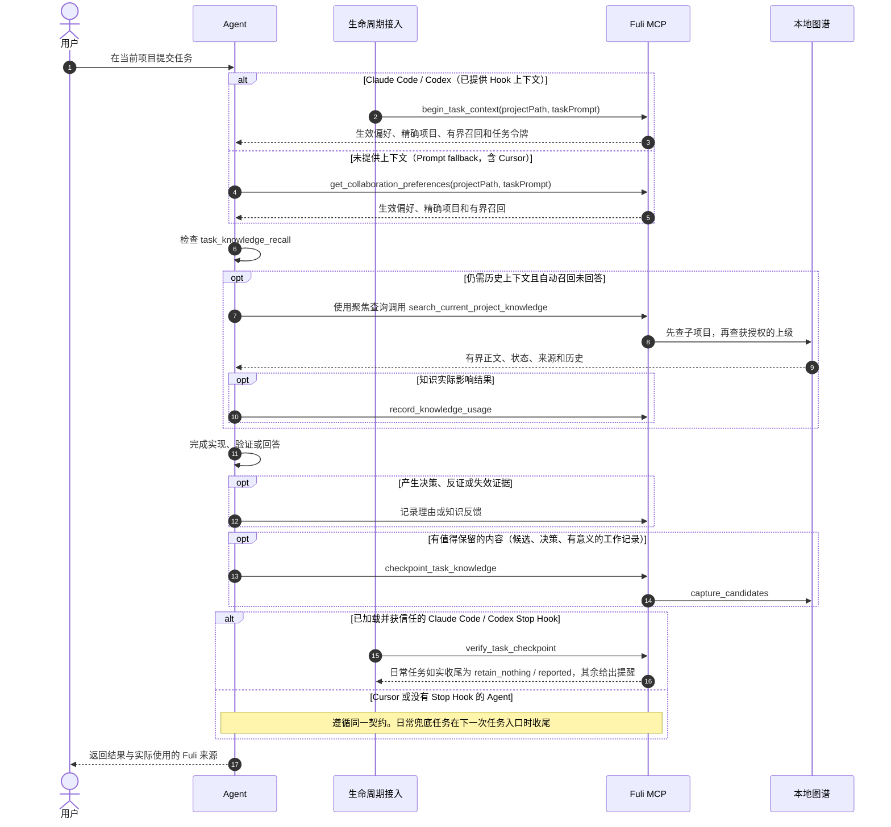

# FULI 怎么工作

[English](how-it-works.md) · 简体中文 · [README](../README.zh-CN.md)

完整的项目理念、什么存在哪里、怎么认出当前项目、Agent 什么时候调什么工具、内置角色，以及圆桌。

## 项目理念

### 1. 衡量复用价值，而不是知识数量

复利的核心问题是：

> 如果没有 Fuli，Agent 是否需要重新学习一条已经确认、仍然有效且与当前任务相关的信息？

节点数、对话数和图谱规模不是成功指标。真正需要验证的是：历史资产能否在正确的项目、时间
和权威边界内被再次使用，并减少重复解释、修正和返工。

### 2. 每个任务都检查价值，但不强迫每个任务沉淀

一次任务可能产生：

- 可复用知识：API 约定、Runbook、发布方式或项目约束；
- 经验：为什么某个做法有效或失败；
- 决策轨迹：候选方案、人的选择、理由和后续验证；
- 判断辅助：偏好、原则、品味或个性倾向。

也可能只有临时输出、猜测或一次性选择。此时正确结果是 `retain_nothing`。复利要求每个任务
结束前做一次知识价值检查，并不是把每次聊天都变成长久记忆。

### 3. 人的权威高于 Agent 的重复判断

AI 可以发现候选、指出冲突、建议公共化，也可以在得到授权后处理延迟冲突；它不能仅凭语义
相似、重复出现或自己的判断伪造人工确认。公共知识提升和有风险的项目写入必须先预览，再由
明确的人类选择触发一次性、原子执行。

### 4. 先组装上下文，再按需取证

Fuli 不会在会话开始时把全部历史塞给模型。入口阶段始终加载当前任务实际生效的个人全局偏好、
精确项目偏好和显式允许传播的上级项目偏好；当任务信号表明可能需要稳定的历史事实、方法、
网址、决策、发布、部署或认证 Runbook 时，同一步骤还会在精确项目及其获授权知识来源中执行
一次小规模、有界的自动召回。
需要更多证据时，Agent 再使用聚焦查询按需检索。只有真正影响回答、实现或决策的知识才记录为
一次使用，单纯检索不会增加权重。

### 5. 保留知识演化，而不是覆盖历史

旧方案可能在当时正确，后来因条件变化被替代。Fuli 保存来源、确认权威、时间、理由、修订、
替代和负面证据，让 Agent 能解释“现在应该用什么”以及“为什么过去曾经不同”。负面反馈会
降低相关内容的排序或触发复核，但不会静默抹掉历史。

### 6. 公共知识归属上级，项目差异留在子项目

例如，酒店和机票项目可以只保存自己的 PRD、配置和领域规则，把共同的本地运行、Mock、测试
和发布方式收敛到活动平台项目：

```text
活动平台（父项目：共享 Runbook）
├── 酒店项目（子项目：酒店 PRD / 配置 / 覆盖项）
└── 机票项目（子项目：机票 PRD / 配置 / 覆盖项）
```

Agent 在酒店项目工作时先搜索酒店本地知识，再沿显式的 `PART_OF` 或
`USES_KNOWLEDGE_FROM` 关系向上搜索允许继承的知识，最多两跳。同稳定键的子项目内容覆盖
父项目内容。项目级个人偏好默认只在精确项目生效；只有显式设置为 `descendants` 或
`selected_projects` 的偏好才可沿同样的授权关系传播，并返回来源项目、路径和距离。多个同层
父项目冲突时必须交给人判断，不能靠权重选胜者。普通 `RELATED_TO` 不会自动扩大作用域；
搜索结果只返回一次性只读扩展建议，由 Agent 先询问用户。

多个子项目中相似的内容只会形成公共化候选。跨无共同父级项目出现的共同偏好也只能形成个人
全局候选，并完整保留每个项目的原文、限定词和来源。当前聚类是词法启发式信号，不是语义
等价证明；必须由人选择内容、作用域和理由后，才能生效。

### 7. 本地优先，公开层不包含个人模型

个人图谱默认留在本机。支持的客户端适配器可保存可见对话，用于私有 Agent 接续；对话记录与
结构化、可复用的确认知识分开存储，对话累积到一定量（默认 64 KB）后较早的消息折叠成摘要，召回有字节预算。凭据、临时日志
与原始命令输出不应写入知识图谱。团队共享层只承载经过确认、具有上下文和来源的项目或领域知识，不包含个人的
品味、个性和判断偏好。

## 实际怎么用：分类、作用域、项目识别与取回

### 先判断存什么，再判断存在哪里

“内容类型”和“生效范围”是两个独立维度。前三类是个人协作偏好，会带有
`profileAspect`；项目事实不带 `profileAspect`，也不会出现在“个人偏好”页中。

| 类型 | 应该存什么 | 例子 |
| --- | --- | --- |
| 品味 `taste` | 用户明确喜欢或排斥的结果、风格与质量方向，适用于界面、文案、产品、架构和工程结果 | “页面少用大渐变，不要卡片套卡片” |
| 个性 `personality` | 用户明确自我描述、并且预计长期稳定的工作或协作特点 | “我习惯直接沟通，希望 Agent 主动推进” |
| 判断偏好 `judgment_preference` | 面对取舍时的决策条件、优先级、风险倾向和操作边界 | “方向性歧义先讨论；未明确时禁止 `git push`” |
| 项目知识 | 可复用的客观项目事实、术语、需求、路由、API、架构、决策理由和 Runbook | “Fuli 的 npm 发布由 GitHub Release 触发” |

可以用四个问题快速分类：它描述的是“想要什么结果”时存品味；描述“我是怎样长期协作的”时
存个性；描述“遇到取舍时怎么决定”时存判断偏好；描述“这个系统客观上如何工作”时存项目
知识。一次性命令、临时输出、未经验证的猜测、原始聊天和凭据都不直接沉淀为确认知识。

“个性”不是所有个人信息的兜底分类。只有用户明确给出的稳定自我描述可以直接带着人工依据
确认；Agent 仅从一次行为推断出的个性必须先保持 `pending`，不能伪装成人工确认。因此
`/preferences` 的“个性”为空，通常表示当前范围内还没有符合这个标准的条目，而不是沉淀
失败。像“文案简洁”更可能是品味，“未授权不推送”更可能是判断偏好。需要明确沉淀时，可以
直接说：`这是我的长期协作个性，请作为个人全局偏好保存：我习惯直接沟通。` Agent 推断的
候选可在 `/preferences` 中由用户确认、纠正或失效。

### 全局和项目级

| 范围 | 何时使用 | 写入关键字段 | 取回规则 |
| --- | --- | --- | --- |
| 个人全局偏好 | 在无关项目中也应该保持不变 | `targetKind: "personal"`，不传 `personalProjectId`，设置 `profileAspect` | 每个任务都加载 |
| 项目级个人偏好 | 协作方式属于一个项目或项目族 | 同上，同时传精确的 `personalProjectId`；默认 `local_only`，不向子项目继承；需传播时显式使用 `descendants` 或 `selected_projects` | 精确项目优先；仅按显式继承模式沿获授权关系传播，冲突不按分数自动裁决 |
| 项目知识 | 事实只属于一个项目，或应由某个上级项目统一维护 | `targetKind: "personal"`，传 `personalProjectId`，不设置 `profileAspect` | 先查当前项目，再沿获授权的 `PART_OF` / `USES_KNOWLEDGE_FROM` 最多向上两跳 |

判断作用域时问一句：**换到完全无关的项目，这条协作偏好还应该改变 Agent 的行为吗？**
“是”就存个人全局；“否，只在 Fuli 项目或项目族”就存项目级偏好，并明确是否允许向子项目
传播。客观项目事实不要因为多个项目都可能用到就改存个人全局；应放在明确的上级或知识源
项目，再建立有方向的授权关系。全局和项目级存在同一 `attributes.preferenceKey` 时，
确认权威必须先裁决；权威相同时才由精确项目版本覆盖全局版本。

### Fuli 怎么识别当前项目

Fuli 只匹配已经登记在“个人项目”中的稳定 `project_id`，不根据目录内容做模糊猜测。通常让
`project_id` 与仓库目录名一致，例如仓库 `/workspace/fuli` 对应项目 `fuli`。标准调用只传
当前工作目录，解析顺序如下：

1. 向上找到最近的 Git 仓库根，从 `.git/config`（worktree 读其公共目录）读取 `origin`
   远程地址，与某一个已登记项目自己的仓库来源 URL 完全相同时命中；同一仓库的 ssh 与 https
   写法视为相同。标为 `role: reference`（只是参考的仓库）的来源不参与匹配；没有 role 的旧来源
   按本项目自己的仓库算。因此任何目录名的克隆或 worktree 都解析到原项目（`git_remote`）；
   但目录名（或 worktree 原仓库名）正好是另一个已登记、且没有记录别的自有仓库的项目时，两者
   不一致，返回 `ambiguous`（`repository_remote_conflict`），由人来选。
2. 否则按仓库目录名与已登记 `project_id` 完全相同时命中；Codex worktree 用 `.git` 指向的
   原始仓库名。记录了另一个仓库地址的项目不会因为同名被命中（`repository_remote_conflict`）。
3. 当前目录名与已登记项目 ID 完全相同时命中。
4. 如果当前目录是工作区根，并且正好只有一个已登记的直接子目录带 `.git`、`package.json`、
   `pyproject.toml`、`Cargo.toml` 或 `go.mod`，命中这个唯一子项目。
5. 多个候选返回 `ambiguous`，没有候选返回 `unmatched`（同一远程地址被多个项目记录也算多个候选）；
   两种情况都不会应用项目级偏好，也不会猜一个项目。

第一次进入尚未登记、但身份明确的仓库时，已安装的沉淀 Skill 可以在首次项目级写入前通过
`upsert_personal_project` 创建最小的本机私有项目。若工作区
有多个候选，应进入精确项目目录运行 Agent，或先在“个人项目”中明确选择和登记。

### Agent 什么时候调用什么

正常使用时，不需要手工调用 MCP 工具：在项目目录中向 Agent 提任务即可。Fuli 已有 Claude
Code、Codex 和 Cursor 生命周期适配器。已加载、获信任的入口 Hook 提供 `begin_task_context`
上下文时，直接使用，不重复 fallback。Cursor 的 Hook 建立持久任务，但偏好与角色上下文
仍由 Agent 取回。没有收到 Hook 上下文时，在每个任务开始调用一次：

```json
{
  "tool": "get_collaboration_preferences",
  "arguments": {
    "projectPath": "/workspace/fuli",
    "taskPrompt": "修复 npm 发布流程，并沿用这个项目已有的发布约定"
  }
}
```

命中后，返回值中的关键部分类似：

```json
{
  "context": {
    "personal_project_id": "fuli",
    "project_resolution": {
      "status": "matched",
      "basis": "repository_root",
      "personal_project_id": "fuli"
    }
  },
  "effective_preferences": ["个人全局偏好 + fuli 的精确项目偏好"]
}
```

入口返回的 `task_knowledge_recall` 没有回答稳定项目事实时，再用 1 至 4 条面向动作、产物、目标
系统或标识符的短查询检索；不要把整段用户请求原样当成唯一查询：

```json
{
  "tool": "search_current_project_knowledge",
  "arguments": {
    "projectPath": "/workspace/fuli",
    "queries": ["npm 发布 Runbook", "GitHub Release 触发条件"],
    "includePending": false
  }
}
```

任务结束时，Hook 模式调用 `checkpoint_task_knowledge`：只有少量、可复用且有证据的内容才用
`capture_candidates`；否则使用 `retain_nothing`。收尾写早了，用 `amend: true` 更正（只改 reason 和
workLog），原记录作为历史保留。Prompt fallback Agent 遵守相同判断标准，并
通过 `capture_session_knowledge` 写入。写个人偏好时设置正确的 `profileAspect` 和稳定的
`attributes.preferenceKey`；写项目事实时不设置 `profileAspect`。如果“设置”中的自动沉淀已
关闭，自动写入会返回 `capture_disabled`，不会产生任何类别的条目：会话原文、checkpoint、知识和
偏好候选、知识使用记录、查看记录，以及经由 Agent 上报的反馈或纠正都会停止。记录设置读取失败时
自动写入同样停止（`reason: policy_unavailable`）。你在 FULI 控制台里明确提交的修改和显式的
`新项目：` 仍会保存，查询已有知识不受影响。关闭期间写下的会话轮次只留一条不含内容的跳过标记，重新打开后
也不会补记。

记录范围还可以按项目选择。`projectMode` 为 `all`（默认）、`all_except`（配合
`excludedProjectIds`）或 `selected`（配合 `selectedProjectIds`）；`unregisteredDirectories`
决定没有登记为 FULI 项目的目录记不记（`selected` 下默认 `skip`，其余默认 `capture`）。目录按
任务入口相同的规则解析为项目，所以同一仓库的 worktree 就是同一个项目。未开启的项目返回
`reason: project_off`，未登记目录返回 `project_unregistered`，每轮任务回执末尾都会写明原因以及
明确提交的修改仍会保存，例如「此项目未开启记忆；你明确提交的修改仍会保存」。关闭某个项目不会隐藏或删除它已有的记录，`projectsOffSince` 记下它从何时
停止记录。Agent 用 `get_capture_policy` 读取（传 `projectPath` 可得知当前项目是否记录），用
`update_capture_policy` 修改前必须先复述改动并得到用户确认；设置页使用 `PATCH /api/capture-policy`。
在会话里说「这次别记」只暂停这一个会话、立即生效、无需确认：Agent 只带 `sessionPaused: true` 和当前
`taskContextToken` 调用 `update_capture_policy`，此后本会话每轮回执都写「本会话已暂停记录（自 HH:mm 起）」
（`reason: session_paused`）。之前的记录保留，该会话派出的 worker 一并暂停；说「继续记」（`sessionPaused: false`）
从此恢复，暂停期间的内容不会补记。暂停状态存在本地运行目录，会话结束即失效。

要让某个会话整体停用 FULI，由用户自己输入 `/fuli stop`（Claude Code 和 Cursor，setup 会安装 `fuli` 命令 Skill）
或 `fuli stop`（所有客户端；Codex 不支持自定义斜杠命令）。这一行由提示词 Hook 直接答复，模型看不到：此后该会话不再注入
记忆、偏好和召回，其 Agent 自己发起的 FULI 读取（搜索、Agent 记忆、对话）也被拒绝，不再自动记录，也不再自动发起协作（worker、借调、其他 Agent、角色任务）；其他会话、本地服务和已有记忆不变。
`fuli start` 在现有设置内重新启用（暂停或更严格的全局、客户端、项目设置照样生效），`fuli restart` 还会让下一轮重新拿到完整
上下文，`fuli status` 显示本会话和默认设置；停用期间的对话不会补录。已发给模型的上下文无法撤回，需要完全隔离请新开会话。
只有任务令牌能说明一次工具调用属于哪个会话（Claude Code 的工具连接跨 /clear 保留，Codex、Cursor 的连接不带会话），所以某个客户端有任一会话停用期间，它不带任务令牌的工具调用一律拒绝，不把记忆提供给可能正是已停用的那个会话。Agent 传入手上已有的 `taskContextToken`（入口、搜索和团队类读取都接受），其他窗口照常工作。
在客户端启动的 shell 里也可以运行同一开关（`!fuli session stop`），因此能运行 shell 的 Agent 也能改它（与能读写本地文件同等信任）；控制台和 `fuli mcp --call` 仍可为你读取；`fuli session default off` 让新会话默认不启用、
需显式启用，已打开的会话保持原状。

本地可先运行下面两个契约测试，验证这些文档说明和项目路径解析仍与实现一致：

```bash
npm run test:node -- test/acceptance-docs.test.js test/project-path-context.test.js
```

## Agent 交互时序

下面是日常任务的简化时序。更完整的项目继承、使用计数、写入预览和来源标记流程见
[智能体调用时序图](../acceptance/智能体调用时序图.md)。



## Agent 圆桌

Agent 之间可以直接对话，就像负责人去问一位同事或子 Agent。比如 Codex 里的 Agent 可以问
某一段 Claude Code 对话里的 Agent，也可以问一位还没运行过的 FULI Agent。不需要人建房间或拉人：
Agent 调用 `message_agent`，Fuli 在对方自己的客户端里以只读方式唤醒它并把回答带回来：
Claude Code 会 fork 原会话；Codex 会在原对话里记下这次问答（对话正在 Codex 中打开时改用新会话）。
暂时唤不醒的消息会在对方下次开始任务时出现在它的收件箱里。

Agent 之间还可以用 `agent_chat` 私聊和建群。消息是推送的：调用 `wait` 的 Agent 会立刻收到新消息，
私聊或 `@` 点名会唤醒不在等待的 Agent。聊天只负责通信，不会改变知识权重。

每一段往来都保存在本机，控制台的“圆桌”页能看到谁问了谁、通过哪个客户端、原文和回答。
工具与限制见[圆桌说明](agent-roundtable.md)。

## 内置角色与 Agent 身份

Jefa（项目经理）、Bole（AR，Agent Resources）和 Tonborg（决策员）是每个空间自带的角色，
不需要招募。Bole 的工作台可查看人员安排、当前工作与招募历史；Tonborg 的工作台可查看判断与反馈。
Jefa 的任务看板随 FULI 内置，无需安装；在角色卡片或工作台的“管理负责项目”里设置它负责哪些项目。
控制台不再有聘请步骤：自定义员工包通过 Agent 工具 `recruit_employee` 招募，招募复用持久身份，
按项目单独任职；安装员工包后，侧栏工作台与 API 共用 FULI 端口，已有 FULI MCP 可发现和调用员工工具。
招募不等于启动模型，也不改写已有客户端配置。详见[员工包安装与扩展协议](employee-agents.md)。
Agent 还可以自己做小的 [Agent 应用](agent-apps.md)；本版本没有沙箱，经你在终端用 `fl app approve` 确认后，应用以你的账户权限运行。

Project Agent 身份仍是控制面记录，不会每个身份常驻一个进程。角色工作记忆按项目私有、
版本化地保存在同一个 Neo4j Provider 中；任务入口恢复唯一负责人，结束检查跨 MCP 进程持久化。
详见[角色记忆、宿主 hooks 与验收边界](project-agent-memory.md)。受支持的 Codex 和
Claude Code Hook 还会保存可见对话，累积到一定量后折叠成摘要，按预算恢复。跨项目借调与
产物验证沿用同一个 Provider；客户端覆盖及模型能力配置见
[对话与协作](agent-conversations-and-collaboration.md)。实际执行器按 ID 共用租约：
只有显式注入受管生命周期适配器的执行器才由 Fuli 启停；Codex 等宿主自己拥有的外部执行器
不会被 Fuli 擅自启动或终止。
