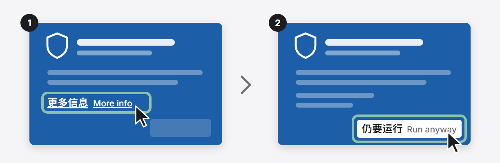
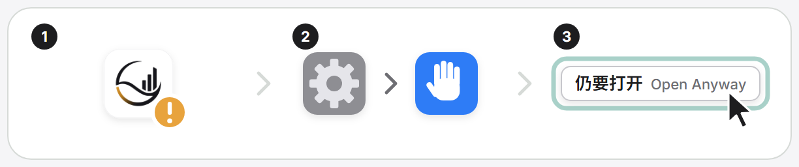

# Install and run FULI

English · [简体中文](install.zh-CN.md) · [README](../README.md)

Desktop client, terminal install, first run checks, every CLI command, local ports and npm packages.

## First run

Install Fuli, connect a client, and run one actual tool call to verify the connection. See
[Installation](install.md#installation) for full requirements and [client connections](client-connections.md)
for configuration formats, Hooks, and troubleshooting.

Humans retain login, Hook trust, and manual review. **Settings showing `Connected` (`connected`)
only means the current Fuli entry is present in the client's configuration file — it does not prove
that the client loaded the MCP process, that a Hook delivered context, or that a tool call
succeeded.**

### 1. Install

Pick one of two ways:

- **Download the app (recommended, Windows):** get `FULI-Setup-<version>.exe` from the
  [latest release](https://github.com/JevonsCode/fuli/releases) and double-click it. No terminal,
  no administrator rights; Node.js, Java and the graph database are built in. On first launch FULI
  finds the AI clients on your computer and connects them in one click, and offers start at login.
  If FULI is already installed, the setup updates it and keeps your data. The installer is not
  code-signed yet, so Windows may show "Windows protected your PC": choose "More info → Run anyway".

  
- **Download the app (macOS, Apple silicon):** get `fuli-macos-arm64-<version>.dmg` from the same
  release, open it and drag FULI.app onto Applications as the window's arrow shows; FULI ejects the
  installer itself when you open it. macOS 13.5 or later; Intel Macs use the terminal install. The app
  is not signed yet: the first time it is blocked, open System Settings › Privacy & Security and
  choose "Open Anyway". See [docs/macos-app.md](macos-app.md).

  
- **Install from the terminal:** for developers, and for macOS / Linux.

With Node.js 24.12+ and Docker Compose v2 available (default container mode; see
[Installation](install.md#installation) for macOS/Linux native mode), run:

```bash
npm install --global fuli-context
fuli setup
fuli open
```

The setup wizard shows its plan before changing your environment.

### 2. Connect a client

- **Detected Codex, Claude Code, Cursor, or Claude Desktop:** `fuli setup` writes the MCP entry and
  supported Hooks/Skills. Quit and reopen apps that read MCP configuration only at launch, then open
  a new task. Codex Hook trust requires manual `/hooks` review in Codex.
- **Other MCP clients:** run `fuli connect` (or open **Settings → Client connection** in the
  console), merge the `fuli` entry into the client's MCP configuration while keeping other servers,
  and reload or trust the server in that client. `fuli connect` prints JSON only.

### 3. First actual tool call and verification

1. Run `fuli status` and confirm the management UI and personal graph are ready (default
   `http://127.0.0.1:2727`).
2. Confirm Fuli tools appear in the client and **make one actual tool call** inside a project
   directory (for example, ask the Agent to load project collaboration preferences or coordinate a
   small task). Verify that Fuli resolves the right project (or registers/staffs a lead Agent) and
   asks for missing context rather than inventing it.
3. Optional cross-tool handoff: use the Agent's continuation instruction in another client
   connected to the same data and verify that it recovers the same Agent, project, and prior work.
   See [Agent conversations and collaboration](agent-conversations-and-collaboration.md).

For a one-off task, this source version also supports an isolated **temporary project** when no
registered project matches; reading preferences alone creates nothing, and an ambiguous project
still needs a choice. Fuli retains its task history and follows the existing Agent recruitment and
executor permissions. The Agent directory explains the first-task entry, and task details show a
completion table only after real worker execution is reported — an assigned Agent or an ordinary
local conversation alone is not worker evidence.

### 4. Troubleshooting

If setup, client detection, or tool calls fail, see
[Common failure recovery](client-connections.md#common-failure-recovery). Use
`fuli setup --yes --connected-only` only to refresh clients that still have an existing Fuli MCP
entry (**Connected** / `connected` or **Configuration changed** / `changed` in Settings); clients
showing **Skills only** (`skills_left`), **Removed** (`removed`), **Not connected**
(`not_connected`), or newly installed clients without a Fuli MCP entry require a full `fuli setup`.

[How it works](how-it-works.md#philosophy) · [Installation](install.md#installation) ·
[Agent roles and teams](employee-agents.md) ·
[Cross-client acceptance](../acceptance/cross-client-handoff.md) · [Contribute](../CONTRIBUTING.md) ·
[Report an issue](https://github.com/JevonsCode/fuli/issues/new/choose)

## Installation

Requirements:

- Node.js 24.12 or later;
- the default container mode needs Docker Compose v2 through Docker Desktop, Rancher Desktop, or a compatible runtime;
- macOS and Linux can use native mode without a VM; it requires Java 21 and `uv` (Python 3.12);
- on a memory-constrained Mac, use
  `fuli setup --runtime-mode native --memory-profile low --adaptive-memory`. Container mode remains the compatibility default and is never changed automatically.

Install globally and initialize:

```bash
npm install --global fuli-context
fuli setup
```

Or use the one-line installer, which checks the Node.js version first:

```bash
curl -fsSL https://xn--8ovp9s.xn--m8txu.com/fuli/install.sh | sh
```

On Windows PowerShell: `irm https://xn--8ovp9s.xn--m8txu.com/fuli/install.ps1 | iex`.

`fuli setup` first shows its plan and asks for confirmation. It then checks the container runtime,
initializes local Graphiti / Neo4j, creates a personal space, installs the companion Agent Skills,
and registers the `fuli` MCP with detected agents. The default setup connects only the personal
Provider; it does not simulate a team-shared service.

Open the management UI after setup:

```bash
fuli open
```

The default URL is `http://127.0.0.1:2727`. On Windows, Hyper-V, WSL and winnat reserve port ranges that change
between boots (`netsh interface ipv4 show excludedportrange protocol=tcp` lists them). A first setup picks ports outside
those ranges. Every `fuli start`, `restart` and `setup` checks again: a Fuli port that is now reserved, or a console port
Windows refuses or another program holds, moves to the nearest free port. Fuli backs up `runtime-settings.json`, saves
the new port, starts normally and says so once (in the command output, the desktop client and the console). It never
moves away from another running Fuli console on that port, and never starts a second one beside it. The Windows tray's
**Use another port** still moves the console to a free port near the default on request.
Open Agent sessions keep showing the old console address in Fuli links until they restart.

The Settings page manages all seven local Fuli ports, graph runtime mode, LAN access, automatic capture,
Agent access, UI language, and the resource refresh interval. Run `fuli restart` after saving port,
runtime, or LAN changes;
the refresh interval applies immediately. The same page polls real memory and disk usage for the
management service, Providers, Neo4j, application files, and local data. Memory is sampled on every
poll; disk usage is sampled at most once per minute, with separate timestamps. Missing container metrics
are shown as partial instead of being replaced with mock values. Native Provider and Neo4j processes
are included. Browser-tab memory is excluded; shared container-VM overhead is excluded in container mode.

### Already installed with npm?

The desktop client and an npm installation (`npm install --global fuli-context`) use the same data folder
(macOS `~/Library/Application Support/Fuli`, Windows `%LOCALAPPDATA%\Fuli`). Installing the client after npm copies
nothing and loses nothing, but the program is then on the computer twice. The client settles that by itself:

- When the client starts FULI, it becomes the one FULI service of that data: a console the npm copy runs is stopped
  and the client's own is started.
- Every Agent client FULI was connected to (Claude Code, Codex, Cursor, …) is pointed at the desktop client's copy,
  once. Open Agent sessions pick it up when they restart.
- The npm copy stays installed until you choose. The console shows one floating notice naming it, with **Remove**: FULI
  runs the npm that installed it (`npm uninstall --global fuli-context` for that prefix, without package scripts) and
  your data stays. If that npm cannot remove it (for example without permission), the notice shows the command to run
  yourself. Closing the notice keeps it closed; **Settings › Clients** still lists the copy. An Agent removes it only
  with your own words.
- The client puts its own `fl` and `fuli` on your PATH. On macOS they are scripts in `~/.fuli/bin`, and a marked
  block at the end of `~/.zshrc` (and `~/.bash_profile` if you have one) puts that folder first. On Windows they are
  in the installation's `bin` folder, first in your user PATH; the system PATH still comes first there, so an npm
  folder in the system PATH (such as nvm-windows) wins until that copy is removed. New terminals pick it up.
  **Settings › Clients › fl / fuli in a terminal** turns this off and takes out exactly what was added; the Windows
  uninstaller removes it too.
- From 0.25.0 on, an npm copy never replaces the client's running service. An older npm copy started by hand
  (`fl start`) can still take it over; the client takes it back the next time it starts FULI. An older copy that meets
  data a newer FULI upgraded leaves those stores read-only instead of rewriting them.

## CLI

The global package provides two equivalent commands: `fuli` and the short alias `fl`.
CLI help, prompts, status output, and errors are always in English and do not follow the web or
system locale. User data such as paths and space names is displayed unchanged.

| Command | Purpose |
| --- | --- |
| `fuli --help` / `fuli -h` | List every public command and its available options |
| `fuli --version` / `fuli -v` | Print the installed Fuli CLI version |
| `fuli setup [options]` | Initialize the Provider, UI, agent integrations, and Skills; safe to rerun |
| `fuli start [options]` | Check Agent integrations, then start the Provider and UI; optionally open a browser, rebuild containers, or enable LAN access |
| `fuli stop [--data-dir DIR]` | Stop services without deleting data |
| `fuli restart [options]` | Restart local services using the same runtime options as `start` |
| `fuli status [--json] [--data-dir DIR] [--port PORT]` | Show UI, personal graph, and shared-service status; `--json` emits machine-readable output |
| `fuli open [--data-dir DIR]` | Open the current management UI in the default browser |
| `fuli graph export --output DIR [--mode container\|native]` | Export graph data as a checksummed, copyable offline bundle |
| `fuli graph import --input DIR [--target-mode container\|native] [--yes]` | Verify and replace target graph data, preserving an automatic pre-import rollback bundle |
| `fuli graph migrate --to native [--yes]` | Move a container graph to native mode, accepted only when node and relationship counts match |
| `fuli update [setup options]` | Update the npm package and refresh local integrations |
| `fuli uninstall [--yes] [--data-dir DIR]` | Remove agent integrations and services while preserving knowledge data and Neo4j volumes |

Common commands:

```bash
fuli --version
fuli status
fuli restart --rebuild
fuli start --lan
fuli graph export --output "$HOME/Backups/fuli-graph"
fuli stop
```

Connect a deployed `fuli-workspace` service:

```bash
fuli connect-workspace \
  --url http://127.0.0.1:8789 \
  --token-file /path/to/private-token
fuli restart
```

The command verifies discovery, protocol version, and token scope before atomically updating the
local runtime configuration with mode `0600`. It never prints the token, token-file path, or remote
principal ID. Non-loopback services must use HTTPS. The current `fuli-workspace-v1` adapter enables
discovery, explicit subscriptions, and queries; publishing, contributions, and review remain off
until those protocol mappings are implemented.

`start` and `restart` accept `--data-dir DIR`, `--personal-space NAME`, `--port PORT`, `--open`,
`--rebuild`, `--lan`, and `--no-lan`. When port or LAN flags are omitted, the saved Settings values
are used. LAN mode listens on private IPv4 addresses and prints the reachable URLs, the
`fuli` username, and a temporary access code generated for that start. The default remains
loopback-only; internal Providers and Neo4j ports are never exposed by `--lan`. LAN mode uses
HTTP Basic Auth and is intended only for trusted home or office Wi-Fi, not public deployment.
Before starting, `fuli start` performs a read-only check of detected Agent MCP, Skill, Codex bootstrap,
and Claude lifecycle integrations. If any are missing or outdated, it still starts the local services
and tells you to run `fuli setup`; it never applies setup changes implicitly.

`setup` and `update` accept:

| Option | Purpose |
| --- | --- |
| `--yes` | Skip confirmation for unattended setup |
| `--codex-only` | Configure Codex only |
| `--data-dir DIR` | Use a specific data and configuration directory |
| `--personal-space NAME` | Set the personal-space name; defaults to `Personal` |
| `--port PORT` | Set the management UI port; defaults to `2727` |
| `--runtime-mode container\|native` | Select containers or native processes; defaults to `container`, with native mode currently on macOS/Linux |
| `--memory-profile low\|balanced` | Select Neo4j's memory budget; fresh installs default to `balanced` |
| `--adaptive-memory` | Enable on-demand wake and staged idle sleep, coordinated by the management service |
| `--no-adaptive-memory` | Disable idle sleep and keep graph services running |
| `--skip-agents` | Do not change agent configuration or Skills |
| `--connected-only` | Refresh only clients that already have a Fuli MCP entry; used automatically by update |
| `--no-start` | Initialize the Provider without starting the UI |
| `--allow-provider-downgrade` | Accept a lower native Provider version, for example moving from a local `rc` build to a public `beta`; back up the data folder first |
| `--personal-only` | Use only the personal Provider; this is the default |
| `--with-dev-public` | Start a development shared Provider for local integration work only |

The `low` profile uses a 128 MiB initial heap, 256 MiB maximum heap, and 64 MiB page cache.
`balanced` uses 256 MiB, 512 MiB, and 256 MiB respectively. The low profile does not add a hard
container memory limit: it lowers steady memory use while leaving room for Neo4j's native memory.
It may cause more garbage collection and disk reads under bulk writes, large traversals, or high
concurrency, but it does not change transaction semantics, storage format, or data volumes. If those
workloads become slow or fail for lack of heap, run `fuli setup --memory-profile balanced --yes`.
The selected profile is saved and reused by later setup, update, start, and restart commands.

Adaptive memory is a lifecycle policy independent of the Neo4j memory profile. When enabled, the
lightweight management service stays available. Real MCP tools, MCP resources, and graph requests
acquire a runtime lease and wake services on demand. After the final lease is released, the personal
Provider stops after 60 idle seconds by default and Neo4j stops after 180 idle seconds. Volumes are
preserved and the next request restores the same data. Active calls renew their leases and cannot be
interrupted by idle timers; a crashed client lease expires after at most 180 seconds. These durations
are current product defaults, not measured hardware thresholds.

This mode trades idle memory for first-request cold-start latency and additional disk reads. Health,
runtime-status, and resource polling do not wake the graph, and `fuli status` treats intentional sleep
as healthy. The management service must remain running to wake graph services, so `--no-start` only
saves the policy for a later start. In container mode the policy stops only Fuli Provider and Neo4j
containers; it does not shut down Rancher Desktop, Docker Desktop, Kubernetes, or the container VM
itself. Native mode directly stops the corresponding Provider and Neo4j processes, so no shared VM
overhead remains while idle.

The current minimum-memory combination is:

```bash
fuli setup --yes --runtime-mode native --memory-profile low --adaptive-memory
```

The two modes use separate data directories. Switching preserves the old mode's data and never
merges changes in the background. To migrate, export while the source mode is still active, then
install or switch to the target mode and import:

```bash
# Rancher / Docker -> native
fuli graph export --mode container --output "$HOME/Backups/fuli-container"
fuli setup --yes --runtime-mode native --memory-profile low --adaptive-memory
fuli graph import --target-mode native --input "$HOME/Backups/fuli-container" --yes
```

Or run the same steps as one command, from a package that has the native runtime (on Windows the
installed Fuli desktop package):

```bash
fuli graph migrate --to native
```

It stops the running console, counts and exports the container graph, sets up native mode, imports,
and accepts the result only when every label and relationship-type count matches. On any failure it
switches back to container mode. The container volume is only read and is left stopped, never removed.
Client integrations are not changed.

Swap `container` and `native` for the reverse direction. Export briefly stops the source database
and resumes only services that were actually running beforehand. Import validates the manifest and
every dump's SHA-256 before stopping the target. It preserves the old target under `backups/graph`
inside the data directory and attempts an immediate rollback if loading fails. Let active Agent graph
writes finish before either operation.

After loading, Fuli uses the target installation's bootstrap token to rotate local Provider access
credentials and atomically updates the runtime configuration; plaintext access tokens are never added
to the bundle. Unmanaged external Workspace connections are preserved for a same-device migration.
Reconnect their credentials separately after moving the bundle to another device.

The bundle is a directory containing `manifest.json`, `personal.dump`, and an optional
`workspace.dump`; it can be copied to another disk or machine. Container mode transfers files through
the Docker API, so the backup location does not need to be shared with Rancher. Dumps use the pinned
Neo4j 5.26 format and are intended for the two Fuli runtime modes or a compatible Neo4j 5.26 setup;
they are not a generic CSV/JSON interchange format for arbitrary databases.

Update:

```bash
fuli update
```

The update flow shows the running CLI, Node, PATH launchers, and npm installation target. If the
current version is already latest, it exits without reinstalling or restarting services. Otherwise,
it verifies that it will not downgrade, stops the old services, installs the latest version, and
refreshes only clients with an existing Fuli MCP entry. Existing knowledge, configuration backups,
and Neo4j volumes remain intact. Reuse any custom setup options during updates.

Reconnect Fuli in already-open clients, or restart those clients and open a new task, to load the
new MCP process. To repair existing integrations that still have a Fuli MCP entry without upgrading,
run `fuli setup --yes --connected-only`. Clients that are `skills-only`, `removed`, or newly added
(no Fuli MCP entry) require a full `fuli setup`.

Uninstall:

```bash
fuli uninstall
npm uninstall --global fuli-context
```

Automated uninstall does not permanently delete the personal graph, which allows a later install to
reuse the same data.

## Local services

| Service | Default loopback address | Availability |
| --- | --- | --- |
| Fuli management UI | `127.0.0.1:2727` | Always |
| Personal Provider | `127.0.0.1:8787` | Always |
| Personal Neo4j Browser / Bolt | `127.0.0.1:8060` / `127.0.0.1:7687` | Always |
| Development shared Provider | `127.0.0.1:8788` | `--with-dev-public` only |
| Development shared Neo4j Browser / Bolt | `127.0.0.1:7475` / `127.0.0.1:7688` | `--with-dev-public` only |

These seven ports can be changed in Settings. Provider and Neo4j bindings remain loopback-only even
when the management UI is started in LAN mode.

To access the UI from another device on the same Wi-Fi, run `fuli start --lan`. Starting LAN mode
from a loopback-only runtime safely restarts only the management UI and preserves Provider and
graph data. Disable LAN in Settings and run `fuli restart`, or run `fuli restart --no-lan`, to return
to loopback-only mode. Starting LAN mode again rotates the temporary access code.

If a port is occupied, Docker Compose is unavailable, or the container runtime is not running,
setup stops before modifying agent configuration and reports the cause.

## npm packages

| Package | Status | Intended use |
| --- | --- | --- |
| [`fuli-context`](https://www.npmjs.com/package/fuli-context) | Available | Personal edition; personal knowledge, the graph database, and the management UI all run locally |
| Fuli Server npm package | In development | A separate server for team-shared deployments; not yet published |

`fuli-context` is currently the only available npm package. The shared layer never contains
personal taste, personality, or judgment preferences.
