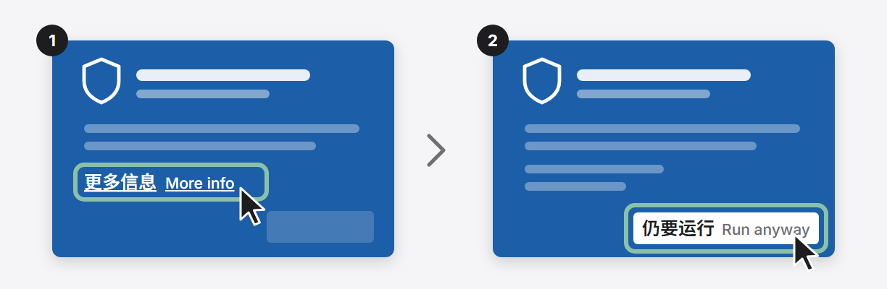
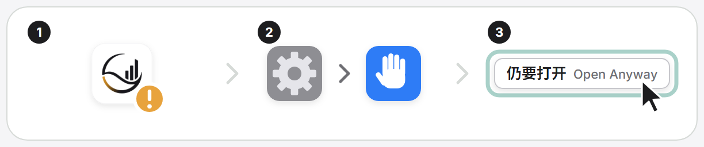

# 安装与运行 FULI

[English](install.md) · 简体中文 · [README](../README.zh-CN.md)

桌面客户端、终端安装、第一次使用的检查、全部 CLI 命令、本机端口和 npm 包。

## 第一次使用

安装 Fuli、接入客户端，并通过一次实际工具调用完成验证。完整要求见[安装](install.zh-CN.md#安装)；配置格式、Hook 与排错见
[客户端接入（英文）](client-connections.md)。

登录、Hook 信任与人工审核仍由人确认。**“设置 → 客户端接入”显示 `已接入`（`connected`）仅代表客户端配置文件中已有当前版本的 Fuli 条目，不代表客户端进程已加载该 MCP、Hook 已送达上下文或工具已成功调用。**

### 1. 安装

两种方式，任选其一：

- **下载客户端（推荐，Windows）**：到[最新版本](https://github.com/JevonsCode/fuli/releases)下载 `FULI-Setup-<版本>.exe`，双击安装，不需要终端。Node.js、Java 和图数据库都已内置，不用另装，也不需要管理员权限。第一次打开时，FULI 会找到这台电脑上的 AI 客户端，一键接入，也可以设置开机启动。已经装过 FULI 的，用它安装会直接更新，数据保留。安装包暂时没有代码签名，Windows 可能提示“已保护你的电脑”，点“更多信息 → 仍要运行”即可。

  
- **下载客户端（macOS，Apple 芯片）**：在同一个版本里下载 `fuli-macos-arm64-<版本>.dmg`，打开后照窗口里的箭头把 FULI.app 拖进「应用程序」；打开 FULI 时它会自己推出安装盘。需要 macOS 13.5 以上；Intel 芯片的 Mac 请用终端安装。安装包暂时没有签名，第一次打开被拦下时，到「系统设置 › 隐私与安全性」点「仍要打开」。详见 [docs/macos-app.md](macos-app.md)。

  
- **用终端安装**：适合开发者和 macOS / Linux。

在具备 Node.js 24.12+ 和 Docker Compose v2 的环境下（默认容器模式；macOS / Linux 原生模式见[安装](install.zh-CN.md#安装)），运行：

```bash
npm install --global fuli-context
fuli setup
fuli open
```

设置向导会先展示计划，再修改环境。

### 2. 接入客户端

- **已检测到 Codex、Claude Code、Cursor 或 Claude 桌面版：** `fuli setup` 会写入 MCP 配置及支持的
  Hook / Skills。只在启动时读取配置的应用须退出重开，重连后新建任务；Codex Hook 信任须在 Codex 的 `/hooks` 中人工审阅。
- **其他 MCP 客户端：** 运行 `fuli connect`（或打开控制台 **设置 → 客户端接入**），将 `fuli` 条目合并到客户端 MCP 配置并保留其他服务器，再按该客户端要求重载或信任连接。`fuli connect` 只打印 JSON。

### 3. 首次实际工具调用与验证

1. 运行 `fuli status`，确认管理界面与个人图谱就绪（默认 `http://127.0.0.1:2727`）。
2. 在客户端中确认 Fuli 工具已出现，并在项目目录里**发起一次实际工具调用**（例如让 Agent 读取当前项目协作偏好或协调一个小任务），检查它是否找对项目（或登记项目并安排负责 Agent），且在缺少信息时如实询问而非编造。
3. 可选的跨工具接续：把这位 Agent 的接续指令带到连接同一份数据的另一客户端，验证它能否恢复同一位 Agent、项目和上次工作。支持范围见[Agent 对话与协作说明](agent-conversations-and-collaboration.md)。

临时任务也能交给 Agent：本次源码支持在没有匹配到已登记项目时建立隔离的**临时项目**；单纯读取偏好不会创建项目，多个候选项目仍需明确选择。Fuli 会保留其任务历史，并遵循既有的 Agent 招募与执行器权限。Agent 目录提供首次任务入口，任务详情只有在收到真实执行报告后才展示完成汇总——仅分配了 Agent 或普通本机对话都不等于工作进程证据。

### 4. 排错与恢复

若安装、客户端检测或工具调用失败，见[常见失败与恢复（英文）](client-connections.md#common-failure-recovery)。
`fuli setup --yes --connected-only` 仅用于刷新仍保留 Fuli MCP 条目的客户端（“设置”页显示**已接入** / `connected` 或**配置有变化** / `changed`）；显示**只剩技能文件**（`skills_left`）、**已移除**（`removed`）、**未接入**（`not_connected`）或新安装的客户端（无 Fuli MCP 条目）须运行完整的 `fuli setup`。

[工作原理](how-it-works.zh-CN.md#项目理念) · [安装](install.zh-CN.md#安装) · [Agent 角色与团队](employee-agents.md) ·
[跨客户端验收](../acceptance/cross-client-handoff.md) · [参与贡献](../CONTRIBUTING.md) ·
[反馈问题](https://github.com/JevonsCode/fuli/issues/new/choose)

## 安装

准备：

- Node.js 24.12 或更高版本；
- 默认容器模式需要 Docker Compose v2，Docker Desktop 或 Rancher Desktop 均可；
- macOS / Linux 可选择不使用虚拟机的原生模式；它需要 Java 21 和 `uv`（Python 3.12）；
- 内存紧张的 Mac 推荐
  `fuli setup --runtime-mode native --memory-profile low --adaptive-memory`。默认仍是兼容性更高的容器模式，不会自动强制切换。

全局安装并初始化：

```bash
npm install --global fuli-context
fuli setup
```

也可以一行安装，会先检查 Node.js 版本：

```bash
curl -fsSL https://xn--8ovp9s.xn--m8txu.com/fuli/install.sh | sh
```

Windows PowerShell：`irm https://xn--8ovp9s.xn--m8txu.com/fuli/install.ps1 | iex`。

`fuli setup` 会先展示操作计划并请求确认，然后检查容器运行时、初始化本机
Graphiti / Neo4j、创建个人空间、安装配套 Agent Skills，并为检测到的 Agent 注册 `fuli`
MCP。默认只连接个人 Provider，不会模拟团队共享服务。

初始化完成后：

```bash
fuli open
```

管理界面默认位于 `http://127.0.0.1:2727`。Windows 上 Hyper-V、WSL 和 winnat 会保留一些端口段，且每次开机可能不同
（`netsh interface ipv4 show excludedportrange protocol=tcp` 可查看）。首次设置会避开这些端口段；之后每次 `fuli start`、
`restart` 和 `setup` 都会再查一遍：Fuli 的端口如果被保留了，或者管理界面的端口被 Windows 拒绝、被别的程序占用，就自动换到最近的
可用端口，先备份 `runtime-settings.json` 再保存新端口，照常启动，并只提示一次（命令输出、桌面客户端和管理界面里）。如果那个端口上
是另一个正在运行的 Fuli，它不会换走，也不会再启动一个。Windows 托盘的「换一个端口」仍可按需改用默认端口附近的可用端口。
已打开的 Agent 会话要重开后，Fuli 链接才会指向新地址。

“设置”页集中管理 Fuli 使用的 7 个本机端口、图数据库运行方式、局域网访问、自动沉淀、
Agent 使用、界面语言和资源刷新频率。端口、运行方式或局域网设置保存后执行 `fuli restart`
生效；资源刷新频率立即生效。
同页按设定间隔采集管理服务、Provider、Neo4j、应用文件和本机数据的真实内存/磁盘占用；
内存每次重采，磁盘最多每分钟重采一次，并分别显示采样时间。
无法取得运行进程数据时会明确显示为不完整，不使用模拟值。原生模式会计入 Provider 和
Neo4j 进程；容器模式不把共享容器虚拟机开销计入 Fuli 合计。两种模式都不含浏览器标签页。

### 以前用 npm 装过？

桌面客户端和 npm 安装（`npm install --global fuli-context`）用的是同一个数据目录（macOS
`~/Library/Application Support/Fuli`，Windows `%LOCALAPPDATA%\Fuli`）。先装 npm 版、再装客户端，数据不会复制也不会丢，
只是电脑上有了两份程序。客户端会自己处理：

- 客户端启动 FULI 时，会成为这份数据唯一的 FULI 服务：npm 版正在运行的服务会被停掉，换成客户端自己的。
- FULI 连接过的每个 Agent 客户端（Claude Code、Codex、Cursor 等）都会改指向桌面客户端这一份，只做一次。已打开的 Agent 会话重开后生效。
- npm 版留不留由你定。管理界面会浮出一条提醒点名它，带「卸载」按钮：FULI 用当初装它的 npm 执行该前缀下的
  `npm uninstall --global fuli-context`（不运行包脚本），数据不受影响。npm 删不掉时（比如没有权限），提醒里会给出你自己要运行的命令。
  关掉提醒后不会再弹，「设置 › 客户端」里仍能找到它。Agent 只有拿到你的原话才会替你卸载。卸载之前，终端里直接敲 `fl` 或 `fuli`
  仍会运行那个 npm 版本。
- 从 0.25.0 起，npm 版不会替换客户端正在运行的服务。更老的 npm 版如果被手动启动（`fl start`）仍可能接管服务，客户端下次启动
  FULI 时会接回来。老版本遇到新版 FULI 升级过的数据，只读不写，不会改写它们。

## CLI

全局安装提供两个等价命令：`fuli` 和短别名 `fl`。
CLI 的帮助、交互提示、状态和错误信息固定使用英文，不跟随网页或系统语言；路径、空间名等
用户数据会按原值显示。

| 命令 | 用途 |
| --- | --- |
| `fuli --help` / `fuli -h` | 显示所有公开命令及其可用参数 |
| `fuli --version` / `fuli -v` | 显示当前安装的 Fuli CLI 版本 |
| `fuli setup [选项]` | 初始化 Provider、管理界面、Agent 接入和 Skills；可重复执行 |
| `fuli start [选项]` | 检查 Agent 接入后启动 Provider 和管理界面；可选择启动后打开浏览器、重建容器或启用 LAN 访问 |
| `fuli stop [--data-dir DIR]` | 停止服务并保留数据 |
| `fuli restart [选项]` | 使用与 `start` 相同的运行参数重启本机服务 |
| `fuli status [--json] [--data-dir DIR] [--port PORT]` | 查看管理界面、个人图谱和公共服务状态；`--json` 输出机器可读结果 |
| `fuli open [--data-dir DIR]` | 在默认浏览器中打开当前管理界面 |
| `fuli graph export --output DIR [--mode container\|native]` | 把当前图数据导出为可校验、可复制的离线备份包 |
| `fuli graph import --input DIR [--target-mode container\|native] [--yes]` | 校验备份并替换目标图数据；导入前自动保留回滚包 |
| `fuli graph migrate --to native [--yes]` | 把容器图谱迁移到原生模式；节点和关系数量完全一致才算成功 |
| `fuli update [setup 选项]` | 更新 npm 包并刷新本机接入 |
| `fuli uninstall [--yes] [--data-dir DIR]` | 清理 Agent 接入和服务，保留知识数据和 Neo4j 数据卷 |

常用示例：

```bash
fuli --version
fuli status
fuli restart --rebuild
fuli start --lan
fuli graph export --output "$HOME/Backups/fuli-graph"
fuli stop
```

连接已部署的 `fuli-workspace` 服务：

```bash
fuli connect-workspace \
  --url http://127.0.0.1:8789 \
  --token-file /path/to/private-token
fuli restart
```

连接命令会先验证服务发现、协议版本和令牌作用域，再以 `0600` 权限原子更新本机运行配置；
它不会在输出中显示令牌、令牌文件路径或远端 principal ID。非本机服务必须使用 HTTPS。
当前 `fuli-workspace-v1` 适配器开放发现、显式订阅和查询；发布、投稿、审核只会在相应协议映射
真正实现后才显示为可用。

`start` 和 `restart` 支持 `--data-dir DIR`、`--personal-space NAME`、`--port PORT`、
`--open`、`--rebuild`、`--lan` 和 `--no-lan`。未显式传入端口或局域网参数时会使用“设置”
页保存的值。其中 `--lan` 会让管理界面监听
私有 IPv4 局域网地址，并在终端输出可访问地址、用户名 `fuli` 和本次启动生成的临时访问
口令。默认启动仍只监听 `127.0.0.1`；内部 Provider、Neo4j Browser 和 Bolt 不会随
`--lan` 开放。局域网模式使用 HTTP Basic Auth，只适合可信家庭或办公 Wi-Fi，不等同于
HTTPS 公网部署。
`fuli start` 启动前会只读检查已检测到的 Agent 的 MCP、Skill、Codex bootstrap 和 Claude
生命周期接入。如果有缺失或过期，它仍会启动本机服务，但会提示执行 `fuli setup`；不会在
后台隐式修改接入配置。

`setup` 和 `update` 支持：

| 选项 | 用途 |
| --- | --- |
| `--yes` | 跳过确认，适合无人值守执行 |
| `--codex-only` | 只接入 Codex |
| `--data-dir DIR` | 使用指定的数据与配置目录 |
| `--personal-space NAME` | 设置个人空间名称；默认是 `Personal` |
| `--port PORT` | 设置管理界面端口；默认是 `2727` |
| `--runtime-mode container\|native` | 选择容器或原生进程；默认 `container`，原生模式当前支持 macOS / Linux |
| `--memory-profile low\|balanced` | 选择 Neo4j 内存档位；首次安装默认使用 `balanced` |
| `--adaptive-memory` | 启用按需唤醒和分阶段休眠；保存后由管理服务协调 |
| `--no-adaptive-memory` | 关闭按需休眠，让图服务保持运行 |
| `--skip-agents` | 不修改 Agent 配置或 Skills |
| `--connected-only` | 仅刷新已有 Fuli MCP 配置的客户端；update 自动使用此选项 |
| `--no-start` | 初始化 Provider，但不启动管理界面 |
| `--allow-provider-downgrade` | 接受更低版本的原生 Provider，例如从本机 `rc` 版换到公开的 `beta` 版；先备份数据目录 |
| `--personal-only` | 只使用个人 Provider；默认模式 |
| `--with-dev-public` | 同时启动开发用公共 Provider，仅用于开发或联调 |

`low` 档使用 128 MiB 初始堆、256 MiB 最大堆和 64 MiB 页缓存；`balanced` 档分别使用
256 MiB、512 MiB 和 256 MiB。低内存档不会设置容器硬内存上限，会在降低常驻内存的同时
为 Neo4j 原生内存留出余量。批量写入、大范围图遍历或高并发时，垃圾回收和磁盘读取可能
增多，但事务语义、存储格式和数据卷不变。如果这些负载变慢或因堆不足而失败，可执行
`fuli setup --memory-profile balanced --yes` 回退。选择的档位会被保存，后续 setup、update、
start 和 restart 会继续沿用。

自适应内存模式是独立于 Neo4j 内存档位的生命周期策略。启用后，管理服务保持轻量常驻：
实际 MCP 工具、MCP 资源或管理界面的图谱请求会先取得运行租约并按需唤醒服务；最后一个
租约释放后，个人 Provider 默认空闲 60 秒停止，Neo4j 默认空闲 180 秒停止。数据卷不会被
删除，下一次请求会自动恢复同一份数据。运行中的调用会持续续租，不会被空闲计时器中断；
客户端异常退出后，租约最多 180 秒自动过期，避免服务永久被占住。这些秒数是当前产品默认值，
不是硬件实测阈值。

这种模式把空闲内存换成首次请求的冷启动等待和更多磁盘读取。管理界面的健康、运行状态和资源
采样不会唤醒图服务；`fuli status` 会把主动休眠报告为正常状态。管理服务必须保持运行才能自动
唤醒，所以 `--no-start` 只会保存策略，不会在本次运行中提供按需唤醒。容器模式下，该策略只
停止 Fuli 的 Provider / Neo4j 容器，不会自行关闭 Rancher Desktop、Docker Desktop、
Kubernetes 或整台容器虚拟机；原生模式会直接停止对应 Provider 和 Neo4j 进程，因此空闲时
不再保留共享虚拟机开销。

当前可用的最小内存组合是：

```bash
fuli setup --yes --runtime-mode native --memory-profile low --adaptive-memory
```

两种模式使用彼此独立的数据目录，切换不会删除原模式的数据，也不会在后台自动合并两边的
新增内容。需要迁移时，先在来源模式仍处于启用状态时导出，再安装或切换目标模式并导入：

```bash
# Rancher / Docker -> 原生
fuli graph export --mode container --output "$HOME/Backups/fuli-container"
fuli setup --yes --runtime-mode native --memory-profile low --adaptive-memory
fuli graph import --target-mode native --input "$HOME/Backups/fuli-container" --yes
```

也可以用一条命令完成同样的步骤（需要带原生运行时的安装包；Windows 上是已安装的 Fuli 桌面版）：

```bash
fuli graph migrate --to native
```

它会停止正在运行的控制台，统计并导出容器图谱，切到原生模式后导入；只有每种标签和关系类型的数量都一致，
才接受迁移结果。任何一步失败都会切回容器模式。容器卷只会被读取，之后保持停止，不会被删除；
客户端接入不受影响。

反向迁移只需交换 `container` 和 `native`。导出会短暂停止来源数据库，完成后只恢复导出前
确实在运行的服务；导入会先校验清单和每个 dump 的 SHA-256，再停止目标数据库。替换前的
目标数据会自动保存在数据目录下的 `backups/graph`，导入失败时会立即尝试回滚。执行前应让
正在写图数据的 Agent 请求结束。

导入完成后会使用目标安装自己的 bootstrap token 重新签发本机 Provider 访问令牌，并原子
更新运行配置；明文访问令牌不会写入迁移包。同一台机器迁移时，非受管的外部 Workspace
连接配置会继续保留；换到另一台机器后，外部服务凭据需要单独重新连接。

备份是一个含 `manifest.json`、`personal.dump` 和可选 `workspace.dump` 的目录，可以复制到
其他磁盘或机器。容器模式通过 Docker API 复制文件，不要求 Rancher 共享备份所在目录。
dump 使用项目固定的 Neo4j 5.26 格式，适合在 Fuli 两种运行模式或兼容的 Neo4j 5.26 环境间
迁移；它不是面向任意数据库的 CSV / JSON 通用交换格式。

更新：

```bash
fuli update
```

更新会显示当前 CLI、Node、PATH 中的启动入口和 npm 安装目标。已是最新版时直接结束，
不会重复安装或重启服务。需要升级时先确认不会降级，再停止旧服务、安装最新版本，
仅刷新已有 Fuli MCP 配置的客户端。
既有知识、配置备份和 Neo4j 数据卷会保留。使用过自定义 setup 选项时，更新时应继续传入
相同选项。

已打开的客户端需要重新连接 Fuli MCP，或重启客户端后新建任务，才能加载新进程。
只需修复仍保留 Fuli MCP 条目的已有接入时，运行 `fuli setup --yes --connected-only`；仅剩 Skills（`skills-only`）、已移除（`removed`）或新接入的客户端（无 Fuli MCP 条目）须运行完整的 `fuli setup`。

卸载：

```bash
fuli uninstall
npm uninstall --global fuli-context
```

自动卸载不会永久删除个人图谱，避免误删。重新安装后可以继续使用原数据。

## 本机服务

| 服务 | 默认回环地址 | 启用条件 |
| --- | --- | --- |
| Fuli 管理界面 | `127.0.0.1:2727` | 始终启用 |
| 个人 Provider | `127.0.0.1:8787` | 始终启用 |
| 个人 Neo4j Browser / Bolt | `127.0.0.1:8060` / `127.0.0.1:7687` | 始终启用 |
| 开发公共 Provider | `127.0.0.1:8788` | 仅 `--with-dev-public` |
| 开发公共 Neo4j Browser / Bolt | `127.0.0.1:7475` / `127.0.0.1:7688` | 仅 `--with-dev-public` |

以上共 7 个端口均可在“设置”页修改。即使管理界面以 LAN 模式启动，Provider 和 Neo4j 仍只
绑定回环地址。

需要同一 Wi-Fi 下的其他设备访问时，执行 `fuli start --lan`。若当前已经以本机模式运行，
命令会安全重启管理界面并保持 Provider 与图谱数据不变。退出局域网模式可在设置页关闭后
执行 `fuli restart`，或直接执行 `fuli restart --no-lan`；再次进入局域网模式会更换临时访问
口令。

如果端口被占用、Docker Compose 不可用或容器引擎未启动，setup 会在修改 Agent 配置前停止
并报告原因。

## npm 包

| 包 | 状态 | 用途 |
| --- | --- | --- |
| [`fuli-context`](https://www.npmjs.com/package/fuli-context) | 已发布 | 个人版；个人知识、图数据库和管理界面都在本机运行 |
| Fuli Server npm 包 | 开发中 | 面向团队共享场景的独立服务端；目前尚未发布 |

目前唯一可用的 npm 包是个人版 `fuli-context`。团队共享层不会包含个人品味、个性或判断偏好。
