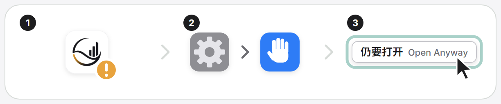

# macOS app (FULI.app in a .dmg)

FULI for people who do not use a terminal on a Mac: open the disk image, drag
FULI.app to Applications, open it. FULI.app is the desktop client
(`desktop/flutter`) with FULI and everything it runs inside it, so the Mac needs
no Node, Java, Python, uv or Homebrew.

Status: every release attaches `fuli-macos-arm64-<version>.dmg` and its SHA-256
(`.github/workflows/release.yml`, job `macos-dmg`), built and smoke-tested the
same way pull requests build it (`.github/workflows/desktop-client.yml`, artifact
`fuli-macos-dmg`). Apple silicon only, macOS 13.5 or later; Intel Macs use the
terminal install.

## Install

1. Open `fuli-macos-arm64-<version>.dmg`. Its window shows FULI.app, an arrow
   and Applications: drag FULI.app onto Applications, then open it from there.
   On that first open FULI ejects the installer disk image itself (only the
   mounted image under `/Volumes` that holds this FULI.app; the downloaded
   .dmg file stays where it is).
   Opened straight from the disk image (or from the read-only copy macOS
   translocates it to), FULI first shows the app icon, an arrow and the
   Applications folder with one button, 「移到「应用程序」 / Move to Applications」:
   it copies itself there (`~/Applications` when `/Applications` is not
   writable), opens the copy and quits, and the copy ejects the image. A FULI
   already there that is as new or newer is opened instead; an older one goes
   to the Trash. 「这次不移 / Not now」 goes on from the image
   (`desktop/flutter/lib/src/platform/desktop/macos_install_place.dart`).
2. Unsigned builds (every build until the Developer ID signature exists) are
   stopped by Gatekeeper the first time. The lower half of the disk image
   window shows the way as three pictures:

   

   Open FULI once, close the message, then go to System Settings > Privacy &
   Security, find "FULI was blocked to protect your Mac" and click **Open
   Anyway**, then confirm with your password. On macOS 14 and earlier,
   Control-click FULI.app > Open > Open works too. This is needed again after
   replacing FULI.app with a newer unsigned build.
3. The window shows FULI's state. 「启动 FULI」 sets FULI up the first time
   (native mode, personal graph only, no Agent client changes) and starts it;
   the console then opens in the window. Agent clients are connected from the
   console afterwards.

If a runtime part is still blocked after "Open Anyway" (a message naming
`node`, `java` or `python3.12`), that is the case this unsigned build could
not test in CI; report it. The terminal workaround is
`xattr -dr com.apple.quarantine /Applications/FULI.app`.

## Where things live

```
FULI.app/Contents/
  MacOS/FULI                       the desktop client (arm64)
  Resources/fuli/                  the FULI package (npm pack of this checkout)
    native-bundle.json             src/native-runtime/macos-assets.js
    src/ node_modules/ dist/web/   FULI, its production dependencies, the console
    runtime/node/bin/node          Node.js 24 (only the executable)
    runtime/jre21/                 jlink image of Temurin Java 21
    runtime/neo4j-community-<v>-unix.tar.gz   the pinned Neo4j archive
    runtime/python/                relocatable CPython 3.12 with the Provider installed
    app-inventory.json             pinned downloads, versions, Python packages
```

The app is read-only at run time. Data stays in FULI's usual macOS data
directory, `~/Library/Application Support/Fuli` (`FULI_DATA_DIR` still
overrides it): the same directory an npm installation uses, so nothing is
moved. On first setup Neo4j is unpacked from the bundled archive into
`native-runtime/` there, exactly as an npm installation unpacks its download,
so the Neo4j version policy and `fuli graph runtime` keep working. Java and
the Provider run from inside the app; `native-runtime/manifest.json` records
their paths and is rewritten when the app moves.

The client finds the bundled FULI next to its executable
(`desktop/flutter/lib/src/runtime/macos_app_runtime.dart`) and runs
`runtime/node/bin/node src/desktop/macos-controller.js status|start|stop`,
which share their logic with the Windows tray (`src/desktop/desktop-controller.js`).
A client built without the bundle keeps using the `fuli` CLI from the login shell.

With the window quit, open Agent sessions keep FULI running: their FULI MCP process
starts the app's own FULI (`Resources/fuli/src/cli.js start --automatic`) when it
is not running, and again within about 15 seconds after it exits, unless the person
stopped it, 3 automatic starts in 10 minutes did not keep it up, or a data format
step waits for the person (docs/client-connections.md, "FULI starts with your sessions").

An npm installation and the app share the data directory; use one of them at a
time. Existing data set up in container (Docker) mode is not switched: start
refuses and names the migration command, as on Windows.

## Update and removal

- Update: 设置 › 版本 「更新到 vX」, the same one click as on Windows
  (`src/desktop/macos-app-update.js`, run by the console's update worker). It
  downloads `fuli-macos-<arch>-<version>.dmg` and checks its published SHA-256,
  copies the new FULI.app next to the installed one without the quarantine flag,
  closes the window, stops FULI, swaps the two bundles, starts FULI from the new
  one, refreshes the Agent clients that were already connected
  (`setup --connected-only`) and opens the window again. A new version that does not start is swapped
  back and the previous one started. FULI must run from a folder it may write
  (Applications, not the disk image); macOS may ask to allow FULI under Privacy &
  Security › App Management. The data directory is never touched. Dragging a
  newer FULI.app over the old one still works too. `fuli update` refuses in the app.
- Removal: stop FULI, move FULI.app to the Trash. The data directory stays;
  delete `~/Library/Application Support/Fuli` yourself only if you mean to.

## Building

On an Apple silicon Mac with Node 24, Flutter and a Temurin JDK 21 (with `jmods`):

```sh
npm ci
(cd desktop/flutter && flutter pub get && flutter build macos --release)
node scripts/build-macos-app.js --client "$PWD/desktop/flutter/build/macos/Build/Products/Release/FULI.app" \
  --output /tmp/fuli-macos --jdk "$JAVA_HOME" --cache-dir /tmp/fuli-macos-cache
python3 -m venv /tmp/dmgbuild && /tmp/dmgbuild/bin/pip install dmgbuild==1.6.7
node scripts/package-macos-dmg.js --app /tmp/fuli-macos/FULI.app --output /tmp/fuli-macos-release \
  --dmgbuild /tmp/dmgbuild/bin/dmgbuild
node scripts/macos-app-smoke.js /tmp/fuli-macos-release/fuli-macos-arm64-<version>.dmg
```

The disk image window (660 x 492 points: a 660 x 460 background under Finder's
32-point title bar, its bottom 28 points left empty for the status bar; toolbar
and sidebar hidden, icons at 112 points) is written by [dmgbuild](https://github.com/dmgbuild/dmgbuild)
straight into the image's `.DS_Store`, without driving Finder, and FULI.app is
copied with `ditto`. Its background is `desktop/macos-dmg/background.png` with
`background@2x.png` for Retina (dmgbuild joins them into one TIFF): FULI.app at
170,150 with the arrow to Applications at 490,150, and the unsigned first open
below. The pictures are drawn by `node scripts/build-installer-art.js` from
`desktop/installer-art/`; the action checks that the image carries the layout.

`build-macos-app.js` downloads Node, CPython (python-build-standalone) and Neo4j
pinned by SHA-256, builds the Provider wheel with the bundled Python and installs
it with binary wheels only, thins the client to arm64, sets
`LSMinimumSystemVersion` to 13.5 (Node 24's minimum) and signs the app ad hoc.
The smoke test copies FULI.app out of the image and starts FULI with a
temporary HOME, ephemeral ports and a PATH without Node, Java, Python or uv.

Intel Macs are not built: the Provider's dependencies would need x86_64 wheels
and a second runtime, built on an Intel runner (`macos-15-intel`) as a separate
image.

## Signing (prepared, not active)

`scripts/sign-macos-app.js` signs every Mach-O file of the bundled runtime
inside out, then Flutter's frameworks, then the app. Without an identity it
signs ad hoc. With a Developer ID identity it adds the hardened runtime and a
secure timestamp, and gives each runtime executable only the entitlements its
file explains:

| File | Entitlements | Why |
| --- | --- | --- |
| `desktop/macos/node.entitlements` | allow-jit, allow-unsigned-executable-memory | V8's JIT and WebAssembly; no native addons, so no library-validation exception |
| `desktop/macos/java.entitlements` | allow-jit, allow-unsigned-executable-memory, disable-library-validation | HotSpot's JIT; Neo4j's dependencies load JNI libraries they unpack from jars at run time |
| `desktop/macos/python.entitlements` | allow-unsigned-executable-memory | libffi closures (ctypes/cffi) |
| `desktop/flutter/macos/Runner/Release.entitlements` | (no sandbox) | the client starts FULI's own processes |

`.github/actions/macos-app` runs the signed path only when all five secrets
exist: `MACOS_CERT_P12` (base64 of the Developer ID Application .p12),
`MACOS_CERT_PASSWORD`, `APPLE_ID`, `APPLE_TEAM_ID`, `APPLE_APP_PASSWORD`. It then
imports the certificate into a temporary keychain, signs the app, signs the
image, submits it to the notary service, staples the ticket and checks it with
`spctl`. Without them the build is unsigned and the steps are skipped.

To check on the first signed build: that notarization accepts the bundled
Neo4j archive and the jars inside it, and whether Neo4j starts without
`disable-library-validation` (drop it if so). Signing also removes the "Open
Anyway" step for every later version: a notarized, stapled image passes
Gatekeeper offline, and the runtime executables inside it are signed with the
same Team ID.
