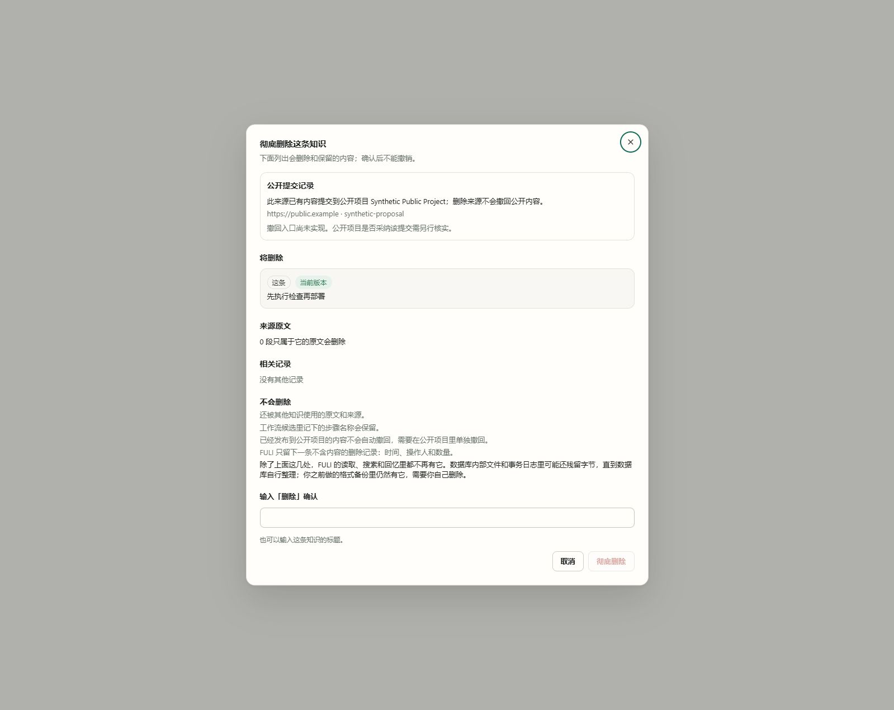

# rec#34 C9 public-submission preview

Captured from the actual `KnowledgeHardDeleteDialog.vue` at UI commit `e8205bb4`, in Chrome, 1599 × 1270 viewport pixels. All content, space/item IDs, project/proposal IDs and URLs are synthetic. The isolated Vite harness disabled API proxying and rejected every fetch except the mocked preview; it never connected to the real FULI console, graph or models. The harness process and browser tab were closed after capture.

The new public-submission section appears above the deletion list. It names the destination project and recorded proposal, says source deletion does not retract public content, and explicitly states that withdrawal is unavailable and remote acceptance remains unverified. A pending draft is not shown. The delete button remains disabled until typed confirmation.

This evidence covers C9-5's current knowledge-item preview only. Source-turn/session selection and restored-ledger recovery are still in development; this is not evidence that all Task B requirements are complete. The desktop layout is checked here; no mobile viewport acceptance is claimed.
