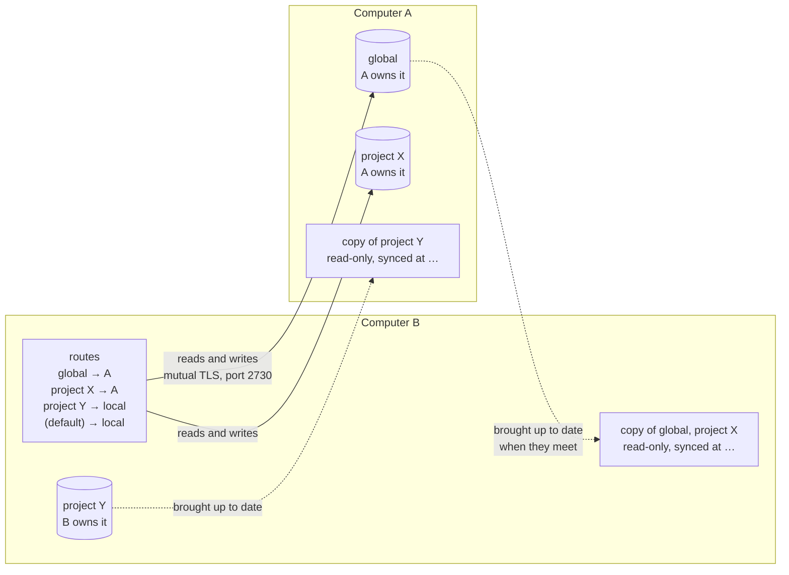
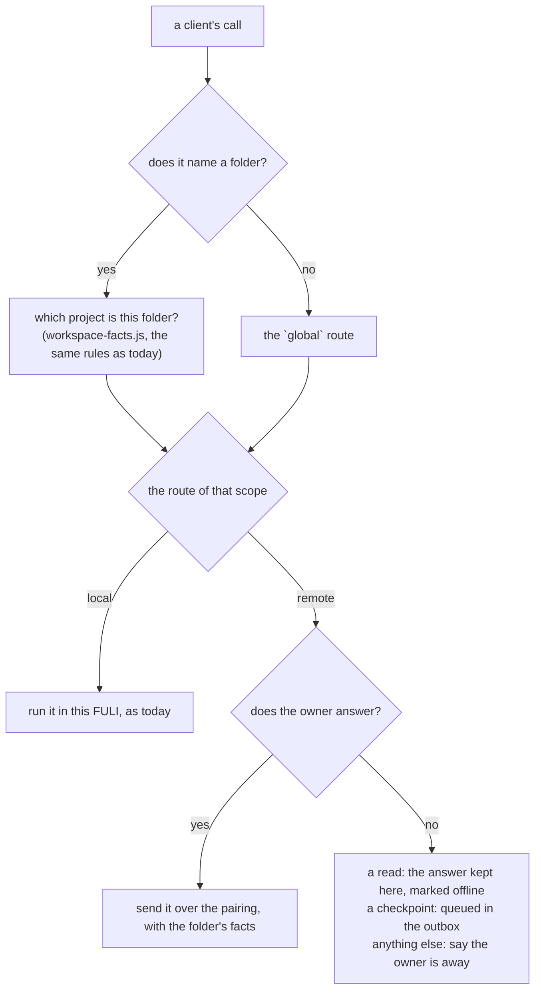

# Design: every FULI is a host, and follows another only where it says so

Status: **being implemented** in 0.29.0, step by step (see "Order of work"). Builds on runners
(`docs/runner.md`). The decisions **D1–D5** were Jevons's to make; the defaults below were agreed
on **2026-11-23** and are what the code does until he says otherwise. Each is a default in one
place, not a rule spread through the code, so changing one stays a small change.

| | Decision taken 2026-11-23 | Where it lives |
| --- | --- | --- |
| **D1** | `global` is one scope with one owner: the person's global habits, personal profile, FLA roster and their global memory, and Jefa's board move together. | the scope table (§3) |
| **D2** | A project a follower owns uses the `global` owner's global habits (the follower's cache while that computer is away), with the project's own preferences on top. | task entry (§4) |
| **D3** | Moving a scope to another computer is wanted in full, and comes after the steps below. Until then a follower may start a route only for a scope it does not already have. | §7 |
| **D4** | A project a follower owns is still led by the `global` owner's FLAs: an FLA's identity and global memory follow `global`, its memory of a project stays with that project's owner. Later step. | §8 |
| **D5** | This work ships on the 0.29.0 line. | `package.json` |

## 1. Why

Runners today (0.29.0-beta.9) make a whole computer either a host or a runner. The switch is a
file: a data directory with `runner/runner.sqlite` and no `graph-runtime.json` is a runner
(`src/runner/runner-mode.js`). Three things follow, and the first two happened on a real pair of
computers on 2026-11-18:

1. **Opening FULI.app on a runner ends it being one.** The desktop start runs `fuli setup` when
   `graph-runtime.json` is missing (`src/desktop/desktop-controller.js`), which writes that file;
   the runner's clients then use a new, empty local FULI.
2. **A runner has no console of its own.** Receipt links (`127.0.0.1:2727`) open nothing on it.
3. **A runner cannot own anything.** The person wants project Y to live on B and project X on A,
   and B to keep working as its own FULI for what it owns.

The person's words: B "can switch itself between host and runner, even be partly one and partly
the other", and "the runner should also be able to be its own host".

## 2. The idea in one paragraph

Every FULI is a complete FULI with its own data and console, always. A link to another FULI (the
existing runner pairing: mutual TLS on port 2730, pinned certificates, outbox) no longer changes
what the computer *is*; it adds **routes**: a short table saying which parts of the person's FULI
this computer reads and writes on the other one. Everything without a route is local. A computer
with no routes is today's host; one that routes everything is today's runner; anything between is
"partly host, partly runner".



Every arrow is one pairing. A solid arrow is the one writer reaching its scope; a dotted arrow is a
read-only copy being brought up to date (§3).

## 3. Scopes: what can be routed

| Scope | Holds | Notes |
| --- | --- | --- |
| `global` | the person's global preferences and habits, personal profile, FLA roster and their global memory, Jefa's board | one owner for the whole scope (**D1**) |
| `project:<id>` | a project's knowledge, project preferences, project memory of its FLAs, its tasks and checkpoints | routed one project at a time |
| default | whatever has no route | always `local` |

**Invariant: every scope has exactly one owner, the computer that writes it.** A follower never
writes a routed scope locally; it sends the call (or queues it in the outbox while the owner is
away). This is what keeps "partly host" from turning into two diverging copies.

**One writer, many read-only copies.** Jevons on 2026-11-23: 「在从机给 FLA 说的事情，主机会知道
吗，从机后续断连会知道吗」. So the invariant is about writing only: a scope another paired computer
has a route to may also be kept there as a **read-only copy**, brought up to date whenever the two
computers reach each other. A project a follower owns is copied, read-only, to the `global` owner,
so what was said to an FLA on the follower is readable on the host, and stays readable after the
follower goes off the network. A copy is never written to and never merged back; it carries the time
it was last brought up to date, and everything that shows it says so.

This is a later step (3–5). What it needs from the earlier steps, and what they already do:

- The routes table says, per scope, who owns it and whether this computer keeps a read-only copy
  of it, with when that copy was last brought up to date.
- Where data came from has three answers, not two: the owner (`host`), this computer's own
  (`local`), and this computer's read-only copy of another computer's scope (`replica`, with the
  time it was synced). The state band, `fuli status` and the `x-fuli-source` header a follower's
  console puts on every answer already carry that third value.

## 4. How a call is routed



The client's MCP entry stays exactly what `fuli setup` writes today. The local MCP server always
runs (no more runner mode by file); for each call it decides where the call goes:

1. **Resolve the folder locally** with the facts the runner already sends (`workspace-facts.js`):
   which project is this folder, by the same rules (remote key, worktree origin, folder name).
2. **Look up the route** of that project (`project:<id>`, else default). Calls with no folder
   (global tools, `list_agent_interfaces`, roundtable) use the `global` route.
3. **Local route:** run it in this FULI as today. **Remote route:** forward it over the existing
   runner connection, with the folder's facts, exactly as runners do now; offline rules and the
   outbox apply unchanged.
4. **Task tokens remember their owner.** A token says which FULI issued it (prefix or a signed
   field), so the checkpoint of a task goes to the FULI that entered it, whatever the routes
   became meanwhile.

Task entry for a local project still needs the person's global preferences. If `global` routes to
A, task entry on B reads them from A (cached for offline, as runner task entry is today) and merges
them with B's project preferences, global first, project overrides, exactly as one FULI merges them
now (**D2**).

## 5. The console on a follower

- FULI.app on B opens **B's own console** at B's own console port. It is B's page, not A's: it
  says who B follows, whether that computer answers, when it was last reached, what waits in the
  outbox, and which capability runs where.
- A's pages are reached over the paired channel: B serves `127.0.0.1:2727/remote/<host>/…`, which
  forwards to A's console over 2730 mutual TLS (`src/runner/console-relay.js` on A). A proxy path
  naming a computer B is not paired with reaches nothing.
- Receipt links A gives (`http://127.0.0.1:2727/…`) open on B too: a path B's own console does not
  own is A's page, carried over the same channel, with B's own state band on top of it.
- The desktop start never removes a link and never writes a route; `fuli setup` on a computer
  with links sets up its runtime and keeps the links.
- A host's console lists its followers and, per follower, which scopes it serves to it. (Step 4.)

## 6. Who may route what

- Routing is granted on the owner: when B asks to follow `project:X` or `global`, A's person
  allows it (once, in A's console or `fuli runner allow`). Today's invitation keeps granting
  "everything" so existing runners keep working.
- A follower can always take a route back (`fuli routes local project:X`); see moving below.

## 7. Moving a scope between computers (D3)

Changing who owns a scope moves its data, which is the hard part. In order of effort:

1. **Start a new route only for a scope the follower does not have yet**: B follows
   project X only if B has no local project X, otherwise it asks the person to pick one. This is
   what the steps below build.
2. **Hand over** (D3, a later step, wanted in full): the owner exports the scope (FLA directories
   already have a Markdown projection for hand-off; knowledge as the existing export), the new
   owner imports it under the same IDs, the old owner keeps a read-only copy and a forwarding
   route. Temporal history moves with it.
3. Two owners merging edits of one scope: **not planned**. One owner per scope is the rule.

Read-only copies (§3) are not moving: a copy never becomes the owner by itself, and a hand-over is
still the step above.

## 8. FLAs across two owners (D4)

An FLA is global (employee number in the personal space) but keeps per-project memory. With
`global` on A and project Y on B, Y's lead is one of A's FLAs, while Y's project memory is on B.
The FLA's identity and global memory stay with `global`'s owner; its memory of a project lives
with that project's owner. Task entry on B for Y reads the FLA's identity from A and its Y memory
locally. This is a later step; until then a follower owns no project, so nothing splits.

## 9. What changes in code (rough)

| Area | Change |
| --- | --- |
| `src/runner/runner-mode.js` | gone; replaced by a routes store (`runner/routes.sqlite`): per scope its owner, and whether this computer keeps a read-only copy and when it was last brought up to date |
| `src/cli/mcp-command.js` | always the local server; a router decides per call (runner modules loaded only when a route is remote) |
| `src/runner/runner-mcp.js` | becomes the remote half of the router |
| `src/graphiti/task-entry*` | global preferences from the `global` owner, merged with local project preferences |
| task tokens | carry their issuer |
| console | the follower's own console with a state band; `/remote/<host>/` proxy; followed projects listed with their owner; host lists what it serves |
| desktop app | start/setup keep links and routes |
| CLI | `fuli routes list \| follow <scope> <host> \| local <scope>`; `fuli runner join` keeps working as "follow everything" |

## 10. Migration from beta

A data directory in today's runner mode (pairing, no runtime) becomes: a FULI with routes
`global → host` and `default → host`. Nothing to do for the person; the first start after the update
sets up the local runtime in the background, and nothing is routed to it until the person makes a
scope local.

## 11. Order of work

1. **Follower console and safe desktop start** (fixes §1.1 and §1.2 for today's runners), with the
   follower's own state visible and its cache no longer expiring. — **done** (this version).
2. Routes store, router in the MCP entry, tokens with issuer; `default → host` reproduces today. — **done**: `runner/routes.sqlite`, `fuli routes`, per-call routing in the follower's MCP server and task owners. `fuli routes local` is refused until step 3 for every scope, and `global` is never local on a follower (D1, D2).
3. Local projects on a follower (`project:Y → local`), global from the host (D1, D2).
4. Owner-side grants; console listing.
5. Moving a scope (D3), FLA split (D4).

**No relay, by decision.** Jevons on 2026-11-23: 「就同一个局域网就可以，我们不做不在一个局域网的
情况，而且这种公司和家里一般都有公司自己的内网 VPN 之类的」. The two computers reach each other
directly — one LAN, or an address a company VPN or a mesh tool gives them — or not at all. FULI
runs no relay of its own and none is planned. Where they are on one network but in different
subnets, mDNS does not carry, so the person tells the follower the address once: `fuli runner
add-address`, or 「添加主机地址」 on the follower's own console page, which is the next step offered
whenever the host does not answer.

## 12. Scopes in the graph

Read-only copies (§3) and moving a scope (§7) share one building block: export every record of a
scope as one envelope, and import it on another computer under the same IDs. This section is the
export, the rules it rests on, and the import ("Import", below). Refusing ordinary writes to a copy
is not built yet, and nothing calls the export or the import today.

- **One classifier.** `graph-provider/fuli_graph/scope_classifier.py` says, as data, which scope
  every node label and relationship type of a personal space belongs to and how that is decided.
  `graph-provider/tests/test_scope_classifier.py` collects every label and type the Provider's
  Cypher names (node patterns `(x:Label …)` and relationship patterns `[x:TYPE …]` in its string
  literals), the field contract declares, or a graph format version declares, and fails when one
  has no row, or a row has nothing left to classify.
- **One export.** `POST /v1/scopes/export` on the Provider (`scope_export.py`), called with the
  Provider's ordinary access token by this computer's own process
  (`GraphitiProviderClient.exportScope`). It is read only and gives a whole scope at once, so it is
  not an Agent tool and is not in the interface catalog.

### Classes

Every label is one of: **global** (the person's habits, profile and global facts, the FLA roster,
FLAs' global memory), **project** (`project:<id>`: the project, its knowledge and habits, the FLAs'
habits, memory, assignments and tasks in it, task contexts, conversations), **local_only** (this
computer's own: client sessions, executors and their learning, one-use tokens and keys, access
principals, the format ledger and undo journals, shared spaces and retired records), **derived**
(recomputed from other records: executor outcome aggregates), or judged per record from its
properties, its parent or the knowledge item it is about. local_only and derived records are never
exported; local_only ones are counted (`localOnlyCount`). Vectors are derived properties (below).

**Knowledge items** (`Entity` nodes and `RELATES_TO` facts). A preference (`fuli_profile_aspect`
set) belongs where its scope fields say: `global`; `project` in `fuli_preference_project_id` and
every one of `fuli_preference_project_ids`, plus, with `fuli_inheritance_mode: selected_projects`,
every one of `fuli_inherited_project_ids`; `agent` in its project. Any other item belongs to its
assignment's project, else every project its source episodes name, plus every project an active
project reference adds (`knowledge_project_scope.py`); with none of these it is the person's
(global). An entity also goes wherever a fact it is an end of goes, so a scope's facts never point
at an entity the scope lacks.

### Edge cases

- **Several projects.** A habit in several projects (shared or inherited) and knowledge with a
  primary project and referenced ones is in **every** one of those project scopes, under one ID;
  an importer upserts it by that ID. Each node and relationship lists all its scopes (`scopes`), so
  a later import can refuse a record that spans projects with different owners. A habit inherited
  by `descendants` is in its own project only: the child projects are a hierarchy question for the
  import step (parent and child under one owner).
- **Cross-scope relationships** (an FLA's project assignment and project memory, a task event's
  FLA, a fact's evidence): a relationship is in every scope both its ends share, and in the project
  scope of an end the other does not share. A relationship between a global and a project node is
  in the project scope only. The end outside the scope is listed in `externalRefs` (its ID and the
  scope it is in, `global` first), never its content. The global export carries no node of a
  project scope, but some global records carry project content, and the owner has accepted this
  (these copies only go to the same person's other computers): an episode (`Episodic`, with its
  `fuli_source_excerpt` and `fuli_summary`) that is also evidence for a global habit; a record
  whose project field names an ID the graph has no project node for (it stays with the person,
  below); and the handover Markdown of an FLA dismissal (`FuliProjectAgentDismissal`).
- **Cross-scope records.** A preference conflict between a global habit and a project habit is in
  the project scope, with the global habit in `externalRefs`. Records about one knowledge item
  (revisions, audits, assignments, references, tag links) follow the item; when the item is gone
  (hard delete) they stay with their own project field, else global.
- **Evidence.** An episode (`Episodic`) is in every scope of the items it mentions (`MENTIONS`,
  and the facts it lists in `entity_edges`) and in its own `fuli_personal_project_id`. One episode
  can be evidence for a global habit and a project fact; both scopes carry it, and the `MENTIONS`
  of the project fact stays out of the global export.
- **Sessions.** A client session (`FuliTaskContextSession`) is the state of the computer the call
  ran on: local_only. The task contexts under it belong to their projects and are exported; the
  `HAS_CONTEXT` link to the session is not (an end that is never exported drops the relationship).
  The same holds for executors, their permissions and observations.
- **Conversations** have no space or project field: their journal scope is a hash of (space,
  project, FLA) (`conversation_scope.py`). The export rebuilds the hash for every FLA and alias of
  the space with every project and with none; a journal no pair explains is local_only, never
  guessed.
- **The space** (`FuliSpace`) is needed by both scopes and belongs to neither: an envelope names
  it by `spaceId` and `groupId` only; relationships from it start at `FuliSpace:<spaceId>`.
- **A project the space no longer has.** A record whose every project is gone stays with the
  person (global), beside the project scope it still names.

### The table

Found by: how the export finds the label in one personal space: `group_id` is the space's, a named
property is the space's ID, a node of a found parent label reaches it by the named relationship,
or a conversation journal property names one of the space's journals. Key: the properties that
identify a record on any computer; its export ID is `<Label>:<key values joined by />`. A record
without its key (an early write) has no ID another computer shares: it is not exported, only
counted (`unidentifiedNodes`), with the relationships that end at it.

| Label | Scope | Found by | Key | Evidence |
| --- | --- | --- | --- | --- |
| `FuliSpace` | both: ID and `group_id` only | not read | `id` | store_identity.py |
| `Entity` | knowledge item (below) | `group_id` | `uuid` | collaboration_context.py, knowledge_management.py, knowledge_project_scope.py |
| `Episodic` | evidence (below) | `group_id` | `uuid` | store_knowledge.py |
| `FuliPersonalProject` | project of `project_id` | `FuliSpace` -[`CONTAINS_PROJECT`]-> | `id` | store_projects.py, temporary_project_scope.py |
| `FuliPersonalProjectRelationReview` | its project relation's | `FuliSpace` -[`HAS_PERSONAL_PROJECT_RELATION_REVIEW`]-> | `id` | personal_project_hierarchy.py |
| `FuliKnowledgeAssignment` | its item's, else `project_id` | `space_id` | `id` | knowledge_management.py |
| `FuliKnowledgeProjectReference` | its item's, else `project_id` | `space_id` | `id` | project_knowledge.py, knowledge_project_scope.py |
| `FuliKnowledgeRevision` | its item's, else global | `space_id` | `id` | knowledge_versions.py, store_knowledge.py |
| `FuliKnowledgeAudit` | its item's, else global | `space_id` | `id` | knowledge_audit.py, knowledge_hard_delete_operations.py |
| `FuliKnowledgeConflict` | project of `source_project_id`, `target_project_id`, else global | `space_id` | `id` | project_knowledge.py |
| `FuliKnowledgeReviewRun` | project of `personal_project_id`, else global | `personal_space_id` | `id` | knowledge_review.py |
| `FuliKnowledgeReviewDecision` | its parent's | `FuliKnowledgeReviewRun` -[`HAS_REVIEW_DECISION`]-> | `id` | knowledge_review.py |
| `FuliKnowledgeTag` | project of `namespace_project_id`, else global | `space_id` | `id` | store_knowledge_tags.py |
| `FuliKnowledgeTagRevision` | its parent's | `FuliKnowledgeTag` -[`HAS_TAG_REVISION`]-> | `id` | store_knowledge_tags.py |
| `FuliKnowledgeTagLink` | its item's, else global | `space_id` | `id` | store_knowledge_tags.py |
| `FuliPreferenceConflict` | its two items', project end wins | `personal_space_id` | `id` | preference_conflicts.py |
| `FuliCommonKnowledgePromotion` | project of `parent_project_id`, `source_project_ids`, else global | `space_id` | `id` | knowledge_hard_delete.py (retired 2026-11-11, still readable) |
| `FuliPersonalGlobalPreferenceDecision` | project of `target_project_id`, else global | `space_id` | `space_id`, `candidate_id` | personal_global_preferences.py |
| `FuliPersonalGlobalPreferenceDecisionEvent` | project of `target_project_id`, else global | `space_id` | `id` | personal_global_preferences.py |
| `FuliWorkflowCandidate` | project of `personal_project_id`, else global | `FuliSpace` -[`HAS_WORKFLOW_CANDIDATE`]-> | `id` | workflow_candidates.py |
| `FuliWorkflowAuthorization` | its parent's | `FuliWorkflowCandidate` -[`HAS_WORKFLOW_AUTHORIZATION`]-> | `id` | workflow_candidates.py |
| `FuliProjectAgent` | **global** | `FuliSpace` -[`HAS_PROJECT_AGENT_IDENTITY`]-> | `id` | store_project_agents.py |
| `FuliProjectAgentAlias` | **global** | `FuliSpace` -[`HAS_PROJECT_AGENT_IDENTITY`]-> | `id` | system_hr_identity.py |
| `FuliOccupation` | **global** | `FuliSpace` -[`HAS_OCCUPATION`]-> | `id` | store_occupation_catalog.py |
| `FuliProjectAgentDismissal` | **global** | `personal_space_id` | `id` | store_project_agent_dismissal.py |
| `FuliProjectAgentRecruitmentPolicy` | **global** | `personal_space_id` | `personal_space_id` | runtime.py |
| `FuliProjectAgentAssignment` | its parent's | `FuliPersonalProject` -[`HAS_PROJECT_AGENT_ASSIGNMENT`]-> | `id` | store_project_agents.py, project_agent_access.py |
| `FuliProjectAgentCoordinationPolicy` | its parent's | `FuliPersonalProject` -[`HAS_PROJECT_AGENT_COORDINATION_POLICY`]-> | `policy_id` | store_project_agent_coordination_policy.py, project_agent_team_growth.py |
| `FuliProjectAgentMemory` | project of `personal_project_id`, else global | `personal_space_id` | `id` | store_project_agent_memory.py |
| `FuliProjectAgentMemoryCheckpoint` | its parent's | `FuliProjectAgentMemory` -[`HAS_MEMORY_CHECKPOINT`]-> | `id` | store_project_agent_memory.py |
| `FuliProjectAgentRecruitment` | project of `personal_project_id`, else global | `personal_space_id` | `id` | store_project_agent_task_recruitment.py |
| `FuliProjectAgentTask` | project of `personal_project_id`, else global | `FuliSpace` -[`HAS_PROJECT_AGENT_TASK`]-> | `id` | store_project_agent_tasks.py |
| `FuliProjectAgentTaskEvent` | its parent's | `FuliProjectAgentTask` -[`HAS_TASK_EVENT`]-> | `id` | store_project_agent_tasks.py, store_project_agent_task_activity.py |
| `FuliProjectAgentRoutingDecision` | its parent's | `FuliProjectAgentTask` -[`ROUTED_BY`]-> | `id` | store_project_agent_tasks.py |
| `FuliAgentVerification` | its parent's | `FuliProjectAgentTask` -[`HAS_VERIFICATION`]-> | `id` | store_agent_verification.py |
| `FuliProjectAgentWorkerRun` | project of `personal_project_id`, else global | `personal_space_id` | `id` | store_project_agent_worker_runs.py |
| `FuliAgentAttention` | project of `personal_project_id`, else global | `personal_space_id` | `id` | store_project_agent_attention.py |
| `FuliAgentLoan` | project of `source_project`, `target_project`, else global | `space` | `id` | store_agent_loans.py |
| `FuliTaskContext` | project of `personal_project_id`, else global | `personal_space_id` | `id` | store_task_contexts.py |
| `FuliConversation` | its journal's project, else global; unknown journal: local_only | journal `scope` | `id` | store_agent_conversations.py, conversation_scope.py |
| `FuliConversationEvent` | its parent's | `FuliConversation` -[`HAS_EVENT`]-> | `id` | store_agent_conversations.py |
| `FuliConversationSession` | its journal's project, else global; unknown journal: local_only | journal `scope` | `id` | store_agent_conversations.py |
| `FuliConversationPolicy` | its journal's project, else global; unknown journal: local_only | journal `id` | `id` | store_agent_conversations.py |
| `FuliConversationTriage` | project of `personal_project_id`, `formed_project_id`, else global | `space_id` | `id` | store_conversation_triage.py |
| `FuliConversationTopicDecline` | **global** | `space_id` | `space_id`, `topic_key` | store_conversation_triage.py |
| `FuliSubscription` | **global** | `FuliSpace` -[`SUBSCRIBES_TO`]-> | `id` | store_publication.py |
| `FuliPublicationDraft` | **global** | `FuliSpace` -[`HAS_PUBLICATION_DRAFT`]-> | `id` | store_publication.py |
| `FuliPrincipal` | **local_only** | not read | `id` | store_identity.py (access tokens of this Provider) |
| `FuliTaskContextSession` | **local_only** | not read | `id` | store_task_contexts.py (a client session on this computer) |
| `FuliConversationBinding` | **local_only** | not read | `id` | store_agent_conversations.py (a host session's read position) |
| `FuliTranscriptCursor` | **local_only** | not read | `id` | store_transcript_recovery.py (a transcript file on this computer) |
| `FuliAgentDelegation` | **local_only** | not read | `token_hash` | project_agent_delegations.py (a one-use token) |
| `FuliRemoteOriginKey` | **local_only** | not read | `space_id` | project_agent_remote_origins.py (this computer's signing key) |
| `FuliRemoteAgentOrigin` | **local_only** | not read | `space_id`, `message_id` | project_agent_remote_origins.py (an expiring proof) |
| `FuliRemoteDelegationAttempt` | **local_only** | not read | `space_id`, `origin_node`, `origin_message_id`, `origin_attempt_id` | project_agent_delegations.py (a one-use attempt) |
| `FuliProjectAgentExecutor` | **local_only** | not read | `id` | store_project_agent_executors.py (programs on this computer) |
| `FuliProjectAgentExecutorRoutingRule` | **local_only** | not read | `id` | store_project_agent_executors.py |
| `FuliProjectAgentExecutorDecision` | **local_only** | not read | `id` | store_project_agent_executor_routing.py |
| `FuliProjectAgentExecutorObservation` | **local_only** | not read | `id` | store_project_agent_executors.py |
| `FuliProjectAgentExecutorOutcomeEvidence` | **local_only** | not read | `id` | store_project_agent_executor_learning.py |
| `FuliProjectAgentExecutorOutcomeReset` | **local_only** | not read | `id` | store_project_agent_executor_learning.py |
| `FuliProjectAgentExecutorOutcomeAggregate` | **derived** | not read | `id` | store_project_agent_executor_learning.py (recomputed from evidence) |
| `FuliDataFormat` | **local_only** | not read | `store` | graph_format_ledger.py |
| `FuliDataFormatEvent` | **local_only** | not read | `store`, `seq` | graph_format_ledger.py |
| `FuliDataFormatUndo` | **local_only** | not read | `apply_id`, `kind`, `ref` | graph_format_journal.py |
| `FuliLeadOccupationMigration` | **local_only** | not read | `migration_id` | migrate_lead_occupation.py (an undo journal) |
| `FuliLeadOccupationChange` | **local_only** | not read | `agent_id` | migrate_lead_occupation.py (an undo journal) |
| `FuliProposal` | **local_only** | not read | `id` | retired_graph_labels.py (shared spaces, retired) |
| `FuliProjectRelease` | **local_only** | not read | `id` | graph_format_backfills.py (shared spaces) |
| `FuliPersonalGlobalPreferenceDecisionPreview` | **local_only** | not read | `id` | retired_graph_labels.py (retired one-use token) |
| `FuliWorkflowReviewPreview` | **local_only** | not read | `id` | retired_graph_labels.py (retired one-use token) |
| `FuliWorkflowReviewEvent` | **local_only** | not read | `id` | retired_graph_labels.py (retired) |
| `FuliWorkflowRule` | **local_only** | not read | `id` | retired_graph_labels.py (retired) |

Relationships: `RELATES_TO` is a knowledge item (above). `OWNS` and `MEMBER_OF` tie access
principals to spaces: local_only. Every other type is judged by its ends (cross-scope rule above):
`MENTIONS`, `CONTAINS_PROJECT`, `PERSONAL_PROJECT_RELATION`, `FULI_PROJECT_RELATION`,
`PROJECT_MEMORY_ACCESS`, `HAS_PERSONAL_PROJECT_RELATION_REVIEW`, `HAS_KNOWLEDGE_ASSIGNMENT`,
`ASSIGNED_TO`, `HAS_KNOWLEDGE_REFERENCE`, `REFERENCES_IN`, `HAS_KNOWLEDGE_REVISION`,
`HAS_KNOWLEDGE_AUDIT`, `HAS_KNOWLEDGE_CONFLICT`, `HAS_KNOWLEDGE_REVIEW`, `HAS_REVIEW_DECISION`,
`HAS_KNOWLEDGE_TAG`, `HAS_TAG_REVISION`, `TAGS`, `HAS_PREFERENCE_CONFLICT`,
`HAS_WORKFLOW_CANDIDATE`, `HAS_WORKFLOW_AUTHORIZATION`, `FROM_WORKFLOW_STEP`, `TO_WORKFLOW_STEP`,
`HAS_PROJECT_AGENT_IDENTITY`, `HAS_PROJECT_AGENT`, `MERGED_INTO`, `HAS_OCCUPATION`,
`HAS_DISMISSAL`, `HAS_PROJECT_AGENT_RECRUITMENT_POLICY`, `HAS_PROJECT_AGENT_ASSIGNMENT`,
`ASSIGNED_AGENT`, `HAS_PROJECT_AGENT_COORDINATION_POLICY`, `HAS_WORKING_MEMORY`,
`HAS_AGENT_WORKING_MEMORY`, `HAS_MEMORY_CHECKPOINT`, `HAS_PROJECT_AGENT_RECRUITMENT`,
`TRIGGERED_RECRUITMENT`, `CREATED_AGENT`, `RECRUITED_BY`, `HAS_PROJECT_AGENT_TASK`,
`HAS_TASK_EVENT`, `EVENT_AGENT`, `HAS_PARTICIPANT`, `COORDINATES_TASK`, `COORDINATED_BY`,
`ROUTED_BY`, `HAS_VERIFICATION`, `HAS_WORKER_RUN`, `FOR_WORKER_RUN`, `AUTHORIZES_WORKER_RUN`,
`RETRIES_WORKER_RUN`, `WORKER_AGENT`, `HAS_AGENT_ATTENTION`, `HAS_EVENT`, `SUBSCRIBES_TO`,
`HAS_PUBLICATION_DRAFT`; and, always reaching a record that is never exported, `BOUND_WORKER_RUN`,
`HAS_TASK_CONTEXT_SESSION`, `HAS_CONTEXT`, `HAS_RELEASE`, `HAS_EXECUTOR_PERMISSION`,
`HAS_EXECUTOR_OBSERVATION`, `HAS_EXECUTOR_OUTCOME_EVIDENCE`, `HAS_FORMAT_EVENT`,
`CHANGED_OCCUPATION`, `OF_AGENT`. A relationship's ID is `<TYPE>:<key>` for the types that carry
their own key (`RELATES_TO` and `MENTIONS` by `uuid`; `PERSONAL_PROJECT_RELATION`,
`PROJECT_MEMORY_ACCESS`, `FULI_PROJECT_RELATION` by `id`), else `<TYPE>:<start ID>-><end ID>`.
Several relationships with one such ID get `#0`, `#1`, … in the order of their properties; the
suffix changes when those properties change, so an importer must not treat it as an identity.

### The envelope

```text
{ replicaProtocol: 1, graphFormat: <GRAPH_FORMAT_VERSION>, embeddingModel: "fuli-embed-v1/<dim>" | null,
  vectors: true | false, spaceId, groupId, scope: "global" | "project:<id>",
  nodes: [{ id, labels, scopes, properties }],
  relationships: [{ id, type, start, end, scopes, properties }],
  ids: { nodes: [...], relationships: [...] },       // the scope's complete ID sets
  externalRefs: [{ id, scope }],                    // ends outside the scope, by ID only
  unclassifiedLabels: { <label>: <count> },         // the space's nodes in no rule: not exported
  unclassifiedRelationshipTypes: [...],             // in the data, in no rule: not exported
  unidentifiedNodes: { <label>: <count> },          // the scope's nodes without their key: not exported
  unidentifiedRelationships: { <type>: <count> },   // the scope's relationships ending at one of them
  complete: true | false,                           // all four above are empty
  localOnlyCount: { <label>: <count> },             // this computer's own records: not exported
  exportedAt, digest }
```

- **Nothing is left out silently.** When `unclassifiedLabels`, `unclassifiedRelationshipTypes` or
  `unidentifiedNodes` is not empty (`unidentifiedRelationships` is never non-empty alone),
  `complete` is false and the envelope **must not be used for an import or a copy**. The counts
  carry no content and no Neo4j element ID (element IDs differ per computer). Unclassified labels
  and types are counted for the whole space, since their scope cannot be told: the relationships
  of every read node in both directions are scanned, and, for a node with no relationship, each
  label in use (`CALL db.labels()`) that no rule reads is scanned by label for the space's
  ownership properties (`group_id`, `space_id`, `personal_space_id`, `space`, a journal `scope`).
  With every label classified, that is one label scan per local_only label present. A node of an
  unknown label with neither a relationship nor an ownership property cannot be found per space.
- **localOnlyCount** counts, per label, the space's local_only records the export met (by
  relationship or ownership property) and the conversations it judged local_only (a journal of a
  project that has no node, and what hangs under it). It is the same in every scope's envelope and
  is not covered by the digest.

- **History moves with the records.** Earlier versions (`fuli_replaced_by_item_id`), revisions,
  memory checkpoints, `fuli_human_change_version` and the rest are records and properties of the
  scope and are exported as they are, none merged or dropped.
- **Properties** are exported whole. A graph time keeps its type: `{"$datetime": "<ISO with
  nanoseconds and offset>"}`, `{"$date": …}`, `{"$time": …}`, `{"$duration": …}`; lists keep their
  order. A datetime in a named time zone adds the zone after its offset, as Neo4j writes it
  (`2026-03-29T01:30:00.000000000+01:00[Europe/Berlin]`), and an import restores the zone. The one
  exception is `UTC`: the driver reads a UTC offset and the zone `UTC` alike, so both are exported
  as the offset; exporting the same value twice still gives the same text, so digests are
  unaffected.
- **Vectors.** `name_embedding` and `fact_embedding` come from the Provider's own embedder, which
  `embeddingModel` names; `fuli_semantic_vector` names its model in `fuli_semantic_model` on the
  item. An importer uses a vector only when its model matches its own, else drops it and computes it
  again. `vectors: false` leaves all three out, with `fuli_semantic_model` and `fuli_semantic_hash`
  (an item must not look indexed without its vector), and sets `embeddingModel` to null.
- **Only the owner exports a scope.** A computer that holds any record of the scope as a read-only
  copy of it refuses the export with 409 `scope_not_owned_here`, naming the owner (`owner`, its
  certificate fingerprint): an envelope a follower passed on would read exactly like the owner's,
  and a third computer would take the follower for the owner. A copy of another scope is left out
  of this computer's own scopes (an episode copied for a project that is also evidence for this
  computer's global habit stays out of its global export) and is reached from them only as an
  `externalRefs` entry; an envelope never carries the copy marker. Two records under one ID (a key
  without a uniqueness constraint) are both unidentified.
- **Deterministic.** Nodes and relationships are sorted by ID, properties by key. `digest` is the
  SHA-256 of the canonical JSON (sorted keys, no spaces, UTF-8) of everything but `exportedAt`,
  `localOnlyCount` and `digest`. Unchanged data gives the same bytes but for `exportedAt`; a change in one scope changes
  only that scope's digest. A sync skips a copy whose digest has not changed.
- **Read only, not a snapshot.** One transaction in Neo4j's read access mode (Neo4j refuses a
  write in it); one streamed query per label, parents and relationship starts asked for 1000 at a
  time. The transaction is read committed: its few dozen queries can see what another transaction
  commits between them. A copy accepts that (the next sync corrects it); moving a scope must first
  freeze writes at the source (one writer per scope), export twice and hand over only when the two
  digests match. An export reads the whole personal space to decide scopes, so its time follows
  the space's size; vectors are left in Neo4j by that read and read again only for the scope's own
  records when the export carries them.

### Not in the graph, so not in this export

These stores are outside the graph and need their own step (a later PR): Jefa's board
(`employees/data/jefa/board.sqlite`, kept per project: `(space_id, project_id)`), the roundtable
(`agent-roundtable.sqlite`), the project change log, judgment, model usage, delegation, role work
and the other stores `src/data-format/local-stores.js` lists, and the runner's own stores.

### What an import must do

The export is the first half. The import PR must:

1. **Check the envelope first and refuse it** unless `complete` is true (no unclassified label or
   type, no unidentified node), `digest` matches the content, `replicaProtocol` and `graphFormat`
   are its own (else upgrade the format first), and drop vectors and compute them again when
   `embeddingModel` differs.
2. **Match identity**: refuse unless `graphiti_group_id(<own provider_id>, 'personal', spaceId)`
   equals `groupId`. Same-ID import needs one personal space ID on all of a person's computers (a
   follower adopts the host's `spaceId`; moving its own earlier data is a separate step).
3. **Upsert only, never delete-then-insert**: local edges hang on copied nodes (`ASSIGNED_AGENT`,
   `HAS_WORKING_MEMORY`). Records deleted at the source are found by comparing `ids` and marked,
   not deleted.
4. **Restore typed values** (`$datetime`, `$date`, `$time`, `$duration`, `$float`) to graph types
   and write through the field contract.
5. **Records in several scopes**: refuse or hold a record whose `scopes` names a project of
   another owner.
6. **Parent and child projects under one owner**, enforced at import and routing:
   `PERSONAL_PROJECT_RELATION` is in both exports with the other end in `externalRefs`; a habit
   inherited by `descendants` is in the parent's export only, so a child moved or copied alone
   lacks it. Refuse when related projects have different owners.
7. **`externalRefs` are references only**: the node exists locally or the reference is recorded
   as dangling; never create an empty node for it.
8. **Task contexts**: today's readers reach them through `FuliTaskContextSession -[:HAS_CONTEXT]->`
   (`store_task_contexts.py`), and sessions are not exported. Either attach imported contexts to
   a local import session or read read-only history by `personal_space_id`. An imported context's
   `token` is finished history: never resumed on another computer.
9. **`FuliConversationSession.working_directory`** is a path on the other computer: display only,
   never used to tell a project by path; mark which computer the record came from.
10. **Not a snapshot**: a copy accepts read-committed exports; moving a scope freezes source
    writes and hands over only when two exports give the same digest.
11. **Moving loses this computer's records**: executors, executor decisions and observations, and
    the lead-occupation undo journal stay behind; tasks keep only their `actual_*` fields. Say so
    in the move's notes.
12. **The global copy carries some project content** (accepted, see "Cross-scope relationships"):
    evidence episodes of global habits, records of project IDs without a project node, dismissal
    handovers.
13. **Stores outside the graph** (above) need their own step.

### Import

`POST /v1/scopes/import?owner=<fingerprint>` (`scope_import.py`; `GraphitiProviderClient.importScope`)
brings one envelope into this graph as a read-only copy of a scope another computer owns. The
request body is the envelope; `owner` is the certificate fingerprint the pairing pinned for the
owner computer. Like the export it uses the Provider's ordinary access token, is called by this
computer's own process only, and is not an Agent tool. It is the only path that writes a copy.

**The envelope is handed on as its raw bytes.** No step between the owner's export and this
import parses it and serializes it again: `exportScope` returns the response text exactly as the
Provider wrote it (with a read-only summary: `scope`, `digest`, `complete`, `graphFormat`, `bytes`),
and `importScope` sends that text as the request body byte for byte. Serializing again would change
the numbers (Python writes `0.0`, `1.0`, `1e-05`; JavaScript writes `0`, `1`, `0.00001`), so every
envelope with vectors would fail its digest, and without the digest a `float[]` would be written as
integers.

**Refused whole, nothing written.** In this order:

| Code | HTTP | When |
| --- | --- | --- |
| `replica_protocol_unknown` | 422 | `replicaProtocol` is not this FULI's |
| `replica_digest_mismatch` | 422 | the digest does not match the content |
| `replica_envelope_incomplete` | 422 | `complete` is false; `leftOut` names the non-empty counts |
| `replica_format_mismatch` | 409 | `graphFormat` is not this graph's: a copy is never upgraded here, both FULIs move to one version |
| `replica_envelope_invalid` | 422 | not an export: the body is not a JSON object, a label this FULI does not copy, a node ID named twice, a property map that is no typed value, or a record that carries a copy marker field (`record`, `properties`): only the importer writes the marker |
| `replica_field_contract` | 422 | a declared property of the wrong type (`graph_field_contract.py`) |
| `replica_space_mismatch` | 409 | this computer has no personal space with the envelope's `spaceId`, or `graphiti_group_id(<own provider_id>, 'personal', spaceId)` is not its `groupId` |
| `replica_owner_changed` | 409 | this computer keeps the scope as a copy of another owner (`owner`): a copy is never handed to another owner by an import; an explicit handover is a later step |
| `replica_scope_owned_here` | 409 | one of this computer's own records has an ID the envelope names, or belongs to the scope alone (its project node, a global habit or FLA it wrote); `count` and the first `records` |
| `replica_related_project_owner` | 409 | a `PERSONAL_PROJECT_RELATION` reaches a project another computer (or this one) writes; checked before the next row, since such a relation is in both projects |
| `replica_cross_owner_record` | 409 | a record is also in a project this computer writes, or another owner's copy of it is in another scope |
| `replica_record_conflict` | 409 | a node of a key the envelope names exists outside this personal space |

A record in global and in this project is not refused for that: per D4 the global owner and a
project's owner may differ. A project the importer has never seen has no known owner and is not
refused; its record is checked again whenever that project's copy arrives.

**The copy marker** (graph/25, automatic: it only extends the field contract) is on every node and
relationship an import writes: `fuli_replica_scopes` (each scope it was copied for: one habit copied
with two projects names both), `fuli_replica_owner`, `fuli_replica_synced_at` (when an import last
wrote this record; a copy's last sync as a whole is what the import returns, kept by the routes
store), and `fuli_replica_owner_deleted_at`. Only the importer writes these four fields: an
envelope that carries one is refused, never copied into them. No index is added: the import reads the whole space for
its checks anyway, so the copy's records of a scope come from that read.

**Upsert, never delete-then-insert.** Nodes are matched by their export ID (the label's key) and
replaced whole with the owner's properties plus the marker, so edges this computer hung on them
stay. Relationships: a type with its own key (`RELATES_TO`, `MENTIONS`, `PERSONAL_PROJECT_RELATION`,
`PROJECT_MEMORY_ACCESS`, `FULI_PROJECT_RELATION`) by that key, whose ends may move; any other type
by **the group** of that type between the same two nodes: the owner's group replaces the copy's
group when they differ, and the `#n` suffix is never read. This computer's own relationships in such
a group are not touched. A record already as the owner has it is not written (`unchanged`), so
importing the same envelope twice changes nothing.

**Typed values** (`$datetime`, `$date`, `$time`, `$duration`, `$float`) are restored to graph types.
Every record is checked against the field contract; a property the contract does not declare (an
older FULI's) is carried as it is and counted in `undeclaredProperties`, as `carried_fields` copies a
stored record.

**Vectors.** When `vectors` is false or `embeddingModel` is not this Provider's, `name_embedding` and
`fact_embedding` are computed here from the same text by this Provider's own embedder, as its write
path does. `fuli_semantic_*` names its model on the item and is kept; the meaning index
(`knowledge_semantic_index.py`) already recomputes an item whose model or text hash is not this
computer's, and an envelope without vectors leaves the one this computer computed in place.
Full-text and range indexes are Neo4j's own and follow the records.

**`externalRefs`** are looked up, never created: a relationship whose end this computer does not
have is not written and is counted in `dangling` (with the first 50 IDs). It is written by the next
import of this scope after the other scope's copy has arrived; nothing else retries it.

**What the owner no longer has**, after every upsert: a copy of this scope whose ID is not in the
envelope loses this scope; one still copied for another scope stays. Otherwise a node that one of
this computer's own relationships still reaches stays, marked `fuli_replica_owner_deleted_at` (a
dismissed FLA this computer's project is staffed with, for example), and is deleted by a later
import once nothing of this computer's points at it; anything else is deleted. Only records with this
scope in their marker and this envelope's owner in `fuli_replica_owner` are ever released; this
computer's own records never are.

**Task contexts.** Imported contexts hang under one `FuliTaskContextSession` per owner
(`fuli_replica_owner` set, no current token), created by the import and deleted when it has no
context left. Readers that reach contexts through sessions (recent sessions, recent working FLAs)
see them as finished history; `get_task_context` needs the session's current token, so an imported
token is never resumed here. A new reader by `personal_space_id` was the other choice; it would
change every reader.

**`working_directory`** of a copied `FuliConversationSession` is the other computer's path. Nothing
tells a project by it (it is shown in a conversation's details only); the marker says which
computer it came from.

**One transaction.** The import reads, checks, upserts and releases in one write transaction ending
with the writer fence, so it lands whole or not at all, and a failure midway leaves the graph as it
was; running it again converges. Measured on a development Mac (Neo4j 5.26, 1 GB heap): global of
480 nodes and 320 relationships (1.6 MB) 0.3 s the first time, 1.1 s unchanged; a project of 2,000
knowledge items, 6,001 nodes and 4,001 relationships with vectors (19.8 MB) 2.4 s, 3.5 s unchanged.
A scope far larger would need batches; then the release must still run only after every batch
succeeded.

**Not built yet.** Refusing ordinary writes to a copy (`replica_read_only`): every Provider write
passes the writer fence, but in Neo4j Community a transaction cannot see which nodes it changed (no
triggers, no change capture, no per-label privileges), and there are about 250 write statements in
70 modules. The next step checks the copy marker where writes resolve their record
(`authorize_personal_project`, `authorize_project_agent`, the knowledge lock), each with a write
flag, behind the router that already sends a routed scope's writes to its owner. Until then the
import overwrites a local change to a copy with the owner's version at the next sync.

### What the next steps must do

The import above is safe to merge because nothing calls it yet. The PRs that make copies flow must
meet these constraints (from the review of the import).

**Write refusal (`replica_read_only`)**

- A write flag on `authorize_personal_project`, `authorize_project_agent` and `lock_knowledge`, with
  the router sending a followed scope's writes to its owner, covers ordinary writes only. Each of
  these bypasses them and needs its own handling and test:
  - `_ensure_personal_space_defaults`, which runs at startup and also when FLAs are listed or
    recruited (`ensure_system_project_hr` / `_coordinator`), and sets `profile_json`, `status`,
    `system_managed` and more on a copied FLA;
  - `clear_stale_name_keys`, `retire_legacy_coordinator`, `merge_legacy_hr`;
  - graph format backfills: `_MaintenanceDriver` does not pass the writer fence;
  - hard deletes, review and conflict writes, rec#92 retrieval-term writes.
- Derived fields (`fuli_semantic_*`, vectors) are an explicit allow-list that may be written on a
  copy; every other write to a copy is refused with `replica_read_only`.
- Do not add `WHERE … IS NULL` to the ~250 write statements: a `MERGE` that no longer matches
  creates a duplicate record. Neo4j Community has no triggers and a transaction cannot see which
  nodes it changed. The backstop is two things:
  - the import stores a content hash on each record and compares it first on the next import; a
    record changed here is counted and reported, not silently overwritten;
  - a source test: every Cypher statement that writes passes one of the hooks above or is on the
    allow-list.

**A follower adopts the host's space ID, startup defaults included**

- `provider_id` must be the same on both computers: the `groupId` check and the system FLAs'
  `stable_uuid(provider_id, space_id, …)` depend on it. Either share it or adopt the host's value
  explicitly.
- Before the first global import, only records with deterministic IDs that are `system_managed`
  defaults (system FLAs, the recruitment policy) are turned into copies: their properties become
  the owner's, and this computer's edges on them stay. Any other local record under the same ID is
  still refused.
- While global is a copy, startup and on-demand defaults skip nodes that carry the marker and
  create none that are missing; the import brings them. `_ensure_personal_space_defaults` gets
  that minimal change and its tests in the same PR.

**The sync loop**

- Hand the envelope on as its raw bytes; never parse and serialize it again.
- `owner` comes only from the certificate fingerprint pinned at pairing, never from the envelope.
  Ask only a scope's owner for its export.
- One import per space at a time. Import global first, then each project, so dangling references
  converge.
- Show refusal codes (409/422) to the person as they are; do not retry in a loop. When the graph
  formats differ, both sides stop first.
- Cap the envelope size: an import holds the whole space and the envelope in the Provider's memory
  at once.
