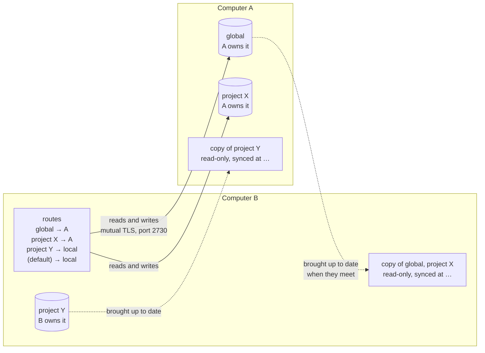
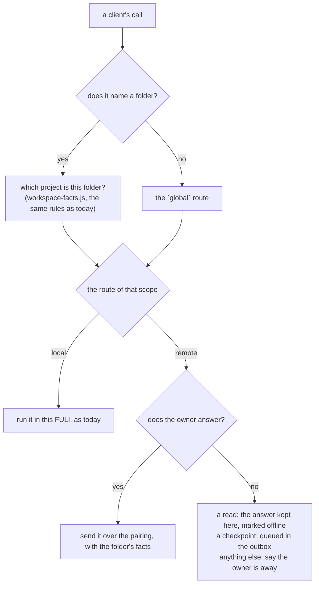

# Design: every FULI is a host, and follows another only where it says so

Status: **being implemented** in 0.29.0, step by step (see "Order of work"). Builds on runners
(`docs/runner.md`). The decisions **D1–D5** were Jevons's to make; the defaults below were agreed
on **2026-11-23** and are what the code does until he says otherwise. Each is a default in one
place, not a rule spread through the code, so changing one stays a small change.

| | Decision taken 2026-11-23 | Where it lives |
| --- | --- | --- |
| **D1** | `global` is one scope with one owner: the person's global habits, personal profile, FLA roster and their global memory, and Jefa's board move together. | the scope table (§3) |
| **D2** | A project a follower owns uses the `global` owner's global habits (the follower's cache while that computer is away), with the project's own preferences on top. | task entry (§4) |
| **D3** | Moving a scope to another computer is wanted in full, and comes after the steps below. Until then a follower may start a route only for a scope it does not already have. | §7 |
| **D4** | A project a follower owns is still led by the `global` owner's FLAs: an FLA's identity and global memory follow `global`, its memory of a project stays with that project's owner. Later step. | §8 |
| **D5** | This work ships on the 0.29.0 line. | `package.json` |

## 1. Why

Runners today (0.29.0-beta.9) make a whole computer either a host or a runner. The switch is a
file: a data directory with `runner/runner.sqlite` and no `graph-runtime.json` is a runner
(`src/runner/runner-mode.js`). Three things follow, and the first two happened on a real pair of
computers on 2026-11-18:

1. **Opening FULI.app on a runner ends it being one.** The desktop start runs `fuli setup` when
   `graph-runtime.json` is missing (`src/desktop/desktop-controller.js`), which writes that file;
   the runner's clients then use a new, empty local FULI.
2. **A runner has no console of its own.** Receipt links (`127.0.0.1:2727`) open nothing on it.
3. **A runner cannot own anything.** The person wants project Y to live on B and project X on A,
   and B to keep working as its own FULI for what it owns.

The person's words: B "can switch itself between host and runner, even be partly one and partly
the other", and "the runner should also be able to be its own host".

## 2. The idea in one paragraph

Every FULI is a complete FULI with its own data and console, always. A link to another FULI (the
existing runner pairing: mutual TLS on port 2730, pinned certificates, outbox) no longer changes
what the computer *is*; it adds **routes**: a short table saying which parts of the person's FULI
this computer reads and writes on the other one. Everything without a route is local. A computer
with no routes is today's host; one that routes everything is today's runner; anything between is
"partly host, partly runner".

Every arrow is one pairing. A solid arrow is the one writer reaching its scope; a dotted arrow is a
read-only copy being brought up to date (§3).

## 3. Scopes: what can be routed

| Scope | Holds | Notes |
| --- | --- | --- |
| `global` | the person's global preferences and habits, personal profile, FLA roster and their global memory, Jefa's board | one owner for the whole scope (**D1**) |
| `project:<id>` | a project's knowledge, project preferences, project memory of its FLAs, its tasks and checkpoints | routed one project at a time |
| default | whatever has no route | always `local` |

**Invariant: every scope has exactly one owner, the computer that writes it.** A follower never
writes a routed scope locally; it sends the call (or queues it in the outbox while the owner is
away). This is what keeps "partly host" from turning into two diverging copies.

**One writer, many read-only copies.** Jevons on 2026-11-23: 「在从机给 FLA 说的事情，主机会知道
吗，从机后续断连会知道吗」. So the invariant is about writing only: a scope another paired computer
has a route to may also be kept there as a **read-only copy**, brought up to date whenever the two
computers reach each other. A project a follower owns is copied, read-only, to the `global` owner,
so what was said to an FLA on the follower is readable on the host, and stays readable after the
follower goes off the network. A copy is never written to and never merged back; it carries the time
it was last brought up to date, and everything that shows it says so.

This is a later step (3–5). What it needs from the earlier steps, and what they already do:

- The routes table says, per scope, who owns it and whether this computer keeps a read-only copy
  of it, with when that copy was last brought up to date.
- Where data came from has three answers, not two: the owner (`host`), this computer's own
  (`local`), and this computer's read-only copy of another computer's scope (`replica`, with the
  time it was synced). The state band, `fuli status` and the `x-fuli-source` header a follower's
  console puts on every answer already carry that third value.

## 4. How a call is routed

The client's MCP entry stays exactly what `fuli setup` writes today. The local MCP server always
runs (no more runner mode by file); for each call it decides where the call goes:

1. **Resolve the folder locally** with the facts the runner already sends (`workspace-facts.js`):
   which project is this folder, by the same rules (remote key, worktree origin, folder name).
2. **Look up the route** of that project (`project:<id>`, else default). Calls with no folder
   (global tools, `list_agent_interfaces`, roundtable) use the `global` route.
3. **Local route:** run it in this FULI as today. **Remote route:** forward it over the existing
   runner connection, with the folder's facts, exactly as runners do now; offline rules and the
   outbox apply unchanged.
4. **Task tokens remember their owner.** A token says which FULI issued it (prefix or a signed
   field), so the checkpoint of a task goes to the FULI that entered it, whatever the routes
   became meanwhile.

Task entry for a local project still needs the person's global preferences. If `global` routes to
A, task entry on B reads them from A (cached for offline, as runner task entry is today) and merges
them with B's project preferences, global first, project overrides, exactly as one FULI merges them
now (**D2**).

## 5. The console on a follower

- FULI.app on B opens **B's own console** at B's own console port. It is B's page, not A's: it
  says who B follows, whether that computer answers, when it was last reached, what waits in the
  outbox, and which capability runs where.
- A's pages are reached over the paired channel: B serves `127.0.0.1:2727/remote/<host>/…`, which
  forwards to A's console over 2730 mutual TLS (`src/runner/console-relay.js` on A). A proxy path
  naming a computer B is not paired with reaches nothing.
- Receipt links A gives (`http://127.0.0.1:2727/…`) open on B too: a path B's own console does not
  own is A's page, carried over the same channel, with B's own state band on top of it.
- The desktop start never removes a link and never writes a route; `fuli setup` on a computer
  with links sets up its runtime and keeps the links.
- A host's console lists its followers and, per follower, which scopes it serves to it. (Step 4.)

## 6. Who may route what

- Routing is granted on the owner: when B asks to follow `project:X` or `global`, A's person
  allows it (once, in A's console or `fuli runner allow`). Today's invitation keeps granting
  "everything" so existing runners keep working.
- A follower can always take a route back (`fuli routes local project:X`); see moving below.

## 7. Moving a scope between computers (D3)

Changing who owns a scope moves its data, which is the hard part. In order of effort:

1. **Start a new route only for a scope the follower does not have yet**: B follows
   project X only if B has no local project X, otherwise it asks the person to pick one. This is
   what the steps below build.
2. **Hand over** (D3, a later step, wanted in full): the owner exports the scope (FLA directories
   already have a Markdown projection for hand-off; knowledge as the existing export), the new
   owner imports it under the same IDs, the old owner keeps a read-only copy and a forwarding
   route. Temporal history moves with it.
3. Two owners merging edits of one scope: **not planned**. One owner per scope is the rule.

Read-only copies (§3) are not moving: a copy never becomes the owner by itself, and a hand-over is
still the step above.

## 8. FLAs across two owners (D4)

An FLA is global (employee number in the personal space) but keeps per-project memory. With
`global` on A and project Y on B, Y's lead is one of A's FLAs, while Y's project memory is on B.
The FLA's identity and global memory stay with `global`'s owner; its memory of a project lives
with that project's owner. Task entry on B for Y reads the FLA's identity from A and its Y memory
locally. This is a later step; until then a follower owns no project, so nothing splits.

## 9. What changes in code (rough)

| Area | Change |
| --- | --- |
| `src/runner/runner-mode.js` | gone; replaced by a routes store (`runner/routes.sqlite`): per scope its owner, and whether this computer keeps a read-only copy and when it was last brought up to date |
| `src/cli/mcp-command.js` | always the local server; a router decides per call (runner modules loaded only when a route is remote) |
| `src/runner/runner-mcp.js` | becomes the remote half of the router |
| `src/graphiti/task-entry*` | global preferences from the `global` owner, merged with local project preferences |
| task tokens | carry their issuer |
| console | the follower's own console with a state band; `/remote/<host>/` proxy; followed projects listed with their owner; host lists what it serves |
| desktop app | start/setup keep links and routes |
| CLI | `fuli routes list \| follow <scope> <host> \| local <scope>`; `fuli runner join` keeps working as "follow everything" |

## 10. Migration from beta

A data directory in today's runner mode (pairing, no runtime) becomes: a FULI with routes
`global → host` and `default → host`. Nothing to do for the person; the first start after the update
sets up the local runtime in the background, and nothing is routed to it until the person makes a
scope local.

## 11. Order of work

1. **Follower console and safe desktop start** (fixes §1.1 and §1.2 for today's runners), with the
   follower's own state visible and its cache no longer expiring. — **done** (this version).
2. Routes store, router in the MCP entry, tokens with issuer; `default → host` reproduces today. — **done**: `runner/routes.sqlite`, `fuli routes`, per-call routing in the follower's MCP server and task owners. `fuli routes local` is refused until step 3 for every scope, and `global` is never local on a follower (D1, D2).
3. Local projects on a follower (`project:Y → local`), global from the host (D1, D2).
4. Owner-side grants; console listing.
5. Moving a scope (D3), FLA split (D4).

**No relay, by decision.** Jevons on 2026-11-23: 「就同一个局域网就可以，我们不做不在一个局域网的
情况，而且这种公司和家里一般都有公司自己的内网 VPN 之类的」. The two computers reach each other
directly — one LAN, or an address a company VPN or a mesh tool gives them — or not at all. FULI
runs no relay of its own and none is planned. Where they are on one network but in different
subnets, mDNS does not carry, so the person tells the follower the address once: `fuli runner
add-address`, or 「添加主机地址」 on the follower's own console page, which is the next step offered
whenever the host does not answer.
