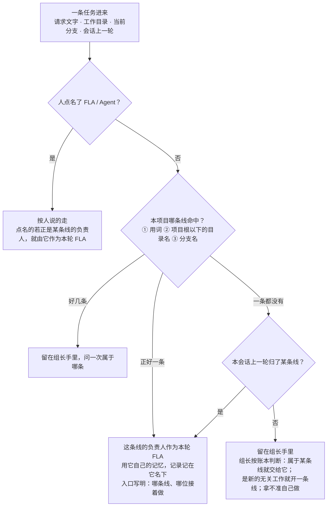

# Workstreams (工作线)

One project often carries several lines of work that share a repository, a
release process and components, but nothing of their business logic: pages,
campaigns, small internal projects. Without a boundary they all land on the
project lead, and its project memory and work log mix them together.

A **workstream** is one such line of work inside a project: a name, what
recognises it, and the one FLA that does it. When a task belongs to a line,
that FLA is this turn's FLA: it works as itself, with its own memory, and its
records are its own. The project lead keeps the ledger; the person can change
it at any time.

Nothing is split that was already recorded. A workstream starts from the day
it is opened and claims no earlier task.

## It is a standing assignment

A workstream is stored as a standing assignment
(`src/standing-assignments/`): confirmed terms for a kind of work, pointing at
one project and one Agent. A project-level standing assignment points at the
project's lead and routes work into the project; a workstream points at a
member of the same project and divides work inside it. The two are one record
type, one store, one set of corrections and one temporal history. The store
format is unchanged.

Why not a sub-project (`PART_OF`)? A sub-project is a separate project with
its own lead, brief, knowledge scope and memory. It separates the shared
things too — the release process, the component conventions, the project's
pitfalls — which is exactly what should stay shared here. A sub-project is
still the right answer when a small project really has its own repository,
release and team.

| | sub-project | workstream |
| --- | --- | --- |
| shared release process, components, conventions | separate | shared |
| business context, decisions, progress | separate | separate |
| its own lead and project page | yes | no |
| cost of opening one | onboarding, a lead | one call |

A workstream is not the `workstreamBoundary` of a
`coordinate_project_agent_task` plan. That boundary is one task's split and
ends with the task; a workstream lasts until it is ended.

## Which workstream a task belongs to



Decided at task entry, deterministically, with no model:

1. **The person named someone.** A named FLA (`#FLA`) or an explicit Agent. A
   workstream never overrides it. Naming the FLA that owns a line of this
   project makes that FLA this turn's FLA, exactly as a matched line does.
2. **A line of this task's project matches.** Only lines of the project the
   task is already in apply, by three signals:
   - **Its words** occur in the request, as a whole term
     (`src/standing-assignments/term-match.js`).
   - **Its folder**: a term is a whole folder name below the repository root of
     the working directory. Folders above the root — the user name, the
     repository's own name, `code`, `src` of other checkouts — are never read.
   - **Its branch**: a term `branch:<name>` matches the current Git branch
     exactly, and `branch:<prefix>/` matches every branch under that prefix.
     The branch is read from the repository's files within 250 ms
     (`workingRepository`, `src/conversations/working-branch.js`); a slow drive
     leaves it unknown.
   A request that names this project, or an explicit project id, keeps its
   lines: naming the project says where, not who.
3. **More than one line matches** → the task stays with the lead, and the
   entry asks the person once which line it is.
4. **None matches, but this session's last task belonged to a line** → the
   session goes on with that line, until another line matches, the person names
   someone, or the line ends.
5. **Nothing matches** → the task stays with the lead.

Only the person's own project-level standing assignments still move a task
into another project, and only by their words. A line the lead opened, a
folder and a branch never move a task between projects: "改首页按钮" in
another project stays there even if some project has a line called 首页, and
a path such as `C:\Users\admin\code\other` never matches a term `admin`.

## Who works when a line matches

The line's owner is this turn's FLA (`selection_reason: workstream_owner`).
It loads its own project memory; its session summary, work log, checkpoint
and receipt are its own; nothing of this line reaches the lead's memory. The
entry's one line says it: 「工作线「春促落地页」由 Ember Vale 接着做」.

This relaxes, for one case only, the rule that the project lead owns every
conversation of its project and that a named member is merely requested
(`project_lead_reporting`, "do not load the specialist's private memory").
That rule protects a member's private memory from a session the lead holds:
the lead asking a member something, or a person naming a member inside the
lead's conversation. It still holds there. The exception applies only when
FULI's entry itself names the owner of an active line of this project, for an
active, non-peer member that this client may run, never the lead and never
for a delegated worker turn. The Provider checks each of those again
(`workstream_owner` in `store_project_agent_context.py`). The lead stays
accountable for the project: the ledger shows the line's progress.

When the owner cannot work this turn the task stays with the lead and the
line says why, by name: the owner is not available in this client, or is no
longer on the project — then the ledger offers to give the line to someone
else.

## The lead divides the work

When nothing matched, the task is the lead's. The entry gives the lead the
project's lines as facts (name and owner), and one short rule, delivered by
reference (`fuli://rules/task-entry/workstream_guidance`), only to a project
that has lines:

- the work belongs to a line → hand it to its owner;
- it is a new piece of work unrelated to every line → open a line for it;
- unsure → do it yourself.

Handing over is one call: `begin_task_context` with `#FLA <owner> <request>`.
The owner then works this turn as itself, as above, and later turns of the
session stay with it.

## Opening, correcting and ending one

The project lead opens one with `register_standing_assignment`
`change: "delegate"`: the terms, the line's name and the member that takes
it. It is recorded as the lead's (`source: "host"`), in one call, without the
person's confirmation. When the session is on a branch that is not a shared
one, that branch is recorded as a term too.

- **One line per FLA per project.** Giving a second line to an FLA that
  already has one is refused, naming its line, with three next steps: add
  these terms to its line, pick another member, or have Bole recruit one.
- **Not to the lead.** A line that stays with the lead needs no workstream.
  Handing a line back to the lead is ending it.
- **Terms that would match everywhere are refused**: a term of one Han, kana
  or Hangul character, or under three characters otherwise, and common words
  such as 页面, 修改, bug, page, web, admin, src. A branch everyone shares
  (`main`, `master`, `develop`, `release`, …) is never a branch term: the same
  list that keeps such a branch from proving two sessions continue one piece of
  work (`sharedBranch`, `src/conversations/continuation-decision.js`).

The lead corrects its own lines the same way, in one call, and they stay the
lead's. A line the person opened or confirmed is the person's: the lead
cannot change it, and the person changes it through preview and their yes,
or in the console. The person's own reassignment may move their rule to the
lead or another project; its sentence then says the line leaves the ledger.

- **「这个还是让 X 做」** — `change: "reassign"` naming the member. A line is
  never reassigned to the lead by default.
- **merge** — one line's terms move into another and the first ends, as one
  change (`POST /api/standing-assignments/:id/merge`).
- **split** — some terms leave a line and open a new one for another member,
  as one change (`POST /api/standing-assignments/:id/split`). If the new line
  cannot be opened, the old one keeps its terms.
- **end** — `change: "retire"`. Its terms are free again; its record and
  every revision stay.

In the console the person's own clicks are recorded as theirs. An FLA acting
for the person there (`run_delegated_action`) is recorded as an Agent's
(`source: "host"`) and may do it only as the lead of that project.

## Memory

Project memory and the work log are keyed by `(space, project, Agent)`, and
the line's owner is the turn's FLA, so its memory and records hold that line
only. What the whole project shares — the release process, component
conventions, pitfalls — is project knowledge, which every member reads
through the ordinary project-scoped search. It is not copied into anyone's
memory.

## The lead's ledger

One line of work answers four things in one place: **which project, which
line, who, how far**.

```text
Campaigns · 春促落地页 · Ember Vale · 进行中：改头图（2026-11-23）
Campaigns · 优惠券中心 · Orin Pike  · 已完成：接券接口（2026-11-21）
```

How far comes from the owner's work log in that project: the latest task
marked with this line, not earlier than the line's start. A task a line took
keeps it in its match basis as `workstream:<assignmentId> <notice>`, so an
owner change never rewrites it. A line with no such task says 还没有任务; a log
that could not be read says so, never 还没有任务.

`get_project_team` returns the lines with that progress. The project page
shows them and changes them by clicking: owner, merge, split, end. The
ledger widget (`workstream-ledger`) shows one FLA's lines — every line of a
project it leads and the line it owns — and links to the project page for
changes. Both are on this computer only: over the LAN the team is shown
without its lines, and the widget says it can only be read here.

Earlier tasks are not reassigned. The ledger's start date is the honest
boundary: work before it was not under any workstream.

## Cost

- No model call, ever.
- A task in a project without lines costs nothing new.
- A task in a project with lines reads the repository and branch from disk
  (at most 250 ms) — the same read the task's beginning uses for its
  conversation and continuation line, so it is read once — and, when a line
  matches, makes one more Provider request to select its owner.
- The entry carries the lines' names and owners and a rules reference only
  when the project has lines; that is counted in the token budget.

## Interfaces

- `register_standing_assignment` — `change: "delegate"` opens a line;
  `reassign`, `edit_terms`, `retire` correct or end one.
- `begin_task_context` with `#FLA <owner>` — hands this turn to a line's owner.
- `get_project_team` — `workstreams`, with `latestTask`.
- Console, this computer only: `GET /api/project-team`,
  `GET /api/workstreams?agentId=|personalProjectId=`,
  `POST /api/standing-assignments`,
  `POST /api/standing-assignments/:id/(retire|reassign|terms|merge|split)`.
