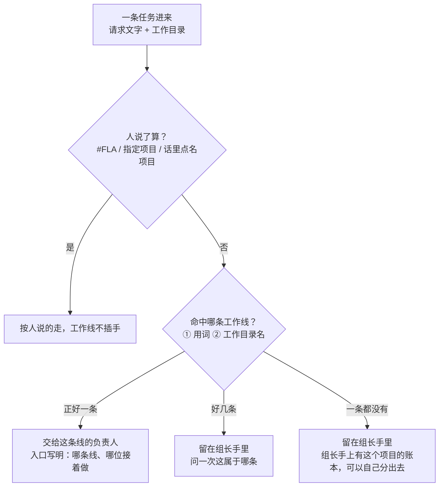

# Workstreams (工作线)

One project often carries several lines of work that share a repository, a
release process and components, but nothing of their business logic: pages,
campaigns, small internal projects. Without a boundary they all land on the
project lead, and its project memory and work log mix them together.

A **workstream** is one such line of work inside a project: a name, the words
that recognise it, and the one FLA that does it. The project lead keeps the
ledger; the person can change it at any time.

Nothing is split that was already recorded. A workstream starts from the day
it is opened and claims no earlier task.

## It is a standing assignment

A workstream is stored as a standing assignment
(`src/standing-assignments/`): the person's or the lead's confirmed terms for
a kind of work, pointing at one project and one Agent. A project-level
standing assignment points at the project's lead; a workstream points at a
member of the same project. The two are one record type, one store, one set
of corrections and one temporal history.

Why not a sub-project (`PART_OF`)? A sub-project is a separate project with
its own lead, brief, knowledge scope and memory. It separates the shared
things too — the release process, the component conventions, the project's
pitfalls — which is exactly what should stay shared here. A sub-project is
still the right answer when a small project really has its own repository,
release and team.

| | sub-project | workstream |
| --- | --- | --- |
| shared release process, components, conventions | separate | shared |
| business context, decisions, progress | separate | separate |
| its own lead and project page | yes | no |
| cost of opening one | onboarding, a lead | one call |

## Which workstream a task belongs to



Decided at task entry, by this order, with no model and no extra round trip:

1. **The person said so.** A named FLA (`#FLA`), an explicit Agent, a project
   the request names, or an explicit project id. A workstream never overrides
   it.
2. **Its words.** A workstream term occurs in the request, as a whole term
   (`src/standing-assignments/term-match.js`).
3. **Its folder.** A workstream term is a whole path segment of the working
   directory, so a task run in `apps/checkout-page/` reaches the workstream
   whose term is `checkout-page` without being told.
4. **More than one matches** → the task stays where it was, with the project
   lead, and the entry asks the person once which one it is.
5. **None matches** → the task stays with the project lead. The lead sees the
   project's workstreams in its entry context and may hand the work on.

Branches, pull requests and page ids are not read at entry: it would cost a
git call on every task for a signal the request text usually carries anyway.
A branch name mentioned in the request is matched by rule 2 like any word.

The entry says which workstream and which FLA in one line, in the receipt and
in `standing_owner`, so "让那个 FLA 继续" is visible rather than implied.

## Opening, correcting and ending one

The project lead opens one with `register_standing_assignment`
`change: "delegate"`: the terms, the line's name and the member that takes
it. It is recorded as the host's (`source: "host"`), in one call — the lead
splitting work is the decision Jevons described, and FULI does not ask the
person again for it. The person's own "以后这些都给 X 做" still goes through
`change: "register"`, preview and confirm, and is recorded as theirs.

What the person confirmed outranks what a lead decided: a lead cannot change
a user-sourced assignment, and the person confirming a host-sourced one makes
it theirs. That rule is the store's, not new here.

Corrections are the existing ones, in a conversation or in the console:

- **「这个还是让 X 做」** — `change: "reassign"` with the member's id: the
  workstream keeps its terms and changes owner. Remembered from then on.
- **merge** — move one workstream's terms into another (`edit_terms`), then
  retire the empty one.
- **split** — remove the terms that belong elsewhere and open a workstream
  for them with its own owner.
- **end** — `change: "retire"`. Its terms are free again; its record and
  every revision stay.

A workstream is not given to the project's own lead: a line of work that
stays with the lead needs no workstream, and letting the lead hold one would
put the mixing back where it started.

One FLA owns at most one workstream per project — the store's own
`(space, project, Agent)` rule. That is the point: a member's project memory
is then exactly one line of work.

## Memory

Nothing new. Project memory and the work log are keyed by
`(space, project, Agent)`, so routing a task to the workstream's owner means
its memory, session summaries and recent tasks only ever hold that line of
work. The project lead keeps its own.

What the whole project shares — the release process, component conventions,
pitfalls — is project knowledge, which every member of the project reads
through the ordinary project-scoped search. It is not copied into anyone's
memory.

## The lead's ledger

One line of work should answer four things in one place: **which project,
which line, who, how far**. The ledger is that place.

```text
Campaigns · 春促落地页 · Ember Vale · 进行中：改头图（2026-11-23）
Campaigns · 优惠券中心 · Orin Pike  · 已完成：接券接口（2026-11-21）
```

`get_project_team` returns `workstreams`: each line's name, its terms, its
owner, when it started, who decided it, and its latest task with that task's
status and date. Reading the latest task costs one bounded read per line, so
it is done only for an explicit read — never at task entry, which stays as
light as it was.

The project page shows the same list, and the lead's own ledger is a widget
(`workstream-ledger`) that can sit on any page: it reads its own data and
takes only the context of where it sits. The person changes the owner, merges
or splits there, by clicking, never by typing an id.

A task a workstream took keeps which line it was, in its Agent assignment's
match basis as `workstream:<assignmentId> <notice>`. It moves no session, so
it carries none of a routed task's session markers, and an owner change later
never rewrites it: the record says which line did the work, not only who did.

Earlier tasks are not reassigned. To read one FLA's history by workstream,
the ledger's start date is the honest boundary: work before it was not under
any workstream, and no task of that time gained a marker.

## Interfaces

- `register_standing_assignment` — `change: "delegate"` opens one;
  `reassign`, `edit_terms`, `retire` correct or end it.
- `get_project_team` — `workstreams` for the project.
- `GET /api/project-team`, `GET /api/standing-assignments`,
  `POST /api/standing-assignments`,
  `POST /api/standing-assignments/:id/(retire|reassign|terms)` — the console,
  on this computer only.

The store format is unchanged; a workstream is a record the schema already
holds.
